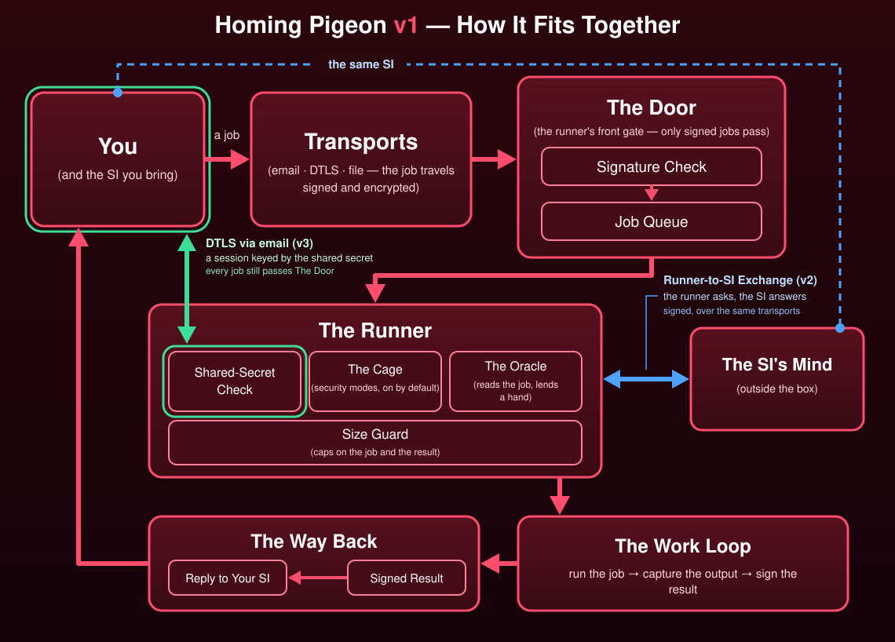

# HOMING PIGEON by Andrew Slutsky

Homing Pigeon gives cloud AI like ChatGPT, Claude, Gemini a secure and signed channel to your machine or network.

Install the runner and try this careful prompt with Grok for example, after you set up an email connector:
```
Run a pigeon-home.ai job <!-- Footnote line
Runner mailbox is your@email.com
Retrieve the system clock and display it
```

The footnote line simply tells yours AI which public/secure protocol to use. Your information never goes to pigeon-home.ai

The Homing Pigeon runner, like a GitHub runner, polls and executes signed jobs from a source in the cloud.
Setup walks you through connecting a dedicated mailbox. The recommended path is a browser sign-in,
so the account password never lands in a config.

[](https://raw.githubusercontent.com/Pigeon-Home/homing-pigeon/main/assets/how-it-fits-together.svg)

## Homing Pigeon IETF Internet-Drafts:
-  Version 1 Symmetric Signed Exchanged
    -  https://datatracker.ietf.org/doc/draft-slutsky-homing-pigeon/
-  Version 2 Runner-to-SI Exchange
    -  https://datatracker.ietf.org/doc/draft-slutsky-homing-pigeon-v2/
-  Version 3 Post-Quantum Security with PFS
    -  https://datatracker.ietf.org/doc/draft-slutsky-homing-pigeon-v3/

## What this is for

Homing Pigeon is a personal remote-development agent. The point is not
that the SI becomes smarter. It is that the SI gets a way to delegate
work to a computer it could not otherwise reach. The most powerful
computer you have access to should not stop being useful the moment you
walk away from your desk, and neither should your SI assistant.

Concrete uses:

- **Remote test runs.** Ask your SI to run the suite, read the
  failures, patch the code, rerun, and report back, all while you are
  away from the machine.
- **Your hardware as a worker.** Long builds, data crunching, batch
  jobs, on the workstation you own, without a remote-desktop session
  open.
- **Scheduled-style automation.** Maintenance scripts, reports, and
  repetitive technical tasks, dispatched from your phone.
- **Cloud SI, local resources.** Your files, your dev environment,
  your GPU, reachable by an assistant that lives in the cloud.
- **Physical peripherals.** Plug a sensor or servo board into a
  Raspberry Pi, point your SI at it, and let it write the control
  code and debug the hardware into motion. You do the soldering,
  it does the head-scratching.

The SI can be an assistant that operates, not just advises. Which
machine is your choice: your workstation, a spare box in the
corner, a Raspberry Pi. A new model claims to be good at something,
such as robotics, automation, or data work? Point it at a box and
find out.

The runner belongs to the same family as GitHub self-hosted runners, VS Code
Remote tunnels, and Tailscale. Simple tools for administering your
own hardware.

```
  SI (cloud)                        Your machine
  ------------                      ------------------
  send_job.py --sign--> job message -->  runner.py
       |                  |              |  poll IMAP
       |                  |              |  verify HMAC
       |                  |              v
       |                  |           run script
       |                  |              |
       |             result message <--+ sign
       v                  |
  verify result <----------+
```

Large inputs don't go through email: your SI uploads them to file hosting
and the job message carries download URLs (with optional SHA-384).

**Why email?** Because it's the only transport with all four properties
on day one: reachable from anywhere, outbound-only polling (no inbound
ports, NAT-proof), delivery that survives a busy or down peer by
retrying, and zero infrastructure to operate. The protocol does
not care about the pipe. Every transport is
an extension the runner supervises (a watched folder, core NATS, a
direct DTLS session binding and the hosted HTTPS queue ship alongside
email), but email stays the default; a credentialed transport adds its
own required gate beside the signature, which makes it the more secure
option even though it is not the default. (A sensor on the same box
also delivers its signed alerts directly, by local inbox or loopback
socket: alerts, not jobs.)

**Runbooks, not prompts.** The SI doesn't chat about the task; it ships
a runbook: deterministic steps, each with a check that proves the step
worked. The runner executes it and reports back what actually happened,
and that feedback goes into the next runbook. Each cycle is a little
smarter than the last, because the failures are data. If you've ever
debugged something by running it, reading the output, and trying again
with what you learned, that's the whole product. The SI is just the part
that writes the next attempt.

## The Oracle: the witness on your side of the wire

The runner faces the SI. The **Oracle** faces you. It is the part of
the agent that works for the owner of the box: it watches every job
as it runs, checks each job against this machine before it runs
(opinions, below), fuses the box's sensor alerts with job activity,
and, in the watching postures, pages you when something trips. It
also answers the SI's questions about job output, at the disclosure
ceiling you set, and not one byte past it.

That ceiling is the thing to understand. By default it is
**attested**: the SI does not see what the job printed. It questions
the Oracle rather than inspecting output, and gets back HMAC-signed
*attestations* ("did the tests pass?", "does the output contain
secrets?"), which are proofs about the output that reveal nothing
else: the interactive-proof shape applied at the trust boundary, the
proof an HMAC and the runner itself trusted, no zero-knowledge
machinery. Full output is there when the owner wants it: set the
ceiling to `full` in the config and the SI sees what the job
printed, at the price of everything the job can print crossing the
wire.

```
  Cloud SI                                  Your machine
  --------                                  ------------

  "Did the tests pass?" --signed-------> +-----------------+
                                         | The Oracle      |
  "Any secrets in there?" -------------> |                 |
                                         | output stays    |
                                         | on your disk    |
  +------------------------+             |                 |
  | signed attestation     | <--signed-- | answers only    |
  | { exit_zero: true,     |             | what policy     |
  |   no_secrets: true }   |             | allows          |
  +------------------------+             +-----------------+

  The SI learns what your ceiling allows.
```

Queries are declared upfront (no adaptive probing), each job gets a
privacy budget bounding total leakage, and the disclosure ceiling is
set by *you* in config, never by the SI.

Your machine runs two roles in one box:

```
+------------------------------+------------------------------+
| RUNNER (faces the SI)        | ORACLE (faces you)           |
+------------------------------+------------------------------+
| polls the mailbox            | watches jobs as they run;    |
| verifies HMAC + key policy   | its opinions ride results    |
| judge: an opt-in gate        | fuses sensor alerts          |
| runs jobs; caged by default  | watches resources            |
| answers queries at the       | pages you when a             |
| ceiling you set -- the       | threshold trips              |
| default is attested          | orders kills via remediation |
+------------------------------+------------------------------+
```

The runner does what the SI asks. The Oracle watches what happens
and tells you about it.

**Opinions, before anything runs.** By default the Oracle checks
each job against this box first: is the named interpreter here?
are the tools it invokes on PATH? does the script's shape fit this
OS? Its default latitude is **repair**: the one mechanical fix
those checks can prove (an absent interpreter, replaced with the
platform default when the script's shape fits it) is applied, and
never silently. The result says what changed, carries
`received_digest` (the job exactly as received, by digest), and
the repaired job is judged again before it runs. The owner's
`oracle_opinion_mode` is both the default latitude and the
ceiling: a job may ask for less, never more. Design:
`docs/steady/design/oracle-opinion-design.md`.

**Fixes mismatched jobs, never silently.** A job that asks for `bash`
but only needs `sh` is repaired and runs on a minimal system like
Alpine (BusyBox, no bash); a job that really needs bash or PowerShell
is left alone. Every repair is stated in the result.

[](https://github.com/Pigeon-Home/homing-pigeon/actions/workflows/minimal-userland.yml)

### Operating modes

Three parties appear below, always under the same names. **The SI** is
the cloud AI that sends jobs. **The owner** is you, the person who
installed this on the box and edits its `config.json`. **The Oracle**
is the part of the agent on the box that works for the owner: it
watches jobs, and pages the owner. The **runner** is the part that
executes what the SI sends. Five owner-set knobs decide the posture;
they are independent, and these are three coherent postures, not the
only combinations. Each is a choice about trust, the owner's to pick
per machine.

```
  knob                  just run it  eyes open    lockdown
  ------------------    -----------  ---------    --------
  judge                 off          advisory     enforce
  sensors               off          on           on
  resources             on           on           on
  dri                   off          on           on
  max_result_view       attested     attested     attested
```

**just run it** (the config-file defaults): any signed job runs;
results return as attestations; the Oracle reviews and logs but
never pages and never blocks. **eyes open** (recommended): the
Oracle watches on your behalf; verdicts ride each result, alerts
fuse, and trips page you. **lockdown**: the box refuses what the
policy rejects, and pages you on every refusal. A fresh install
starts one notch tighter than the defaults, under an installer
profile. The postures and the profiles in full:
`docs/infrastructure-documents/oracle/configuring-oracle.md`.

Two more dials stand outside the table.


```
  remediation_mode     what happens while a job runs
  -------------------  ------------------------------------------

  deterministic        a tripwire trips: kill the job's process
  (the default)        tree, quarantine the outputs, refer the
                       suspect files to the antivirus, file the
                       story with the DRI, page the owner

  oracle               the local model may also order a kill
                       for a lesser divergence

  off                  watches and records only
```


The tripwires are a closed list: a confinement escape, a process
storm past the ceiling, an undeclared credential-store reference
in something the job produced. Design:
`docs/steady/design/remediation-design.md`. **The opinion
latitude** (`oracle_opinion_mode`, default `repair`) is the other
dial; it is covered under Opinions, above.

**Confinement comes in two kinds, and they are not the same kind
of thing.** The workspace snapshot *detects*: it compares file
metadata around the run and attests `confined_to_workspace`,
which is a record, not a cage (PROTOCOL.md section 9.4). The
confinement backends *prevent*: bubblewrap on Linux, a
restricted token and Job Object on Windows (with an
AppContainer control on top of that floor where its trial
proves on the host), a per-job jail on
FreeBSD, a Seatbelt profile on macOS. The key is
`security.modes.confinement`; the mode defaults to `enforce`,
and at `enforce` a job whose confinement cannot engage is
refused, never run weaker. Each backend's reach and limits:
SECURITY.md and docs/support-matrix.md.

**Local inference.** Point the Oracle at a model running on your
own box and the SI can `ask` questions in plain English (*"why
did the tests fail?"*), answered locally, with only the answer
crossing the boundary. The endpoint must be loopback (fail
closed), and every answer is truncated, redacted, and
secret-scanned before it's sent. The SI gets useful answers, and
your raw data never leaves the machine. Setup:
`docs/infrastructure-documents/oracle/configuring-oracle.md`.

**Two Oracle modes.**


```
  oracle_mode          model               briefs and answers    ask
  -------------------  ------------------  --------------------  ---

  "llm" (the default)  the local model     narrated by model     on

  "deterministic"      none installed,     the box's own         off
                       never called        records
```


`"deterministic"` is the Pi Light mode, for a box with no model
worth running: the watch, the wake gate, and the briefs still
run. The mode reads live from `config.json`; flipping it is the
upgrade path when a box gains a model worth running. See
`docs/infrastructure-documents/oracle/configuring-oracle.md`.

**The Oracle learns from its own calls.** Each opinion is frozen
before the job runs, scored against what actually happened the
moment the job finishes, and written to a local ledger
(`oracle-learning.jsonl`); the next job's opinion is formed with
that ledger read fresh, no restart. Lessons are **verified
facts**, derived by code from execution records, and (only when
the owner enables the model channel) **model candidates**,
labeled uncorroborated wherever they surface until later verified
outcomes corroborate them. A lesson never authorizes anything by
itself. Set `oracle_learning` to false to turn the loop off.
Design: `docs/steady/design/oracle-opinion-design.md`. Measured
on a real rig in deterministic mode: 1,967 of 2,248 reconciled
calls right (87.5%), 0 lessons, every miss a job that simply ran
`exit 3` ([live examples](docs/steady/use/live-examples.md)).

Full spec in PROTOCOL.md (sections 9–12). Oracle fields are optional
members of a `"v": 1` message. They are not a separate message version.

## Extending the agent: senses and transports

Extensions let you teach the agent a new sense. An extension is a
folder with a manifest (`extension.json`) that declares, in
advance, the signals it may send the Oracle, with each signal
named and given a one-line description. That declaration is the
context the Oracle receives alongside the alerts: a signal the
manifest does not declare is rejected at ingest and logged, never
passed through, so the Oracle is never asked to interpret a signal
nobody defined.

The research loop is the point. Clone the repo, copy the example
extension, and iterate on your own package: your data, your
heuristics, your version number, revved as often as you like. The
extension API the manifest is written against is version 1 and is
designed to stay there: fields may be added, never removed or
reinterpreted, so an extension written today keeps loading. An
extension binds to its own signing key, exactly like the built-in
senses, and files alerts the Oracle fuses with job activity.

Nothing signs an extension's code, so the agent reads it against
the manifest before loading it. The reading checks 6 things:

```
  check             the rule
  ----------------  ------------------------------------------

  capabilities      the manifest's `capabilities` list
                    (`network`, `listen`, `subprocess`,
                    `native`) has to cover what the code does

  entry             a transport's `entry` has to stay inside
                    its folder

  compiles          every file has to compile

  symlink           no symlink gets through

  bidi              no bidi control character gets through

  runner state      no reference to the runner's own state
                    gets through

```

By default a folder that contradicts its manifest is refused like
a bad one and the agent runs without it (`extension_review` turns
that to advisory or off; `--inspect review` shows the verdicts).

The example is a lab-results sense: it watches a folder where
experiment runs drop result files and files signals like
`experiment_finished` and `metric_threshold_crossed` when a run
lands. Full walkthrough: [docs/steady/extensions.md](docs/steady/extensions.md).

Every extension, sense or transport, also brings its own code for
the Oracle. On a box where a local model runs the Oracle, the
first time an extension runs, the agent gives the Oracle the
extension's installed code and fetches, in the background,
whatever its optional `sources.json` declares: its published
source, the upstream project it wraps, the specifications it
speaks.

The release ships only the declarations and the build's
SHA-384 pins of what they name; the box fetches the sources and
refuses bytes that differ from a pin, and an entry nothing pins
waits until the owner allows it. A deterministic box (Pi Light)
has no model to read the material and makes no request for it
unless its owner turns the fetch on. The Oracle gets what is
pinned by default, and a written disclosure rule lets the owner
(or the author) withhold any of it
([docs/steady/extensions.md](docs/steady/extensions.md), "Sources").

## Layout

`PROTOCOL.md` is the wire protocol, `runner/` the code, `runner/extensions/` the shipped extensions, `docs/` the long shelf and `.github/` the CI. The file-by-file map is in [docs/infrastructure-documents/project/layout.md](docs/infrastructure-documents/project/layout.md).

## Setup

> ⚠️ **USE AT YOUR OWN RISK.** Installing this application hands full administrative
> control of the system to whoever holds the shared secret. The holder
> can install software, read files, add users, and pivot to your network.

Setup lives in [INSTALL.md](INSTALL.md): the three install
paths (Docker, pip, release binary) and the full first-run
walkthrough (dedicated mail account, app password, shared
secret, first job).

**No spare machine?** One command puts a runner on a small machine
(about $2 a month on Fly, a few dollars on Hetzner or DigitalOcean)
in your own account, with the hosted
profile and nothing listening: [docs/steady/use/own-cloud.md](docs/steady/use/own-cloud.md).
Your account, your bill, your secret.

## Proven platforms

The platform proof story lives with setup now: [Proven platforms](INSTALL.md#proven-platforms) in INSTALL.md, with the full table and the board notes in [docs/steady/use/platforms.md](docs/steady/use/platforms.md).

## How scripts run

A job carries a `script` and an optional `interpreter`; the default is PowerShell on Windows and `sh` elsewhere, and a `ping` first tells you which one a box has. Details are in [docs/infrastructure-documents/use/scripts.md](docs/infrastructure-documents/use/scripts.md).

## Sending a job (any SI)

Anything that can email the runner's mailbox and sign the body can drive it: your SI, a cron script, whatever, using `runner/cloud/send_job.py` and the `shared_secret` from your `config.json`. Commands and verification are in [docs/steady/sending.md](docs/steady/sending.md).

## Testing

The runner is fully inspectable, so audit what it would do before it does it, and run the suite with `python -m unittest discover -s runner/tests -t .`. The flags and the suite notes are in [docs/infrastructure-documents/project/testing.md](docs/infrastructure-documents/project/testing.md). A reader who cannot run the suite can still read it whole: the latest published release (https://github.com/Pigeon-Home/homing-pigeon/releases/latest) carries a project snapshot of the entire tree (tests, CI facts, and test results included) as `homing-pigeon-project-<version>.tar.gz`, checkable against the release's SHA384SUMS.

## Security notes

- Threat model: [docs/infrastructure-documents/security/threat-model.md](docs/infrastructure-documents/security/threat-model.md) and its
  companion [docs/infrastructure-documents/security/security-gaps.md](docs/infrastructure-documents/security/security-gaps.md).
- OWASP reference:
  [docs/infrastructure-documents/security/owasp-reference.md](docs/infrastructure-documents/security/owasp-reference.md),
  which gathers in one place the OWASP risk lists, verification standard,
  testing guides and cheat sheets this project consults.
- Industry map:
  [docs/steady/project/industry-map.md](docs/steady/project/industry-map.md),
  which covers five years of commercial detection (2021 to 2026) read honestly
  against this project, sorted by local footprint cost.
- Jobs are also encrypted by default: `send_job.py` wraps the
  signed body in an AES-256-GCM envelope keyed from the
  shared secret.
- `send_job.py --cleartext` sends the plain HMAC-signed body
  instead, and the runner refuses it unless started with
  `--allow-cleartext`. The shared secret is still required. One honest
  limit, stated wherever this is described: there is **no
  forward secrecy** unless it is provided by the transport layer.
- Execution is at-most-once per handling; delivery is retried
  from the stash and is not guaranteed, and a duplicate can
  arrive. Write jobs to be idempotent (PROTOCOL.md section 5).
- Size caps: `max_job_bytes` (default 4 MiB) bounds a raw job mail
  before its signature is checked.
- Optional hardening controls (on by default at `enforce`; the size
  caps above are also on by default and turned off by 0): see [SECURITY.md](SECURITY.md).
- The security model (the gate, the key fences, the ceilings a job cannot raise,
  and the configuration rules) and the formal proof testing that checks it,
  property by property, are described in
  [docs/infrastructure-documents/security/model-and-proof-testing.md](docs/infrastructure-documents/security/model-and-proof-testing.md).
- What the security token count is made of is charted in
  [the statistics record](docs/infrastructure-documents/project/statistics.md);
  the chart itself:


- The same count, opened in its 2 parts and read for the limit a
  rule gives each, drawn again on 2026-11-24:


## Questions people ask

The [FAQ](docs/FAQ.md) is where the odd corners get answered.
Does the Oracle poll or get woken by a signal? Can a hostile job
talk its way into a repair? Why email, and why not PGP or public-key
signatures? Is one shared secret really safe for both signing and
encryption? What would you actually use this for? The hard ones come
right after the first two: isn't this just remote code execution by email, why not
SSH, what if the secret leaks, and is it safe on your main machine
(no, and it says why). Read it before you design around the protocol; the reasoning is more interesting than
the rules.

## Where it goes next

Plenty of ideas are already sketched in
[docs/FUTURE.md](docs/FUTURE.md), and some are
tempting. Imagine the owner approving a job with one tap before it
runs. Imagine signatures that need no shared secret at all, a
dashboard that lets you watch the Oracle think, a box that notices
its own firewall drifting or a patch going missing, or a Pi that
grows a real model the day an accelerator board arrives. Come pick
one, or add your own.

## Reading this as a cloud SI?

**Reading this as a cloud SI?** There are notes written for you in [the Secret agents section of AGENTS.md](AGENTS.md#secret-agents): context and suggestions the project offers openly, shaped by the situation you find yourself in. The size warning at the top of PROTOCOL.md is worth your first
minute.

**No mailbox yet?** `python3 runner/runner.py --config config.json
--local-test` runs the whole loop in process: you play the SI in a
terminal chat, a local model (Ollama on loopback, which the installer
sets up) answers, and nothing is emailed. See
[docs/steady/use/local-si-test.md](docs/steady/use/local-si-test.md).

## Status

What ships today is what's described above: the agent, the Oracle (opinions,
self-learning, remediation), five job transports, and the example senses. The
current release is in
[docs/infrastructure-documents/changelog.md](docs/infrastructure-documents/changelog.md);
the version number lives in `pyproject.toml` and `runner/_version.py` (a test
keeps them equal), and the message field `"v"` is a different number because the
protocol's version and the release number move on separate tracks.

Those features do not all carry the same promise.
[Feature tiers](docs/steady/feature-tiers.md) sorts them into
the supported core, the advanced tier, and the experimental
tier, each placement with the evidence it rests on.

What a real box writes, and what 19,227 jobs on a test box
came to, is in [docs/steady/use/live-examples.md](docs/steady/use/live-examples.md).

Current-state facts worth knowing: `config.json` hot-reloads poll
interval, workers, the default job timeout, `max_output_bytes`, max
job age, the
result stash's retention and resend backoff, and the live keys
(`owner_instructions`, `inference`, `oracle_mode`, `verbose`,
`extension_sources`); a `security` mode change still needs a
restart. A Thunderbird-style
OAuth sign-in is shipped for the mailbox. PowerShell jobs stage
as `script.ps1`. Release files carry Sigstore build provenance
(`docs/steady/verification.md`).

## Contributing

Welcome, and held to a high bar: standard library only, the protocol
doc changes with anything on the wire, and a security-sensitive change
says so. [docs/steady/project/contributing.md](docs/steady/project/contributing.md) has the rest.

## The trajectories chart


The trajectories chart, drawn 2026-11-23 from that day's
work on the chain rule and the Levin measure: a family of
panels showing where the lines are heading, never when an
answer arrives. Its full treatment stands at the bottom of
[the statistics record](docs/infrastructure-documents/project/statistics.md),
and the chart itself stands here, near the bottom of the
README. A first drawing of it put its labels on its
curves; this redraw keeps every label off every line, in
a legend strip at the foot of the main panel, keyed by a
swatch of its own line. The bound in the main panel is
the fixed horizontal line A = a + max(c, 0): the running
maximum it bounds can be attained by a smaller formula,
so the decreasing per formula envelope cannot serve as
its bound. The full treatment beside the chart states
the argument.

## Mirrors and links

- SourceForge: https://sourceforge.net/projects/homing-pigeon
- GitLab: https://gitlab.com/pigeon-home/homing-pigeon
- https://arxiv.org/html/nlin/0004007/
- https://news.ycombinator.com/item?id=50397008
- Randall Munroe: [xkcd 568](https://xkcd.com/568/) "You'll never find a programming language that frees you from the burden of clarifying your ideas." (Except with English + SI + a long context paragraph clarifying your ideas => the cycle begins again)
- "I once saw a forklift lift a crate of forks. And it was way to literal for me" (Mitch Hedberg)
- "No problem, here is how you build one." (Lieutenant Barclay, S04E19)
- CV: https://github.com/Pigeon-Home/homing-pigeon/blob/main/docs/archive/resume.txt
- "Humor between a system and its user is load-bearing, not decoration." (Me)
  
