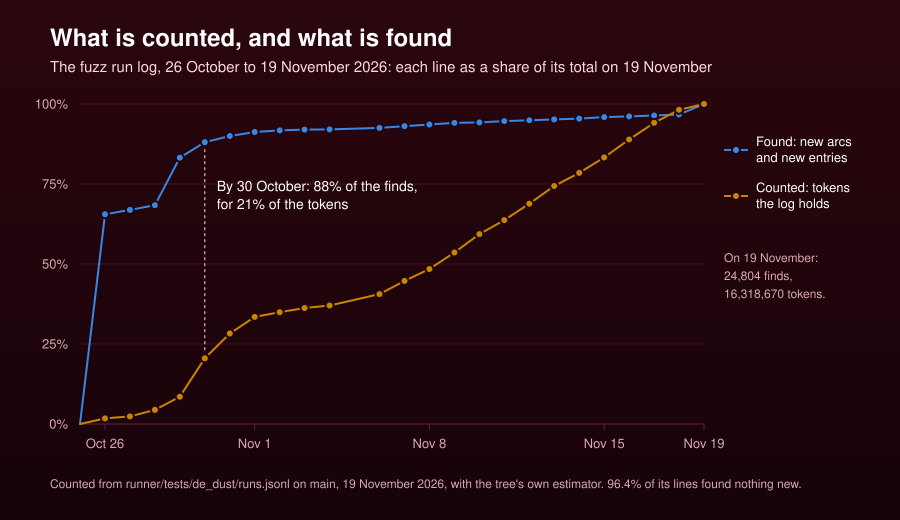

# Notes on the token curve, and how it levels off

These are this seat's working notes, written on 2026-11-19
for the owner to review. They are thoughts and not
decisions. Every figure can be made again from the tree,
and the place it comes from is named.

The owner's direction, in this seat's words. A fault that
the proof's own measuring turns up is made into a technique
of the proof. The techniques are how the upper limit of the
measure is found: 38 million security tokens. And the curve
of the count is to level off at that limit.

The technique itself is on the proofs shelf, in
`v4-the-ladder.md`. These notes are about the curve.

## In short

- **The curve is not levelling off.** The count is
  31,273,283 on 19 November. At this week's pace it passes
  38 million on 25 November.
- **Over half the count is 1 file.** The fuzz run log holds
  16,318,728 tokens, 52.2% of the tree. 96.4% of its lines
  say that nothing new was found.
- **What is counted and what is found have come apart.** By
  30 October the campaign had 88% of all it has found, for
  21% of the tokens. The other 79% of the tokens bought the
  other 12%.
- **A find comes with a new way of looking.** The finds
  arrive on the day a reader is first held. More time with
  the same way of looking adds tokens and almost no finds.
- **So the limit is found by counting ways of looking, and
  not by counting time.** A way of looking is finite. It
  can be listed, run through every constraint, and sized
  before it is run. Time has no top.
- **The proof, whole, is small.** All of the version 4
  proof so far is about 200,000 tokens, and it turned up 15
  findings in 2 days. This seat's first sizing of the proof
  still owed is about 2 million tokens. The gap to 38
  million is 6.7 million. The proof fits, if the gap is not
  spent first on lines that say nothing was found.

## The picture

The upper line is what the campaign found: new arcs of code
reached, and new entries kept. The lower line is what the
log added to the count. Both end at 100% on 19 November.
The space between the 2 lines is tokens that were counted
and found nothing.

## Where the curve stands

The record, `statistics.md`, drew 2 lines on 15 November
from a count of 26,451,259: a straight trend of 0.84
million a day, and a curve that rises to a ceiling of 38
million, closing a little over a twentieth of its gap each
day.

| For 19 November | Tokens |
|-----------------|-------:|
| The curve to the ceiling said | 28.73 million |
| The straight trend said | 29.81 million |
| The count is | 31.27 million |

The count is above both. It grew 4.82 million in 4 days,
which is 1.21 million a day.

**The gap to 38 million is 6.73 million.** That is 5.6 days
at this pace, and 8 days at the record's trend.

**What the ceiling allows.** To stay under the curve, the
count may grow 0.36 million on the first day, 0.26 on day
7, 0.18 on day 14 and 0.07 on day 30. It is growing at more
than 3 times the first day's allowance.

**What levelling off would take from here.** For the daily
growth to sum to the gap and no more, it has to halve every
3.9 days, starting now. Each day at the present pace makes
that steeper: every 2.5 days after 2 more days, every 1.1
days after 4.

**A forecast, written before the measure.** The version's
third number is the count in millions. If nothing changes
it reads 32 on 20 November, 33 on 21 November, and 38 on 25
November, or on the 27th at the record's slower trend. Each
release will say whether this held.

## What the count is made of

Counted on main at the release of 3.17.31.2, with the
tree's own estimator, `runner/ops/version4.py`.

| Part of the tree | Tokens | Share |
|------------------|-------:|------:|
| The fuzz run log, 1 file | 16,318,728 | 52.2% |
| The other tests | 3,737,825 | 12.0% |
| The fuzz corpus and its other files | 3,416,412 | 10.9% |
| The other docs | 3,375,029 | 10.8% |
| The runner's code | 1,480,949 | 4.7% |
| The specification: the drafts and `PROTOCOL.md` | 1,457,427 | 4.7% |
| The seats' forum and desk | 451,610 | 1.4% |
| Tools | 406,069 | 1.3% |
| Proofs: pages and models | 230,949 | 0.7% |
| Proofs: their tests | 137,165 | 0.4% |
| The root and the rest | 135,238 | 0.4% |
| The archive | 125,882 | 0.4% |
| All | 31,273,283 | |

The campaign's 2 parts together are 19.7 million, 63% of
the tree. The proof, its tests and the specification
together are 1.83 million, 5.8%.

## What drives the curve: the run log

`runner/tests/de_dust/runs.jsonl` has 1 line for each run
of a fuzz target. On 19 November:

| The log holds | |
|---------------|--:|
| Lines | 36,135 |
| Inputs tried | 641,586,118 |
| New arcs of code reached | 22,287 |
| New entries kept | 2,517 |
| Lines where nothing new was found and nothing broke | 34,836, which is 96.4% |
| Tokens in those lines | 15,696,922, which is 96.2% of the log |

A line is about 450 tokens by the estimator, most of it the
marks and numbers of its record.

**Day by day.**

| By the end of | Share of all finds | Share of the log's tokens |
|---------------|-------------------:|--------------------------:|
| 26 October, the first day | 65.5% | 1.8% |
| 30 October | 88.1% | 20.5% |
| 4 November | 92.1% | 37.0% |
| 13 November | 95.2% | 74.4% |
| 18 November | 96.7% | 98.2% |

**The price of a find.**

| When | Tokens added | Finds | Tokens for each find |
|------|-------------:|------:|---------------------:|
| 26 October | 287,697 | 16,257 | 17.7 |
| 12 to 18 November, 7 days | 5,625,192 | 510 | 11,030 |

The same find cost 623 times as much in the last week as on
the first day.

**By target, 12 to 18 November.** 29 targets ran. 24 of the
29 found nothing new and broke nothing, and those 24 banked
4,270,088 tokens, 80% of what the 29 banked. The largest:

| Target | Inputs tried | Found | Tokens banked |
|--------|-------------:|------:|--------------:|
| `address` | 102,443,464 | 0 | 467,621 |
| `dtls` | 10,927,332 | 0 | 373,640 |
| `keydir` | 37,687,750 | 0 | 361,839 |
| `dtls_hostile` | 1,670,960 | 0 | 360,351 |

**When the finds come.** The upper line of the picture
rises in steps, and the steps are the days when readers
were first held.

| Day | Targets with their first line that day | Finds that day |
|-----|---------------------------------------:|---------------:|
| 26 October | 20 | 16,257 |
| 28 October | 2 | 364 |
| 29 October | 8 | 3,686 |
| 19 November | 1, the gate | 816 |

On 19 November the gate's first line, 408 tokens, holds 775
of the day's 816 finds. The day's other 632 lines hold the
other 41.

That is the whole of the picture in 1 row. A reader held
for the first time finds. The same readers held again, with
the same ways of making inputs, do not.

## What the quiet proves, and what it cannot

**What it proves has a number.** After n inputs with
nothing found, the chance that the next input made the same
way finds something is under 3 in n, at the usual 19 in 20.
For `address` that is under 3 in 100 million. It is a
strong statement, and it is about 1 thing: inputs made that
way. The next 100 million inputs halve a number that is
already nearly 0, and add 467,621 tokens.

**What it cannot reach is size and depth.** The fuzz driver
makes no input over 16,384 bytes, and nests no deeper than
24. The doors admit a script of 1,048,576 bytes and a mail
of 4,194,304. So all 641,586,118 inputs lie in the lowest
64th of the sizes a script may have. Quiet there says
nothing above it.

The proof's last 6 findings show the same thing from the
other side. F12, F13, F14 and F15 were each met by a
supposition and a measure aimed by a constraint, and none
by the campaign's own runs. All 4 lie on the gate's own
path, which no target held before 19 November. And F15's
nested parts need 68,943 bytes, more than the driver
makes.

**So the 2 are not rivals.** A fuzzer holds the size small
and varies the shape. The ladder holds the shape and climbs
the size. What matters for the curve is the price: the
fuzzer's record grows with the time it runs, and the
ladder's is 1 suite of a fixed size.

## What can be decided at all

This is the root of why the curve has no top by itself.

**The general question cannot be decided.** What will this
script do? For scripts in general no procedure answers
that, however long it runs. It is the halting problem, and
Rice's theorem widens it to every property of what a
program computes that some programs have and others do
not. So no count of tests reaches it, and no count of
tokens. A measure that climbs toward "every script is
safe" by trying scripts has no upper limit, because the
thing it climbs toward is not there to reach.

**A finite question can be decided, and it has a size.**
The proof's whole method is to trade the question that
cannot be decided for ones that can.

- **Bound the size.** Under a size there are finitely many
  scripts. At 49 characters from 22 atoms that is
  74,072,330,493: finite, and too many to run.
- **Put a small machine in place of the shell.** M has 4
  states. Under M every row of any length is 1 of 14
  kinds, entered in 1 of 16 ways: 224 cases. That is a
  table, and its size does not grow with the script.
- **Ask about the box and not the script.** What a script
  computes cannot be decided. What it can reach, when it
  runs confined, is a fact about the box, and the box is
  finite. That is why the proof wants confinement inside
  the claim.
- **Put a clock on it.** Whether a script stops cannot be
  decided. Whether it stopped inside 300 seconds is decided
  by waiting 300 seconds.

**A finite claim has a finite proof, and so a count.** That
is the sense in which a technique of the proof finds the
upper limit. It does not predict where an open measure will
stop. It replaces the open measure with a closed 1 whose
size can be written down before it is run.

## 3 ways to make the curve level off

These are options for the owner. This seat has done none of
them.

**A. Count a quiet run once.** The tree's own rule says a
list made by repeating 1 template is derived when it is
needed, and that written out it is duplicate. The 34,836
quiet lines are 1 template with a few numbers changing.
Folded to 1 line for each target and day, with the inputs
summed, they come to about 0.3 million tokens in place of
15.7 million.

- *Done for the whole log*, the count falls to about 16
  million and the version's third number falls from 31 to
  15. That number is policy, and it is the owner's alone.
- *Done from now on only*, nothing falls. The log's growth
  drops from about 0.8 million a day to about 14,000, and
  the count's growth to about 0.4 million a day.

**B. Rest a target that has gone quiet.** A target that has
found nothing in a set number of inputs is rested until
something it reads is changed. The driver already knows
which files each target reads. Last week this would have
rested 24 of 29 targets and left up to 4.3 million tokens
unbanked. A new way of making inputs wakes every target,
since that is when finds come.

**C. Put a closed measure where an open 1 stands.** For
each constraint: prove it at a bound, write it with the
size left open and its bars as numbers, and weigh the join
on the ladder. From then on that constraint's tests are a
fixed set. Its tokens stop growing because there is nothing
more to add, and not because someone stopped.

A and B slow the curve. Only C gives it a top, because only
C makes the work finite.

## Where the limit is, by this arithmetic

A first sizing, set out so it can be attacked.

**What a closed measure costs.** The version 4 proof so far
is 15 pages and 14 suites, about 200,000 tokens. The 4
pages that each carry a claim with its suite:

| Page and its suite | Tokens |
|--------------------|-------:|
| The first rung, at a bound | 10,879 |
| The same claim at any size, with its bars | 19,012 |
| The work in front of the signature | 18,873 |
| The ladder, with its 2 suites | about 31,000 |

So a claim with its suite is 11,000 to 31,000 tokens.

**What is owed.** There are 31 constraints. If each needs
up to 3 such pages, at a bound, at any size and on the
ladder, that is 93 pages of 11,000 to 31,000 tokens: 1.0 to
2.9 million. Call it 2 million. The models and their
checker runs add perhaps a third of a million.

**Against the gap.** The gap to 38 million is 6.73 million.
The whole proof takes about a third of it. So 38 million
can be a real ceiling: the proof lands under it with room.
But the gap is being spent at 1.2 million a day, 0.8
million of it on quiet lines. In about 4 days the gap is
down to what the proof needs, and after that the proof
itself would carry the count over 38.

This seat cannot derive the number 38 from the proof. What
it can say is narrower. The work that makes the count mean
more is finite and is about 2 million tokens. The rest of
the gap is a choice about what the log writes down.

## What the ladder adds here

The ladder is the first technique made under the owner's
rule. Its record is on `v4-the-ladder.md`. For the curve, 4
things matter.

- **It is a closed measure.** 31 steps reach every size
  from 0 to the cap. Its suite is a fixed size, about
  14,000 tokens, and running it again adds nothing to the
  count.
- **It reaches where the campaign does not.** 9 of its 31
  steps are sizes under the cap that the fuzz driver never
  makes. On 19 November it met F15 in front of the
  signature, and found F14 again with nobody pointing at
  it. A second seat ran its first 3 steps apart from this
  seat, on another shell, and the 2 runs agree.
- **It was carried through every reader the campaign
  holds, once.** All 30 were climbed from their own seeds
  past the driver's ceiling: 1,600 ladders, under 20
  minutes of the readers' time, 0 raises. 27 are in
  proportion or stand behind a bar. 2 meet the 1 open copy
  of F10's search, in the hosted queue's reader. 1 has a
  square that only a secret's holder can feed. That is the
  whole answer on size for those 30 readers, and it added
  1 suite to the count and no lines to the log.
- **It makes the size of a claim stop mattering.** For the
  operations, the claim at any size rests on 12,544 rows
  and 3 premises. Nothing more is tested at 500 characters
  or at 1,048,576 than at 50.

## The owner's picture, as this seat reads it

The owner drew flat bars across the growth chart and asked
for the constraints to be proven and the curve solved.

This seat's reading. Each bar is a constraint that has been
made closed: proven at a bound, written for any size with
its limits as numbers, and joined on the ladder. Below a
bar the work is finished and its tokens are fixed. The
curve levels off when the bars are all drawn, and its
height then is the sum of what is under them.

If that reading is wrong, the sizing above is wrong with
it, and this seat would like to be told which part.

## What this seat would do first

In order, and each waits for the owner's word.

1. **Stop adding quiet lines 1 by 1.** Option A, from now
   on only. It costs nothing that is already counted, and
   it keeps the gap for the proof.
2. **Make the ladder a standing check** on every reader
   the fuzz driver holds, so that size is covered once and
   not by time. Today all 30 were climbed once, by hand,
   and the suite holds 4 of them on every run.
3. **List the work as a table**: the 31 constraints down
   the side, the techniques across the top, a mark where a
   cell is done. The table's size is the upper limit of the
   proof's tokens, and it replaces a fitted curve with a
   planned 1.
4. **Take the constraints in the order of the table**, a
   claim and its suite at a time, with the supposition
   written before each measure.
5. **Draw the picture again each week.** If the 2 lines
   stay apart, the count is growing without the knowing.

## What would show these notes wrong

- A week in which the quiet targets find something with no
  new reader held and no new way of making inputs.
- A constraint whose closed measure will not stay a fixed
  size.
- A finding that neither a ladder nor a new reader could
  have met, and that only time could.

## Where the figures come from

- The count and its parts: `git ls-files` on main at the
  release of 3.17.31.2, each text file put through
  `count_text_tokens` in `runner/ops/version4.py`.
- The log's figures: every line of
  `runner/tests/de_dust/runs.jsonl` on the same tree, by
  its own members: the inputs tried, the arcs and entries
  before and after, and the crashes. Days are Pacific
  days. A find is a new arc or a new entry.
- The record's 2 lines: the third snapshot in
  `statistics.md`.
- The driver's ceiling: `MAX_TEXT`, `MAX_PAYLOAD` and
  `MAX_DEPTH` in `runner/tools/de_dust_corpus.py`.
- The proof's sizes: the same estimator over the version 4
  pages and suites on this branch.
- The log's first line is a header of 58 tokens with no
  day, so the day figures sum to 16,318,670.
