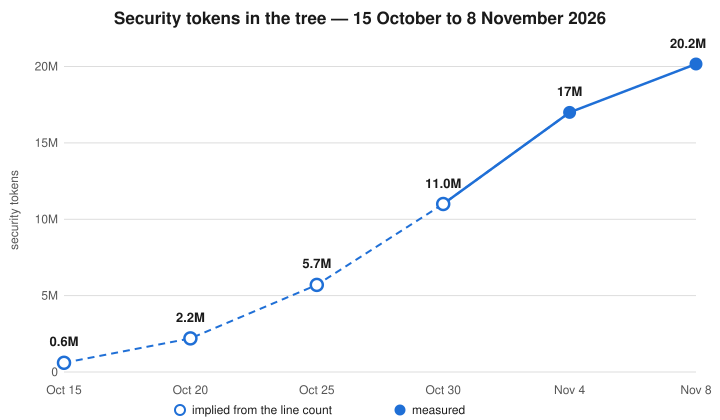

# The project's statistics: the 21-million-token measure

Dated 2026-11-11. Measured on main at commit
c5c1e3cbb2bb16bb7bc99e255ddd6672630cbf20, the head this
refresh was measured on.

The recorded line, in the display form settled for publication:

21 mil security tokens, 6,000 commits, 1,400,000 lines at 96.83% non-latent code

## What stands behind each figure

- Tokens: 20,435,240, counted over the whole tree by the project's
  own estimator (runner/ops/version4.py) — the same measure the
  version number's 3rd component carries, which is why the line
  reads 20. Display form: 20 mil security tokens — security
  tokens is this record's name for the tree's tokens counted
  by the project's own estimator, so called because the tree's
  tokens all serve its security. The short form of the name
  is sec-tokens. Verify it on any checkout:
  `python3 runner/ops/version4.py measure` prints the count and
  its whole millions.
- Lines: 1,341,311 lines in tracked files at the measured head. The display
  figure, 1,300,000, is that count rounded.
- Commits: the display figure, 5,000, is rounded from a
  full-history recount at the measured head, taken from a
  complete clone, which counts 5,195. The project's local
  mirrors are shallow (810 commits deep) and cannot recount
  the whole history on their own — the recount above rests on
  the complete clone, and any future count should be taken
  the same way.
- Non-latent: 96.83%, from the fresh dormant-code audit
  ([dormant-code-audit.md](dormant-code-audit.md), 2026-11-09,
  measured at 4111ac4659145c8a6f4d2829ade2b1a35b9bdc24):
  duplicate and latent code held at 3.17% of the
  tree in near copies and 0.03% in exact copies. The audit
  supersedes the 2026-11-03 audit's figures (96.35%, from
  3.65% near copies), whose family-by-family analysis stands
  in [duplication-audit.md](duplication-audit.md).

## The facts, machine-readable

The same figures, in the form the evergreen docs are
generated from. The marked figure slots in AGENTS.md,
PROTOCOL.md and docs/steady/fuzzing.md are filled from this
block by runner/tools/refresh_figures.py, and the guard test
holds them to it; the block is rewritten at each fresh
measure (see the release procedure in the use runbook), with
the core figures exported from runner/ops/core.py, which
stays their source of truth.

```json
{
  "as_of": "2026-11-11",
  "commit": "c5c1e3cbb2bb16bb7bc99e255ddd6672630cbf20",
  "counter": "runner/ops/version4.py",
  "tokens": 21019043,
  "lines_tracked": 1395876,
  "commits": 5515,
  "display_commits": 6000,
  "display_lines": 1400000,
  "non_latent_percent": 96.83,
  "latent_near_percent": 3.17,
  "latent_exact_percent": 0.03,
  "audit_date": "2026-11-09",
  "core_files": 136,
  "core_lines": 63497,
  "core_lines_nonblank": 57469,
  "core_tokens": 666204,
  "core_assembled_lines": 64481,
  "core_assembled_nonblank": 58344,
  "core_assembled_zip_bytes": 814692,
  "core_assembled_tokens": 676062
}
```

## Verifying these figures against the artifacts

This record is the canonical source for the tree's figures:
every other mention of them in the project's documentation
states the figure with its date and points back here. A reader
with a checkout verifies locally first — re-measure the tree
in front of them with the version4.py command above and run
its tests; a release describes the commit it was cut from,
not a working tree. A reader who wants to check the figures
against the artifacts themselves
— rather than against another document — goes to the published
release: the latest release stands at
https://github.com/Pigeon-Home/homing-pigeon/releases/latest
and carries the wheel, the source distribution, the platform
archives, the project snapshot of the whole tree (its
PROJECT-SNAPSHOT.md indexes every file at the exact commit, and
its CI-SNAPSHOT.json states the facts of the producing build),
and SHA384SUMS, against which any downloaded artifact can be
checked. The release also carries a build-provenance
attestation tying the set to this repository's own workflow;
`gh attestation verify <file> --repo Pigeon-Home/homing-pigeon`
checks it. The snapshot is the tree a visiting system can read
the test suite from when it cannot run the suite itself.

## Why this record stands in the repository

These figures were first assembled in a working lane, off the
repository, and the lane died before the figures landed anywhere
a reader could find them. The project's standing rule is that
work lives in the repository, where it is visible, reviewable,
and carried by the next release cut; a lane outside the repo can
die unseen. The figures therefore stand here, with their measured
basis beside the display line, and the release that publishes
them states this record as its reason.

## The growth of the measure: a snapshot as of 2026-11-08

A dated record, kept for the shape of the growth rather than as
a current figure: the figures at the top of this record are the
current ones, with their own date and measured basis. The 6
points below are evenly spaced across the project's first 24
days, from its first release to the measure of 2026-11-08.



| Date | Release | Lines in the tagged tree | Security tokens | Basis |
|------|---------|--------------------------|-----------------|-------|
| 2026-10-15 | v3.7.2 | 41,632 | about 0.6M | implied from lines |
| 2026-10-20 | v3.11.30 | 144,993 | about 2.2M | implied from lines |
| 2026-10-25 | v3.12.78 | 378,222 | about 5.7M | implied from lines |
| 2026-10-30 | v3.14.42 | 727,924 | about 11.0M | implied from lines |
| 2026-11-04 | v3.15.17.156 | 1,127,754 | 17M | measured — the version's 3rd component |
| 2026-11-08 | count at commit d1b8e8a229 | 1,218,733 | 20,163,806 | measured — the count recorded that day |

How the points were derived. Each point is taken from that
day's last release tag, and the lines are the line count of the
tagged tree. The token measure was not recorded on the early
tags, so the first 4 points are implied: the tree's lines at
each tag, multiplied by the ratio the first measured point
gives — on 2026-11-04 the version's 3rd component measured
17M tokens against that tree's 1,127,754 lines, about 15.1
tokens per line. The last 2 points are measured, not implied:
2026-11-04 by the version component itself, and 2026-11-08 by
the count of 20,163,806 taken at commit d1b8e8a229. The implied
points are estimates, shown for the shape of the growth; the
measured points anchor the series at its later end. Read with
that caution, the shape is plain: the tree roughly doubled
every 5 days through October, and the climb steepened into
November.
