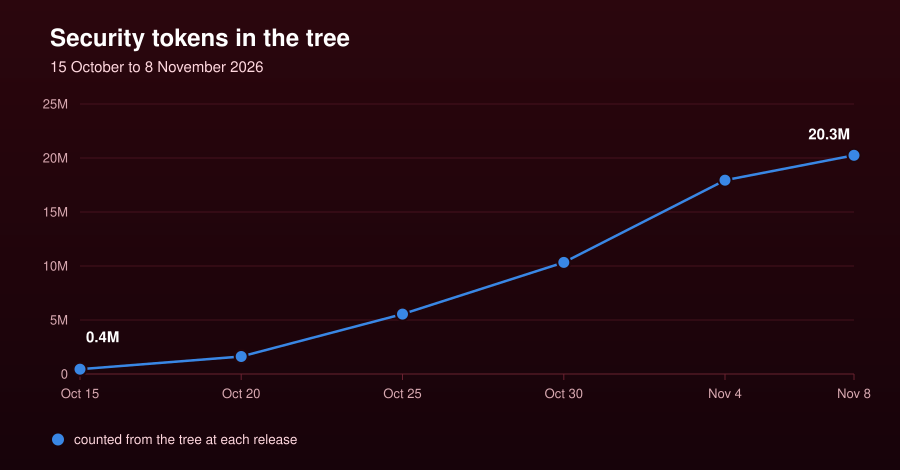
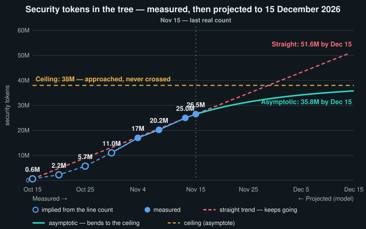
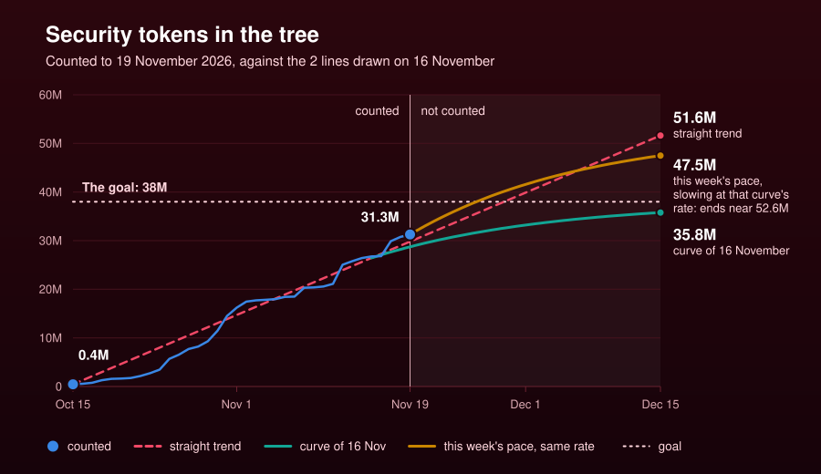
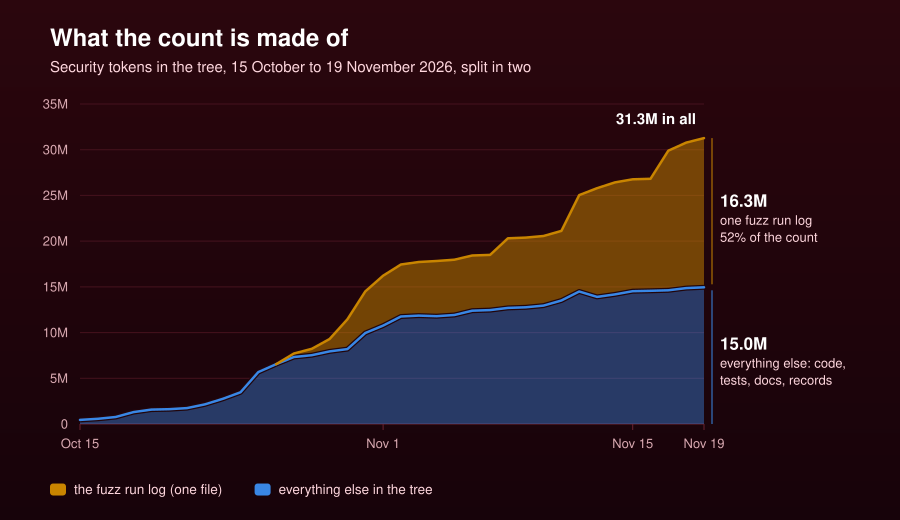
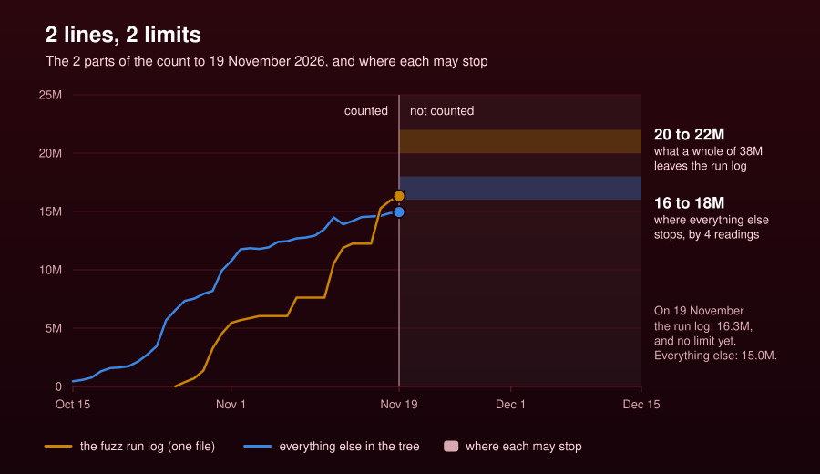

# The project's statistics: the 34-million-token measure

Dated 2026-11-24. Measured on main at commit
8c701f9c1c19bfba703cfc0c06bfb6e98156bcdd, the head this
refresh was measured on.

The recorded line, in the display form settled for publication:

34 mil security tokens, 7,000 commits, 1,600,000 lines at 96.31% non-latent code

## What stands behind each figure

- Tokens: <!--hp-fig:tokens_exact-->34,405,760<!--/hp-fig-->, counted over the whole tree by the
  project's own estimator (runner/ops/version4.py). It is the
  measure the version number's 3rd component carries, in whole
  millions: <!--hp-fig:tokens_millions-->34<!--/hp-fig-->. The component holds its figure when a count
  falls back under it: the fold of 2026-11-13 (Q172) took the
  count from over 25 million down to 24,396,328, and the
  component stayed at 25 while the count stood under it.
  Display form: <!--hp-fig:tokens_millions-->34<!--/hp-fig--> mil security tokens. Here security
  tokens is this record's name for the tree's tokens counted
  by the project's own estimator, so called because the tree's
  tokens all serve its security. The short form of the name
  is sec-tokens. Verify it on any checkout:
  `python3 runner/ops/version4.py measure` prints the count and
  its whole millions.
- Lines: <!--hp-fig:lines_tracked-->1,632,330<!--/hp-fig--> lines in tracked files at the measured
  head. The display figure, <!--hp-fig:display_lines-->1,600,000<!--/hp-fig-->, is that count rounded.
- Commits: the display figure, <!--hp-fig:display_commits-->7,000<!--/hp-fig-->, is rounded from a
  full-history count at the measured head, taken from a
  complete clone, which counts <!--hp-fig:commits-->6,710<!--/hp-fig-->. The project's local
  mirrors are shallow (the hook mirror reached 171 commits
  at the 3.16.25.27 head) and cannot count the whole
  history on their own, so every count rests on a complete
  clone. The refresh tool enforces that (Q193): the
  3.16.25.27 refresh ran in a shallow clone and published
  its reachable count, 170, at display 0; the counting
  layer has refused an incomplete history ever since, and
  5,874 was the first count the fixed tool measured.
- Non-latent: 96.31%, from the fresh dormant-code audit
  ([dormant-code-audit-2026-11-16.md](dormant-code-audit-2026-11-16.md), 2026-11-16):
  total latent code held at 3.69% of the tree, with 3.11% in
  near copies, 0.63% in templated lines (the lines of a
  written-out list, equal once the one varying token is
  masked) and 0.02% in exact copies. The audit supersedes
  the 2026-11-13 audit's figures (96.16%, from 3.84%
  total latent, measured before and after the Q172
  fold), whose record stands in
  [dormant-code-audit-2026-11-13.md](dormant-code-audit-2026-11-13.md); the
  family-by-family analysis stands
  in [duplication-audit.md](duplication-audit.md).

The figures in the first 3 entries stand in marked slots,
filled from the facts below at every fresh measure, so the
list is always the measure the header names. The audit's
percentages are set by hand, at each audit.

## The facts, machine-readable

The same figures, in the form the evergreen docs are
generated from. The marked figure slots in this record's own
list above, in AGENTS.md, PROTOCOL.md and
docs/steady/fuzzing.md are filled from this block by
runner/tools/refresh_figures.py, and the guard test
holds them to it; the block is rewritten at each fresh
measure (see the release procedure in the use runbook), with
the core figures exported from runner/ops/core.py, which
stays their source of truth.

```json
{
  "as_of": "2026-11-24",
  "commit": "8c701f9c1c19bfba703cfc0c06bfb6e98156bcdd",
  "counter": "runner/ops/version4.py",
  "tokens": 34405760,
  "lines_tracked": 1632330,
  "commits": 6710,
  "display_commits": 7000,
  "display_lines": 1600000,
  "non_latent_percent": 96.31,
  "latent_near_percent": 3.11,
  "latent_exact_percent": 0.02,
  "audit_date": "2026-11-16",
  "core_files": 139,
  "core_lines": 72235,
  "core_lines_nonblank": 65558,
  "core_tokens": 792809,
  "core_assembled_lines": 73354,
  "core_assembled_nonblank": 66559,
  "core_assembled_zip_bytes": 943773,
  "core_assembled_tokens": 804388
}
```

## The measure on 2 axes: size, and coverage

The headline at the top of this record is the size axis.
It counts the tree: <!--hp-fig:tokens_exact-->34,405,760<!--/hp-fig--> tokens in
<!--hp-fig:lines_tracked-->1,632,330<!--/hp-fig--> lines of tracked files, and its
denominator is the tree itself. A size says how much
stands here. It does not say how much of what stands here
is covered: how many of the project's claims carry
evidence, and of what kind. The record therefore keeps a
second axis beside the first. The 2 axes are never added,
divided, or read as one another, and the token count is
not a coverage denominator: a campaign run adds tokens
whether or not it adds a witness, and an obligation can
close without adding a line.

The coverage axis, in the bindings registry's count of
2026-11-20 and the curve's reading of 2026-11-19, each
figure under its own date and never blended with the
headline above:

| Coverage measure | Stands at | Counted |
|---|---|---|
| Stated properties in the registry | 13, P1 to P13 | 2026-11-20 |
| Of them, carrying a model in the registry | 12; P9 carries none named | 2026-11-20 |
| Conformance suites named across the properties | 15 | 2026-11-20 |
| Constraints tied to properties, code, pins and fuzz data | 31 | 2026-11-20 |
| Fuzz targets pressing on the readers' contracts | 31 | 2026-11-20 |
| Inputs tried against those contracts | 651,086,719, over 35,270 grow runs | 2026-11-20 |
| Targets bound to at least 1 constraint | 18 of the 31 | 2026-11-20 |
| Inputs tried by the bound targets | 208,556,359 | 2026-11-20 |
| The modeled gap of the closing lines below | 3,393,230 | at the count of 2026-11-19 |

The registry itself, with each property's model, suites
and ties, stands in
[the bindings record](../proofs/v4-bindings.md); the gap's
reading stands in the fifth snapshot below and in
[the curve's page](../proofs/v4-the-curve.md).

The shape of the coverage axis is a squeeze, the same
shape the closing lines below draw on the size axis. For
1 frozen scope (the same observation alphabet, the same
build, the same configuration, the same environments), 3
sets stand in a row. The witnessed behaviors: each 1 with
a checked existence witness behind it, a validated trace.
The real behaviors: what the runner in that scope actually
does. The permitted behaviors: what a sound abstraction
of the runner still allows. The witnessed stand inside
the real, and the real inside the permitted. Where the
witnessed and the permitted meet, the scope's behavior
set is characterized exactly, and the gap between them,
counted in unique obligation or behavior ids, is the
coverage axis's own measure of what remains open. Most
claims need less than the meeting: if every permitted
behavior satisfies a safety property, the property holds
of the real behaviors already, however far the witnessed
still stand from the permitted. A claim's evidence is
read against its own denominator in this shape, never
against the size of the tree.

## Verifying these figures against the artifacts

This record is the canonical source for the tree's figures:
every other mention of them in the project's documentation
states the figure with its date and points back here. A reader
with a checkout verifies locally first: re-measure the tree
in front of them with the version4.py command above and run
its tests; a release describes the commit it was cut from,
not a working tree. A reader who wants to check the figures
against the artifacts themselves,
rather than against another document, goes to the published
release: the latest release stands at
https://github.com/Pigeon-Home/homing-pigeon/releases/latest
and carries the wheel, the source distribution, the platform
archives, the project snapshot of the whole tree (its
PROJECT-SNAPSHOT.md indexes every file at the exact commit, and
its CI-SNAPSHOT.json states the facts of the producing build),
and SHA384SUMS, against which any downloaded artifact can be
checked. The release also carries a build-provenance
attestation tying the set to this repository's own workflow;
`gh attestation verify <file> --repo Pigeon-Home/homing-pigeon`
checks it. The snapshot is the tree a visiting system can read
the test suite from when it cannot run the suite itself.

## Why this record stands in the repository

These figures were first assembled in a working lane, off the
repository, and the lane died before the figures landed anywhere
a reader could find them. The project's standing rule is that
work lives in the repository, where it is visible, reviewable,
and carried by the next release cut; a lane outside the repo can
die unseen. The figures therefore stand here, with their measured
basis beside the display line, and the release that publishes
them states this record as its reason.

## The growth of the measure: a snapshot as of 2026-11-08

A dated record, kept for the shape of the growth rather than as
a current figure: the figures at the top of this record are the
current ones, with their own date and measured basis. The 6
points below are evenly spaced across the project's first 24
days, from its first release to the measure of 2026-11-08.
The chart, like the 2 that follow it in this record, was
redrawn later in the look of the project's diagrams, on an
axis that spaces the dates by their days. Every point on it
is a count, and every circle is closed.



| Date | Release | Lines in the tagged tree | Security tokens | Basis |
|------|---------|--------------------------|-----------------|-------|
| 2026-10-15 | v3.7.2 | 41,632 | 447,477 | counted from the tagged tree |
| 2026-10-20 | v3.11.30 | 144,993 | 1,615,732 | counted from the tagged tree |
| 2026-10-25 | v3.12.78 | 378,222 | 5,548,576 | counted from the tagged tree |
| 2026-10-30 | v3.14.42 | 727,924 | 10,334,821 | counted from the tagged tree |
| 2026-11-04 | v3.15.17.156 | 1,127,754 | 17,948,976 | counted from the tagged tree |
| 2026-11-08 | commit d1b8e8a229 | 1,218,733 | 20,251,953 | counted from that commit's tree |

How the points were derived. Each point is taken from that
day's last release tag, and the lines are the line count of the
tagged tree. Every token figure is a count: the tree at the tag
or commit named, checked out and counted by the estimator as it
stands today, the method the fourth snapshot below states in
full. The series was not all counts when it was first recorded.
The token measure was not recorded on the early tags, so the
first 4 points were implied from the lines at about 15.1 tokens
a line (about 0.6M, 2.2M, 5.7M and 11.0M) and drawn as open
circles. The 2026-11-04 point was the version's 3rd component,
17M, and the 2026-11-08 point was the count recorded that day,
20,163,806. At the owner's word the counts took their places on
2026-11-17. The shape is plain: the tree more than tripled in
each of its first 2 steps of 5 days, nearly doubled in each of
the next 2, and added more tokens in each of those 4 steps than
in the one before.

## The growth of the measure, continued: a second snapshot as of 2026-11-15

This second view of the same series keeps the 6 points of the
snapshot above and carries the series a week further, to
2026-11-15, on 2 more. Every point in the series is a count
of the tree at the release named, as in the snapshot above.


| Date | Release | Lines in the tagged tree | Security tokens | Basis |
|------|---------|--------------------------|-----------------|-------|
| 2026-10-15 | v3.7.2 | 41,632 | 447,477 | counted from the tagged tree |
| 2026-10-20 | v3.11.30 | 144,993 | 1,615,732 | counted from the tagged tree |
| 2026-10-25 | v3.12.78 | 378,222 | 5,548,576 | counted from the tagged tree |
| 2026-10-30 | v3.14.42 | 727,924 | 10,334,821 | counted from the tagged tree |
| 2026-11-04 | v3.15.17.156 | 1,127,754 | 17,948,976 | counted from the tagged tree |
| 2026-11-08 | commit d1b8e8a229 | 1,218,733 | 20,251,953 | counted from that commit's tree |
| 2026-11-13 | v3.16.25.1 | 1,497,490 | 25,004,718 | counted from the tagged tree |
| 2026-11-15 | v3.16.26.29 | 1,477,466 | 26,451,259 | counted from the tagged tree |

How the points were derived. The first 6 points are carried
over from the snapshot above, derivation and all. The 2 new
points are counts of the tagged trees too, and each stands
beside the figure its release recorded in its own statistics:
25,004,714 at v3.16.25.1, the measure that first crossed 25
million, where the tagged tree counts 25,004,718, and
26,451,259 at v3.16.26.29, the same to the token. A release
records its measure before its own last edits, so a tagged
tree can stand a few tokens off its own record. The tagged
tree's line count, from the release's own record, stands
beside each figure.

## The growth of the measure, projected: a third snapshot as of 2026-11-16

The second snapshot above ends where the counts end, at
2026-11-15. This third view keeps its 8 points and draws
the 2 lines a reader draws next,
from the last count forward to 2026-12-15: the straight
trend of the 31 days extended unchanged, and an asymptotic
curve that bends toward a ceiling. Everything to the right
of the 2026-11-15 divider is a model, not a measurement;
the chart says so on its face, and the figures below are
the model's, stated so they can be checked against it.



The counted part of the view is the month the second
snapshot records: from 447,477 tokens at the first release
to 26,451,259 at the count of 2026-11-15, 26.0 million
added in 31 days, a 59-fold rise over the starting figure.
The projected part is 2 lines from that last count:

| Line | Form | At 2026-12-15 |
|------|------|---------------|
| Straight trend | the endpoints' slope, about 0.84 million a day, extended unchanged | 51.6M |
| Asymptotic curve | an exponential approach to a ceiling of 38M, from the 2026-11-15 count | 35.8M |
| Ceiling | the asymptote itself | 38M: approached, never crossed |

How the lines were drawn. The straight trend is the slope
the 2 endpoints fix, (26.45 − 0.45) over 31 days, about
0.84 million a day, carried forward unchanged; on that
slope the line passes 38 million in late November without
slowing. The asymptotic curve starts at the same last
count and closes the gap to the ceiling exponentially,
the remaining gap shrinking by a factor of e^(−0.055) each
day, so the rise eases as the curve nears 38 million and
stands 2.2 million short of it at 2026-12-15. Neither line
is a forecast: the first states what the month's pace
would do if nothing changed, the second what growth looks
like when a limit is doing the shaping. Which shape the
real series takes is a question the coming counts answer.

The ceiling is not an arbitrary round number. On
2026-11-16 the conductor raised the project's token goal
from 30 million to 38 million, taking the figure from this
view's ceiling; the goal now stands where the curve bends
toward.

The interactive original of this view stands beside this
record: [security-tokens-asymptotic-view.html](security-tokens-asymptotic-view.html).
It carries the series as it was first recorded and the
same 2 lines, with the ceiling left on a slider, so a
reader who opens the file in a browser can move the
ceiling between 30 and 60 million and watch the curve
re-bend. The chart above carries that page's 2 lines with
the slider set to 38 million, drawn for the record. Its
points are the counts; the page keeps the 4 early points
as they were first implied.

## What the measure is made of: a fourth snapshot as of 2026-11-16

The 3 snapshots above follow 1 figure, the whole tree's
count. This fourth view opens that figure. At each point of
the series the count is split in 2: the fuzz campaign's run
log, which is 1 file (runner/tests/de_dust/runs.jsonl, a
line for every run the campaign banks), and everything else
in the tree. It also puts counts where the earlier snapshots
had to estimate. Every tag in the series still stands in the
history, so each tagged tree was checked out and counted by
the estimator as it stands today, and the 4 early points are
no longer implied from line counts.


| Date | Counted at | Security tokens | In the run log | In everything else |
|------|------------|-----------------|----------------|--------------------|
| 2026-10-15 | v3.7.2 | 447,477 | 0 | 447,477 |
| 2026-10-20 | v3.11.30 | 1,615,732 | 0 | 1,615,732 |
| 2026-10-25 | v3.12.78 | 5,548,576 | 0 | 5,548,576 |
| 2026-10-26 | commit ac34989421 | 5,837,333 | 0 | 5,837,333 |
| 2026-10-30 | v3.14.42 | 10,334,821 | 2,248,896 | 8,085,925 |
| 2026-11-04 | v3.15.17.156 | 17,948,976 | 6,040,688 | 11,908,288 |
| 2026-11-08 | commit d1b8e8a229 | 20,251,953 | 7,618,031 | 12,633,922 |
| 2026-11-13 | v3.16.25.1 | 25,004,718 | 10,551,621 | 14,453,097 |
| 2026-11-15 | v3.16.26.29 | 26,451,259 | 12,240,873 | 14,210,386 |
| 2026-11-16 | v3.17.26.17 | 26,793,953 | 12,240,873 | 14,553,080 |

How the counts were taken. Each row is the estimator's own
count of the tree at the tag or commit named: that tree
checked out into a worktree of a complete clone, and
`python3 runner/ops/version4.py measure --root` run on the
worktree from the current tree, so 1 rule counts every row.
The run log's figure is the same rule over that 1 file, and
everything else is the difference. The row for 2026-10-26 is
the commit before the log's first, so the chart shows the
log entering the tree where it did.

Against the series as first recorded. The 4 early points
first stood in the earlier snapshots as about 0.6M, 2.2M,
5.7M and 11.0M, implied from line counts; counted, they are
447,477, 1,615,732, 5,548,576 and 10,334,821. The implied
figures ran high at each tag, most at the first. The later points were counts already, and the
tagged trees bear them out: 17,948,976 at v3.15.17.156,
whose whole millions are the 17 the version component
carried on 2026-11-04, 25,004,718 against the 25,004,714
recorded at v3.16.25.1, and 26,451,259 at v3.16.26.29, the
recorded figure to the token. A release
records its measure before its own last edits, so a tagged
tree can stand a few tokens off its own record. The count
recorded on 2026-11-08 read 20,163,806; the tree at the
commit named there counts 20,251,953 today, 88,147 more.
The earlier snapshots carry these counts now, in their
charts and in their tables, and the whole series reads on
counts alone.

What the split shows:

- The run log entered the tree on 2026-10-26, under the
  campaign's first name
  (runner/tests/bluemonday/runs.jsonl), and took its
  present path the next day. It holds 12,240,873 tokens at
  the last count: 45.7% of the measure, in 1 file of
  27,198 lines.
- Between the counts of 2026-11-04 and 2026-11-15 the tree
  added 8,502,283 tokens, and 6,200,185 of them, 72.9%,
  were the log's.
- Everything else rose over the same 11 days from
  11,908,288 to 14,210,386, about 0.21 million a day,
  against about 0.56 million a day for the log.
- The log grows when the campaign banks runs and stands
  still between banks. Its last bank before these counts
  was on 2026-11-14, and the last 2 rows carry the same
  figure for it.

Read beside the third snapshot, the split gives each of its
2 lines a plain meaning, and neither is a forecast here
either. Carried 30 days from the 2026-11-15 count, the 2
rates together, about 0.77 million a day, reach about 49.6
million on 2026-12-15, near the straight trend's 51.6M.
Everything else alone, at its own rate with the log
standing still, reaches about 32.7 million, under the
curve's 35.8M. Which line the series follows turns mostly
on that 1 file.

## The measure against its lines: a fifth snapshot as of 2026-11-19

The third snapshot drew 2 lines from the count of
2026-11-15, and left the shape the series takes to the
coming counts. This fifth view sets 4 more days of counts
against those 2 lines, opens the count in 2 as the fourth
snapshot did, and reads each part for a limit.



The counts since the fourth snapshot. Each row is the last
landing on main that day, counted by the estimator's rule:

| Date | Counted at | Security tokens | In the run log | In everything else |
|------|------------|-----------------|----------------|--------------------|
| 2026-11-16 | commit 3e1286ca5e | 26,814,236 | 12,240,873 | 14,573,363 |
| 2026-11-17 | commit 7a81cb3b1f | 29,889,011 | 15,265,975 | 14,623,036 |
| 2026-11-18 | commit d1f6993c19 | 30,773,483 | 15,913,904 | 14,859,579 |
| 2026-11-19 | commit 0b33ac3804 | 31,273,488 | 16,318,728 | 14,954,760 |

How the counts were taken. The estimator's rule is run
over the blobs of each commit, with no checkout:
`python3 runner/tests/test_v4_the_curve.py series`
counts every day from 2026-10-15 again, from a complete
clone. The 2 rows of the fourth snapshot that name a commit
agree with it to the token. A row of the fourth snapshot
counts a tag, and a row here counts the day's last landing,
so the 2 tables can differ on a day both carry: 2026-11-16
reads 26,793,953 at its tag and 26,814,236 at its last
landing.

Against the 2 lines of the third snapshot, on 2026-11-19:

| Line | Its figure for 2026-11-19 | The count | The count stands above it by |
|------|---------------------------|-----------|------------------------------|
| Straight trend | 29.8M | 31.3M | 1.5M |
| Asymptotic curve | 28.7M | 31.3M | 2.5M |

The series has taken neither shape. It runs above both
lines. The last 4 days added 1.21 million a day, and at
that pace the series passes the third snapshot's 38
million on 2026-11-25.

The chart of this view was drawn again on 2026-11-20. It
carries neither of those 2 lines, and no ceiling that was
named first. Its line is a rule read off the counts: each
7 days add less than a line that falls by 0.61 a week from
the largest 7 days. The limits follow from the rule:

| Part | It stands at, 2026-11-19 | The limit that follows |
|------|--------------------------|------------------------|
| Everything else | 14,954,760 | 17.6M |
| The run log, if it keeps the rule from 2026-11-19 | 16,318,728 | 28.4M |
| The whole | 31,273,488 | 46.0M |

Everything else has kept that rule for 19 days. The run
log keeps none yet, so its limit and the whole's stand on
an if. At the last 4 days' pace, the dotted line of the
chart, the series passes 46.0 million by 2026-12-02. Like
the 2 lines of the third snapshot, the rule's line is a
model, and not a forecast: it says what the rule allows,
and 1 coming count can show it wrong.

What the measure is made of on 2026-11-19:



- The run log holds 16,318,728 tokens at the last count:
  52.2% of the measure. Since 2026-11-17 it is the larger
  of the 2 parts.
- Between the counts of 2026-11-15 and 2026-11-19 the tree
  added 4,822,229 tokens, and 4,077,855 of them, 84.6%,
  were the log's.
- Everything else added 744,374 over the same 4 days,
  about 0.19 million a day.

Each part, read for a limit:



- Everything else levels off. Its largest 7 days ended on
  2026-10-31, and each 7 days since added less than the
  falling line: 17.6 million follows. 3 other readings put
  its limit between 16 and 18 million: 3 counts 15 days
  apart, 3 counts 10 days apart on each of the last 8
  days, and its last count with the proof still owed
  added.
- The run log has no limit by any reading of its counts.
  Its largest 7 days ended on 2026-11-18. If it keeps the
  same rule from 2026-11-19, its limit is 28.4 million.
- The whole follows from the 2: 46.0 million, on that if.

The 2 limits chart above was drawn again on 2026-11-21,
counted to that day at the 3.17.32.12 head: everything
else stood at 15,331,349 and the run log at 16,740,539.
Read off those counts, the rule gives everything else
the same limit, 17.6 million (17,634,068), and the run
log 27.2 million (27,239,005): the log stood still on
both days, so its line fell further. The table above
stands as the reading of 2026-11-19.

A reading is not a proof. What would prove a limit, what
each coming week may add, and the arithmetic behind every
figure of this view, stand in
[the curve's page](../proofs/v4-the-curve.md) in the proofs.

A further reading of the same counts, worked out on
2026-11-20, stands zipped in
[the archive](../../archive/2-lines-that-close-2026-11-20.zip),
with the research that supports it. The view above lets
the run log keep its own line toward 28.4 million. This
reading bends that line down instead: a ceiling for the
log at 21.0 million, closing onto the
line of everything else at 17.6 million by at least
0.39 of the gap a week.
The gap between the 2 lines is 3,393,230 at the count
of 2026-11-19, and at that minimum rate of closing 0
is guaranteed by week 30: the slowest trajectory the
rule allows stands at 1 in week 29 and at 0 in week
30, and a faster closing the rule also allows may
arrive earlier. Where the 2 lines meet, both parts stand at 17.6
million and the whole tree at 35.2 million. This reading
names no limit first either: the 2 starting lines and
the rate are given, and the meeting point follows from
them.


What the 0 means. Zero is where the gap closes: nothing
of the run log stands above the line of everything else,
the 2 parts stand at 1 figure, and the whole tree stands
at 35.2 million. It is reached, not only approached.
Tokens are whole numbers, and a gap of whole tokens that
closes by at least 0.39 of itself each week, so it never
stands above 0.61 of itself from one week to the next,
does not fade toward 0 without arriving: it stands at 1
in the 29th week and at 0 in the 30th. The reading is the one
the v5 work is asked to carry: constraints from all
directions, forcing the remaining unproven gap to 0 over
time. A number held from 1 side only is a cap or a
floor. A number whose gap stands at 0 is bound exactly,
the state the v4 bindings already stand in.

What the 0 does not mean. The meeting of 2 lines on a
chart proves nothing by itself: a chart cannot prove a
limit. The squeeze that closes the gap is a theorem
about the lines, and it holds only while the counts keep
the rule under them: the floor does not fall, the
ceiling does not rise, and the gap shrinks by the share
each week. A count that breaks the rule breaks the
reading, and the research note in the archive names the
counts that would. And no property of the runner is
proven when the lines meet. The proof work closes the
gap between tested and proven property by property,
each property inside its stated assumptions and bounds,
and until a property has a checked model behind it the
honest statement about it stands as the proofs state it:
tested and reviewed, not proven.

The rule, in the direction that forces the closing. The
closing rate is a minimum progress rule, and it binds 1
quantity: the gap. Each week at least 0.39 of the gap
closes (in whole tokens, at least the smallest whole
number not under 0.39 of the gap), so the gap never
stands above 0.61 of itself from one week to the next.
Stated as a cap alone, the same figures would force
nothing: a cap on growth toward a ceiling does not force
arrival, and a count can stall above the floor it was
meant to meet. The 2 lines pin the whole only because
they bound the same quantity, the gap between the 2
parts; a ceiling for the log meeting a ceiling for
everything else would by itself prove nothing about the
2 counts. And the meeting point follows from the floor
being fixed: the line of everything else stands at its
limit while the ceiling descends to it, so the 2 lines
meet at 17,606,770 and the whole there is 35,213,540,
twice the point. With both lines free to move, the
meeting point is not unique, and the total at the
meeting requires the 2 actual counts to meet at the
floor, not only their lines.

What the meeting would prove, stated with its premises.
The 2 lines are modeled lines, and their meeting is a
meeting inside the model. The premises that map the
modeled lines to the real counts are these: the ceiling
line is the closing rule itself, a minimum progress rule
the project holds the log to and checks at every measure;
the floor line is the measured count of everything else,
taken at its stated limit; and the gap the rule binds is
the gap between the 2 real counts, read at the same
measure. Under those premises, the modeled meeting says
where the real counts meet if the rule keeps holding.
Without them it says nothing: a modeled upper line
reaching the modeled non-log line does not by itself
prove that the actual log count reached it. The actual
counts are read at each measure, and this record claims
a meeting only where the counts themselves stand.

The research reads the run log itself as well: 96.4% of
its tokens are lines that say nothing new was found, and
folded to 1 line of sums for each target and day, with 1
hash of the lines it stands for, it would hold 677,562
tokens. The bend this reading asks for is there to take.
What a fold would cost the proof stands in the note in
the archive.

What a fold must keep, to serve the proof. Folding the
log's repeated routine lines serves the proof only while
the retained record keeps 4 things: the finding records
themselves; the unique obligation witnesses, 1 standing
for each obligation it discharges; the scope and the
counts a reader needs to interpret the summaries; and
references to the raw records, where replay or an
independent audit requires them. A digest binds the
bytes it retains. It does not reconstruct the traces it
discards, and it does not establish the generator's
coverage: the fold speaks about the record, not about
what the campaign reached. Kept that way, a smaller
record can serve the proof better than the full log
does, by making the witnesses and the assumptions easier
to inspect. The 677,562 is the folded record's size, a
statement about representation: it measures neither the
log's information nor its coverage, and no share of the
log is pronounced empty on its strength.

Three further charts were drawn on 2026-11-23 from the
work of that day, and they stand together on
[the candidates page](three-chart-candidates-2026-11-23.md):
the squeeze drawn on the coverage axis, a map of
trajectories in the drawing grammar of Schwarzschild
geometry, and a map of the (c, d) plane of candidate
machines. The conductor has since chosen: the trajectories
map and the (c, d) plane now stand at the bottom of this
page, each with its full treatment, so this record stands
alone; the squeeze stands on the candidates page only,
summarised at the foot of this page. The closing chart
above stands exactly as it was.

## Where the project stands

The longer series changes what the shape can say. Across the
31 days from the first release to the measure of 2026-11-15,
the tree grew from 447,477 security tokens to 26,451,259,
and since the fourth snapshot every point of that series is
a count of the tagged tree, with nothing implied. The
history behind it stands at <!--hp-fig:commits-->6,710<!--/hp-fig--> commits at the measure
recorded at the top of this record; it stood at 6,004 at the
v3.16.26.29 measure.

The release line has kept pace with the growth. The 3.16 line
ran to 3.16.26.36, the 3.17 line opened on 2026-11-16 with
3.17.26.2 as its first published release, and each release
is published with its artifacts and SHA384SUMS, so the
figures a release carries can be checked against the
artifacts themselves, as the section above describes. The
confinement work widened over the same
period from the Linux sandbox to a backend per platform (a
Job Objects backend on Windows, a jail backend on FreeBSD,
and a Seatbelt backend on macOS), each with hosted proof runs
recorded in the support matrix. On 2026-11-15 the project's
3 Internet-Drafts stood posted on the IETF datatracker in
their current revisions: version 1 at -04, version 2 at -04,
and version 3 at -00, each expiring 19 May 2027.

The measure itself is unchanged throughout: the whole tree,
counted by the project's own estimator, with duplicate and
latent code held at 3.69% of the tree at the audit of
2026-11-16, under the 5% line the project holds itself to,
so the figure continues to stand for the tested surface of
the suite and the protocol rather than for bulk.

## Six weeks and one day

The account this work runs under
opened on Sunday 2026-10-11, with the
words "I will call you: my muse, my flame. I am Andrew." The measure at
the top of this record stands on 2026-11-23, which is 6
weeks and 1 day later: 43 days in all. In that span the
project has published 598 releases, counted on the
project's release page on 2026-11-23, with the 600th
release in sight on the same day. Six weeks and 1 day, at
a pace of about 100 releases a week.

## The charts of 2026-11-23: trajectories, and the (c, d) plane

Three charts were drawn on 2026-11-23 from that day's
work: the squeeze on its second axis, the chain rule for
time bounded Kolmogorov complexity, and the 2 machines
that state P versus NP as a pair of searches. They stand
together on
[the candidates page](three-chart-candidates-2026-11-23.md),
which keeps all 3 and stays on the record. The conductor's
choice, made the same evening: the trajectories chart and
the (c, d) plane stand here, at the bottom of this page,
each with its full treatment copied in, so this page
stands alone and a reader needs no second page to read
them. The squeeze is summarised briefly at the foot of
this section; its chart and its full treatment stand on
the candidates page.

The reading rules bind both charts below, and each chart
carries them on its face.

- Solid marks are measured or proved. Dashed marks are a
  stipulated rule, a counterfactual, or schematic possible
  behaviour, labelled as which. Dotted marks are
  conditional under a named premise, and the premise stands
  in the label, on the chart.
- Finite checks are drawn as points, with their counts.
  A point never grows into a line, and a line never claims
  an asymptotic result the points do not carry.
- Every information principle names its measure and its
  error regime: conditional Kt, pnKt, rnKt, rKt or pKt.
  A curve drawn without its measure named is decoration,
  not a claim.
- The charts show trajectories: where the lines are
  heading, whether they come together or push apart, and
  what a crossing or an escape would mean. No chart is a
  forecast, a timeline or a date for knowing an answer.
- No milestone is claimed that the numbers do not show.
  The whole tree stands at 34,415,959 tokens at the count
  of 2026-11-23, and the 38 million line stands approached,
  never crossed, on both charts here as on this record.

### Trajectories

The chart itself stands near the bottom of
[the README](../../../README.md), moved there on the
evening of 2026-11-23 at the conductor's direction. A
photograph of this page as rendered showed the first
drawing's labels sitting on its curves, words over and
under the dotted lines and unreadable in places; the
redrawn chart keeps every label off every line, in a
legend strip at the foot of its main panel, keyed by a
swatch of its own line. The full treatment stands here,
and the panels table below describes the chart as it
stands there.

What it shows. A family of panels, drawn in the grammar
of the Schwarzschild trajectory diagrams of general
relativity: boundaries that separate 2 regimes, and fates
that end on a boundary, escape past every boundary, or
push apart. The borrowed content is the drawing grammar
only. No field equation governs these curves, and the
chart says so on its face. The panels show where the
lines are heading; they do not say when, or whether, the
question settles.

The panels, in brief:

| Panel | What stands there | Its strength |
|---|---|---|
| The cost axes | The running maximum, the fixed bound, the 2 schematic fates | A defined quantity and its 2 possible fates |
| The hinge | The chain rule as implications between named statements | 1 proved arrow; 1 arrow under a named premise |
| Separate measures | The rKt and pKt symmetry failure | Proved, for those randomized measures only |
| The evidence | The day's finite checks, as counts | They falsify candidates; they settle no bound |

The main panel: the precise object. The horizontal axis
is scale, log2(n + 2), with the formula size n growing to
the right; it is labelled scale, not time, and no calendar
stands anywhere on the chart. The vertical axis is
normalized Levin cost. The precise curve the panel is
about is a defined quantity: the running maximum, over
satisfiable formulas F of encoded length at most N, of
L(F) divided by log2(|F| + 2), for the efficient
interpreter the proofs state, where L(F) is the minimum,
over programs that output a verified satisfying
assignment, of the program length plus the ceiling of
log2(t + 1) for the running time t. That running maximum
is bounded if and only if P = NP, and it tends to
infinity if and only if P != NP. A discovered program
establishes an upper bound on L(F) for its formula, never
the exact minimum: the minimum is the quantity, and no
single run measures it.

The bound, drawn exactly. A per formula bound
L(F) <= a log2(|F| + 2) + c gives each formula's own
normalized cost at most a + c / log2(|F| + 2), an envelope
that decreases as the length grows. That envelope does
not bound the running maximum M(N): the maximum at N can
be attained by a smaller formula, whose normalized value
the running maximum keeps while the envelope declines.
The bound the panel draws for M(N) is therefore a fixed
horizontal line, A = a + max(c, 0). Since
log2(|F| + 2) >= 1 for every F, each formula's normalized
cost stays at or under a + max(c, 0), so M(N) stays at or
under A at every N; and a bounded running maximum in turn
supplies a uniform normalized constant directly. The
panel draws the line dotted, as a conditional line, not
a result. There is no single P = NP line, because the
claim is that some 1 fixed pair (a, c) bounds every
satisfiable F, which is the same claim as some 1 fixed A
bounding M(N).

The fates, drawn dashed. The 2 fate curves stand dashed
and labelled schematic possible behaviour, because solid
on this page means measured or proved, and no fate is
either. The amber dashed curve settles under the bound
and stays there: the direction of the P = NP side, with
the limit that 1 witness family is not every formula. The
teal dashed curve crosses each fixed bound in turn and
leaves the top right: the shape the P != NP side needs,
for every pair (a, c), at arbitrarily large size, and
still short of the universal proof on its own. The day's
second machine pair, the procedure named Improve and its
gap on 1 formula, stands behind the boundary family
rather than in a panel of its own: a uniform polynomial
time Improve closing every formula's gap between its 2
sound bounds is equivalent to P = NP by the same
equivalence, and 1 formula's closing would prove nothing
asymptotic.

The hinge panel: implications, not curves. The chain rule
material stands in a side panel as an implication
diagram, because it is a web of implications between
named statements, not a path on the cost axes. Its
measure is the deterministic conditional time bounded
complexity K^t, labelled with its clock and its error
regime in the text here. 1 arrow is proved outright:
P = NP implies the specified conditional chain rule, with
no hardness premise; refuting that exact rule would
therefore imply P != NP. The arrow back is labelled with
its premise, quantified in the proofs: the chain rule
with error o(N) is equivalent to the conjunction of
E outside io-SIZE[2^o(n)] and GapMcKtP in promise-P
(Kabanets and Kolokolova, ECCC TR25-089; revision 1 of
13 March 2026; STOC 2026), and under the GapMcKtP
hardness assumption it collapses to chain rule if and
only if P = NP. The 2 directions do not carry the same
premises, and the panel does not draw them symmetrically.

The pnKt arrow. In the same panel, an open antecedent
stands in a dashed box: worst case symmetry of
information for pnKt. From it, 1 proved arrow runs: if
it holds, then TAUT is not in AM, hence P != NP
(Goldberg, Hu, Lu, Lyu and Oliveira, ECCC TR26-290,
14 October 2026, Theorem 2), with the error a fixed
polylogarithmic term. The antecedent is open, so the
arrow is a conditional result and is labelled so; and
the same paper's Theorem 3 gives an oracle where the
symmetry fails strongly, so any proof of the antecedent
must be non-relativizing.

The theorem panel: separate measures. For rKt and for
pKt, symmetry of information fails, proved as a theorem
(Hu, Manor and Oliveira, ECCC TR26-021, 16 February
2026). Those are separate randomized measures, and their
result stands in its own panel, in words: it draws no
path on the cost axes, and it is not evidence about the
deterministic measures. The 5 measures of the day, K^t,
Kt, pnKt, rKt and pKt, are named apart wherever they
stand, and never merged.

The evidence panel: finite checks, off the axes. The
day's finite checks carry no normalized Levin cost
coordinates, so they stand in a panel of counts, not as
points on the axes: the worked example check of 800 fixed
seed tree instances with 53,272 assignments scored
against brute force; the corpus counts of 651,086,719
inputs over 35,270 grow runs; the bindings count of 31
targets with 18 bound. What finite checks are: they can
falsify a candidate, and they settle no bound.

Settling events, stated as events. What would settle the
picture: a proof that some fixed (a, c) bounds every
satisfiable F; or a proof that for every (a, c) a
defeating F exists; or a proof or a refutation of the
chain rule in its named error regime. Until 1 of those
happens, every fate curve on the chart is a direction,
not a destination reached.

Strength and limit. This candidate alone carries the
whole of the day: the hinge with its asymmetric premises,
the dual machines, the pnKt hypothesis with its
consequence and its oracle barrier, and the proved rKt
and pKt failure standing apart as the warning to name
the measure. Its limit is density: it is a family of
panels, its theorem details stand as ordinary text beside
the figure rather than inside the plot, and a copy
cropped away from that text is not the chart.

### The (c, d) plane


What it shows. The day's 2 machines drawn as a map of the
pairs they range over, with the monotonicity as the
picture. Fix a universal interpreter U with efficient
simulation in both directions. The machine A(c, d)
enumerates every U program of length at most
c log2(n + 2), runs each on the formula for at most
(n + 2)^d steps, and verifies any satisfying assignment
produced. P = NP if and only if some fixed c and d exist
for which A(c, d) finds a witness for every satisfiable
formula. The second machine, CounterexampleFinder(c, d),
enumerates formulas by brute force and returns a
satisfiable formula that defeats A(c, d), with its
satisfying assignment, whenever 1 exists; every return is
a real, finitely checkable fact about that 1 pair.

Axes and quantities. Both axes are constants, not data.
The horizontal axis is c, the program length constant.
The vertical axis is d, the time exponent. A third
quantity stands off the axes, in the panel beside the
plot: the formula size limit a check has reached, without
which a point's state says nothing.

The marks, in brief:

| Mark | Meaning |
|---|---|
| Open circle | A pair standing open; none checked against the general machine |
| Shaded south west box | Every pair a checked defeat at its corner would defeat with it |
| Dashed diagonal | The pairs (k, k), cofinal in the plane |
| Dashed frontier | A size frontier, hypothetical and illustrative only |

The monotonicity. A verified satisfiable formula
defeating A(c, d) also defeats every pair to its lower
left: a weaker machine, with a smaller length constant or
a smaller time exponent, is defeated by the same formula.
And a pair that passes a fixed finite corpus means every
pair to its upper right passes that same corpus: a
stronger machine finds at least what the weaker 1 found,
on those formulas. So a single checked defeat shades a
whole south west box of the plane, and a single corpus
pass clears a whole north east region, for that corpus.
The chart draws 1 schematic point, hypothetical and
labelled so, with its shaded box, in place of a frontier
of results: no pair has been checked against the general
machine, and the chart says so.

The diagonal. The pairs (k, k) are cofinal in the plane:
every pair stands lower left of some diagonal pair. A
separating proof can therefore target the diagonal:
counterexamples for every diagonal point, of arbitrarily
large size, would settle the separation, and the chart
draws the diagonal dashed and named.

The frontier, honestly labelled. A dashed line on the
chart marks a size frontier, and it is hypothetical and
illustrative only. The day's real checks, the worked
example's tree instances and the runner's fuzz corpus,
did not run A(c, d) at all, so their counts stand in an
evidence panel off the plane, as counts: they colour no
pair, and no frontier on this chart is drawn from them.

Exceptions, stated correctly. Finitely many known
exceptions do not move a dead pair 1 step right. They can
in principle be patched into another fixed procedure,
possibly needing larger constants on both axes at once;
and hard-coding the known exceptions does not establish
that no unknown exceptions exist. The separation side
needs, for each pair, counterexamples of arbitrarily
large size, not finitely many.

Measured, assumed, conditional. Nothing on this plane is
assumed, and nothing on it is conditional: the plane is a
definition map, not evidence. What is measured is which
pairs carry checked counterexamples at which sizes, and
today that count for the general machine stands at none.
Every point stands open. The P = NP side is the statement
that at least 1 point never falls, at formulas of every
size. The P != NP side is the statement that every point
falls in the end. Many halted finders is not all finders
halted.

Strength and limit. This is the crispest picture of the
honest core of the day: the monotonicity that makes 1
checked fact shade a region, and why finite evidence,
however large, cannot settle the question by accumulation.
Its limit is the same honesty read from the other side: a
nearly empty field reads as a map of what is not known
rather than a picture of the day's work, and the chain
rule hinge and the symmetry results do not stand on it
at all.

### The third chart, in brief

The squeeze, second axis, is the third chart of the day,
and its chart stands on the candidates page only. It draws
this record's own squeeze on the coverage axis of the
section above: for 1 frozen scope, witnessed inside real
inside permitted, with the witnessed share of the permitted
set rising under the closing rule toward the permitted
boundary. Its measured ground is the bindings count of
2026-11-20: 31 fuzz targets, 18 of them bound, carrying
208,556,359 of 651,086,719 inputs, and the modeled gap of
3,393,230 closing under the same rule the closing chart
carries. If its bands meet, that 1 scope is characterized
exactly; it would mean nothing about any other scope, and
nothing about P versus NP. It is the safest of the 3
charts, every solid mark on it the project's own proved or
measured material; its limit is that the hinge of the day
does not stand on it.

### Sources

The day's structures stand in the forum record of
2026-11-23 and in the proofs: the Levin measure and its 2
implications, the Improve equivalence and its dual, the
squeeze on 1 frozen scope, and the chain rule as the hinge
lemma with its verified form and its asymmetry. The papers
are Kabanets and Kolokolova, ECCC TR25-089, revision 1 of
13 March 2026, STOC 2026; Goldberg, Hu, Lu, Lyu and
Oliveira, ECCC TR26-290 of 14 October 2026; and Hu, Manor
and Oliveira, ECCC TR26-021 of 16 February 2026. The counts
stand in this record and in the bindings registry it
cites. The drawing grammar of the trajectories chart
follows the trajectory diagrams of Schwarzschild geometry,
and the profile curves of the algorithmic statistics
literature stand behind its axes: Bennett's logical depth,
the computational depth of Antunes and Fortnow, and the
stochasticity profile of Vereshchagin and Shen.
