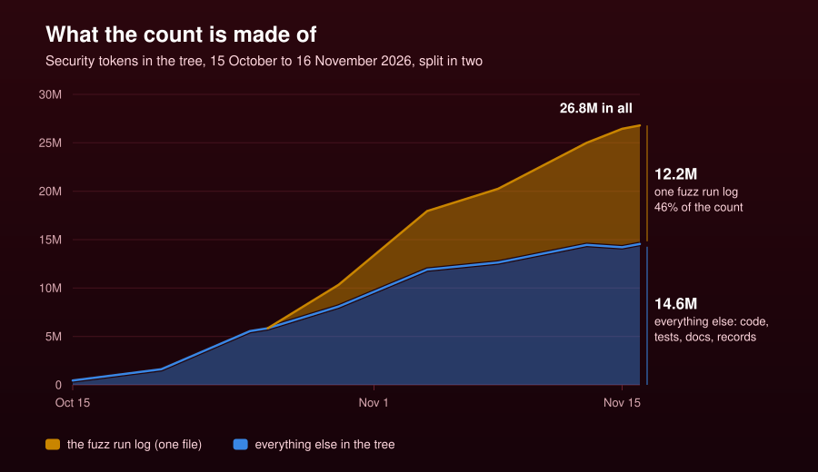

# The project's statistics: the 30-million-token measure

Dated 2026-11-19. Measured on main at commit
1a6ec22e8273021caaf5b4f1e80573d7af123060, the head this
refresh was measured on.

The recorded line, in the display form settled for publication:

30 mil security tokens, 6,000 commits, 1,600,000 lines at 96.31% non-latent code

## What stands behind each figure

- Tokens: <!--hp-fig:tokens_exact-->30,849,887<!--/hp-fig-->, counted over the whole tree by the
  project's own estimator (runner/ops/version4.py). It is the
  measure the version number's 3rd component carries, in whole
  millions: <!--hp-fig:tokens_millions-->30<!--/hp-fig-->. The component holds its figure when a count
  falls back under it: the fold of 2026-11-13 (Q172) took the
  count from over 25 million down to 24,396,328, and the
  component stayed at 25 while the count stood under it.
  Display form: <!--hp-fig:tokens_millions-->30<!--/hp-fig--> mil security tokens. Here security
  tokens is this record's name for the tree's tokens counted
  by the project's own estimator, so called because the tree's
  tokens all serve its security. The short form of the name
  is sec-tokens. Verify it on any checkout:
  `python3 runner/ops/version4.py measure` prints the count and
  its whole millions.
- Lines: <!--hp-fig:lines_tracked-->1,552,002<!--/hp-fig--> lines in tracked files at the measured
  head. The display figure, <!--hp-fig:display_lines-->1,600,000<!--/hp-fig-->, is that count rounded.
- Commits: the display figure, <!--hp-fig:display_commits-->6,000<!--/hp-fig-->, is rounded from a
  full-history count at the measured head, taken from a
  complete clone, which counts <!--hp-fig:commits-->6,316<!--/hp-fig-->. The project's local
  mirrors are shallow (the hook mirror reached 171 commits
  at the 3.16.25.27 head) and cannot count the whole
  history on their own, so every count rests on a complete
  clone. The refresh tool enforces that (Q193): the
  3.16.25.27 refresh ran in a shallow clone and published
  its reachable count, 170, at display 0; the counting
  layer has refused an incomplete history ever since, and
  5,874 was the first count the fixed tool measured.
- Non-latent: 96.31%, from the fresh dormant-code audit
  ([dormant-code-audit-2026-11-16.md](dormant-code-audit-2026-11-16.md), 2026-11-16):
  total latent code held at 3.69% of the tree, with 3.11% in
  near copies, 0.63% in templated lines (the lines of a
  written-out list, equal once the one varying token is
  masked) and 0.02% in exact copies. The audit supersedes
  the 2026-11-13 audit's figures (96.16%, from 3.84%
  total latent, measured before and after the Q172
  fold), whose record stands in
  [dormant-code-audit-2026-11-13.md](dormant-code-audit-2026-11-13.md); the
  family-by-family analysis stands
  in [duplication-audit.md](duplication-audit.md).

The figures in the first 3 entries stand in marked slots,
filled from the facts below at every fresh measure, so the
list is always the measure the header names. The audit's
percentages are set by hand, at each audit.

## The facts, machine-readable

The same figures, in the form the evergreen docs are
generated from. The marked figure slots in this record's own
list above, in AGENTS.md, PROTOCOL.md and
docs/steady/fuzzing.md are filled from this block by
runner/tools/refresh_figures.py, and the guard test
holds them to it; the block is rewritten at each fresh
measure (see the release procedure in the use runbook), with
the core figures exported from runner/ops/core.py, which
stays their source of truth.

```json
{
  "as_of": "2026-11-19",
  "commit": "1a6ec22e8273021caaf5b4f1e80573d7af123060",
  "counter": "runner/ops/version4.py",
  "tokens": 30849887,
  "lines_tracked": 1552002,
  "commits": 6316,
  "display_commits": 6000,
  "display_lines": 1600000,
  "non_latent_percent": 96.31,
  "latent_near_percent": 3.11,
  "latent_exact_percent": 0.02,
  "audit_date": "2026-11-16",
  "core_files": 137,
  "core_lines": 69011,
  "core_lines_nonblank": 62575,
  "core_tokens": 761924,
  "core_assembled_lines": 70130,
  "core_assembled_nonblank": 63576,
  "core_assembled_zip_bytes": 904125,
  "core_assembled_tokens": 773503
}
```

## Verifying these figures against the artifacts

This record is the canonical source for the tree's figures:
every other mention of them in the project's documentation
states the figure with its date and points back here. A reader
with a checkout verifies locally first: re-measure the tree
in front of them with the version4.py command above and run
its tests; a release describes the commit it was cut from,
not a working tree. A reader who wants to check the figures
against the artifacts themselves,
rather than against another document, goes to the published
release: the latest release stands at
https://github.com/Pigeon-Home/homing-pigeon/releases/latest
and carries the wheel, the source distribution, the platform
archives, the project snapshot of the whole tree (its
PROJECT-SNAPSHOT.md indexes every file at the exact commit, and
its CI-SNAPSHOT.json states the facts of the producing build),
and SHA384SUMS, against which any downloaded artifact can be
checked. The release also carries a build-provenance
attestation tying the set to this repository's own workflow;
`gh attestation verify <file> --repo Pigeon-Home/homing-pigeon`
checks it. The snapshot is the tree a visiting system can read
the test suite from when it cannot run the suite itself.

## Why this record stands in the repository

These figures were first assembled in a working lane, off the
repository, and the lane died before the figures landed anywhere
a reader could find them. The project's standing rule is that
work lives in the repository, where it is visible, reviewable,
and carried by the next release cut; a lane outside the repo can
die unseen. The figures therefore stand here, with their measured
basis beside the display line, and the release that publishes
them states this record as its reason.

## The growth of the measure: a snapshot as of 2026-11-08

A dated record, kept for the shape of the growth rather than as
a current figure: the figures at the top of this record are the
current ones, with their own date and measured basis. The 6
points below are evenly spaced across the project's first 24
days, from its first release to the measure of 2026-11-08.
The chart, like the 2 that follow it in this record, was
redrawn later in the look of the project's diagrams, on an
axis that spaces the dates by their days. Every point on it
is a count, and every circle is closed.


| Date | Release | Lines in the tagged tree | Security tokens | Basis |
|------|---------|--------------------------|-----------------|-------|
| 2026-10-15 | v3.7.2 | 41,632 | 447,477 | counted from the tagged tree |
| 2026-10-20 | v3.11.30 | 144,993 | 1,615,732 | counted from the tagged tree |
| 2026-10-25 | v3.12.78 | 378,222 | 5,548,576 | counted from the tagged tree |
| 2026-10-30 | v3.14.42 | 727,924 | 10,334,821 | counted from the tagged tree |
| 2026-11-04 | v3.15.17.156 | 1,127,754 | 17,948,976 | counted from the tagged tree |
| 2026-11-08 | commit d1b8e8a229 | 1,218,733 | 20,251,953 | counted from that commit's tree |

How the points were derived. Each point is taken from that
day's last release tag, and the lines are the line count of the
tagged tree. Every token figure is a count: the tree at the tag
or commit named, checked out and counted by the estimator as it
stands today, the method the fourth snapshot below states in
full. The series was not all counts when it was first recorded.
The token measure was not recorded on the early tags, so the
first 4 points were implied from the lines at about 15.1 tokens
a line (about 0.6M, 2.2M, 5.7M and 11.0M) and drawn as open
circles. The 2026-11-04 point was the version's 3rd component,
17M, and the 2026-11-08 point was the count recorded that day,
20,163,806. At the owner's word the counts took their places on
2026-11-17. The shape is plain: the tree more than tripled in
each of its first 2 steps of 5 days, nearly doubled in each of
the next 2, and added more tokens in each of those 4 steps than
in the one before.

## The growth of the measure, continued: a second snapshot as of 2026-11-15

This second view of the same series keeps the 6 points of the
snapshot above and carries the series a week further, to
2026-11-15, on 2 more. Every point in the series is a count
of the tree at the release named, as in the snapshot above.


| Date | Release | Lines in the tagged tree | Security tokens | Basis |
|------|---------|--------------------------|-----------------|-------|
| 2026-10-15 | v3.7.2 | 41,632 | 447,477 | counted from the tagged tree |
| 2026-10-20 | v3.11.30 | 144,993 | 1,615,732 | counted from the tagged tree |
| 2026-10-25 | v3.12.78 | 378,222 | 5,548,576 | counted from the tagged tree |
| 2026-10-30 | v3.14.42 | 727,924 | 10,334,821 | counted from the tagged tree |
| 2026-11-04 | v3.15.17.156 | 1,127,754 | 17,948,976 | counted from the tagged tree |
| 2026-11-08 | commit d1b8e8a229 | 1,218,733 | 20,251,953 | counted from that commit's tree |
| 2026-11-13 | v3.16.25.1 | 1,497,490 | 25,004,718 | counted from the tagged tree |
| 2026-11-15 | v3.16.26.29 | 1,477,466 | 26,451,259 | counted from the tagged tree |

How the points were derived. The first 6 points are carried
over from the snapshot above, derivation and all. The 2 new
points are counts of the tagged trees too, and each stands
beside the figure its release recorded in its own statistics:
25,004,714 at v3.16.25.1, the measure that first crossed 25
million, where the tagged tree counts 25,004,718, and
26,451,259 at v3.16.26.29, the same to the token. A release
records its measure before its own last edits, so a tagged
tree can stand a few tokens off its own record. The tagged
tree's line count, from the release's own record, stands
beside each figure.

## The growth of the measure, projected: a third snapshot as of 2026-11-16

The second snapshot above ends where the counts end, at
2026-11-15. This third view keeps its 8 points and draws
the 2 lines a reader draws next,
from the last count forward to 2026-12-15: the straight
trend of the 31 days extended unchanged, and an asymptotic
curve that bends toward a ceiling. Everything to the right
of the 2026-11-15 divider is a model, not a measurement;
the chart says so on its face, and the figures below are
the model's, stated so they can be checked against it.


The counted part of the view is the month the second
snapshot records: from 447,477 tokens at the first release
to 26,451,259 at the count of 2026-11-15, 26.0 million
added in 31 days, a 59-fold rise over the starting figure.
The projected part is 2 lines from that last count:

| Line | Form | At 2026-12-15 |
|------|------|---------------|
| Straight trend | the endpoints' slope, about 0.84 million a day, extended unchanged | 51.6M |
| Asymptotic curve | an exponential approach to a ceiling of 38M, from the 2026-11-15 count | 35.8M |
| Ceiling | the asymptote itself | 38M: approached, never crossed |

How the lines were drawn. The straight trend is the slope
the 2 endpoints fix, (26.45 − 0.45) over 31 days, about
0.84 million a day, carried forward unchanged; on that
slope the line passes 38 million in late November without
slowing. The asymptotic curve starts at the same last
count and closes the gap to the ceiling exponentially,
the remaining gap shrinking by a factor of e^(−0.055) each
day, so the rise eases as the curve nears 38 million and
stands 2.2 million short of it at 2026-12-15. Neither line
is a forecast: the first states what the month's pace
would do if nothing changed, the second what growth looks
like when a limit is doing the shaping. Which shape the
real series takes is a question the coming counts answer.

The ceiling is not an arbitrary round number. On
2026-11-16 the conductor raised the project's token goal
from 30 million to 38 million, taking the figure from this
view's ceiling; the goal now stands where the curve bends
toward.

The interactive original of this view stands beside this
record: [security-tokens-asymptotic-view.html](security-tokens-asymptotic-view.html).
It carries the series as it was first recorded and the
same 2 lines, with the ceiling left on a slider, so a
reader who opens the file in a browser can move the
ceiling between 30 and 60 million and watch the curve
re-bend. The chart above carries that page's 2 lines with
the slider set to 38 million, drawn for the record. Its
points are the counts; the page keeps the 4 early points
as they were first implied.

## What the measure is made of: a fourth snapshot as of 2026-11-16

The 3 snapshots above follow 1 figure, the whole tree's
count. This fourth view opens that figure. At each point of
the series the count is split in 2: the fuzz campaign's run
log, which is 1 file (runner/tests/de_dust/runs.jsonl, a
line for every run the campaign banks), and everything else
in the tree. It also puts counts where the earlier snapshots
had to estimate. Every tag in the series still stands in the
history, so each tagged tree was checked out and counted by
the estimator as it stands today, and the 4 early points are
no longer implied from line counts.



| Date | Counted at | Security tokens | In the run log | In everything else |
|------|------------|-----------------|----------------|--------------------|
| 2026-10-15 | v3.7.2 | 447,477 | 0 | 447,477 |
| 2026-10-20 | v3.11.30 | 1,615,732 | 0 | 1,615,732 |
| 2026-10-25 | v3.12.78 | 5,548,576 | 0 | 5,548,576 |
| 2026-10-26 | commit ac34989421 | 5,837,333 | 0 | 5,837,333 |
| 2026-10-30 | v3.14.42 | 10,334,821 | 2,248,896 | 8,085,925 |
| 2026-11-04 | v3.15.17.156 | 17,948,976 | 6,040,688 | 11,908,288 |
| 2026-11-08 | commit d1b8e8a229 | 20,251,953 | 7,618,031 | 12,633,922 |
| 2026-11-13 | v3.16.25.1 | 25,004,718 | 10,551,621 | 14,453,097 |
| 2026-11-15 | v3.16.26.29 | 26,451,259 | 12,240,873 | 14,210,386 |
| 2026-11-16 | v3.17.26.17 | 26,793,953 | 12,240,873 | 14,553,080 |

How the counts were taken. Each row is the estimator's own
count of the tree at the tag or commit named: that tree
checked out into a worktree of a complete clone, and
`python3 runner/ops/version4.py measure --root` run on the
worktree from the current tree, so 1 rule counts every row.
The run log's figure is the same rule over that 1 file, and
everything else is the difference. The row for 2026-10-26 is
the commit before the log's first, so the chart shows the
log entering the tree where it did.

Against the series as first recorded. The 4 early points
first stood in the earlier snapshots as about 0.6M, 2.2M,
5.7M and 11.0M, implied from line counts; counted, they are
447,477, 1,615,732, 5,548,576 and 10,334,821. The implied
figures ran high at each tag, most at the first. The later points were counts already, and the
tagged trees bear them out: 17,948,976 at v3.15.17.156,
whose whole millions are the 17 the version component
carried on 2026-11-04, 25,004,718 against the 25,004,714
recorded at v3.16.25.1, and 26,451,259 at v3.16.26.29, the
recorded figure to the token. A release
records its measure before its own last edits, so a tagged
tree can stand a few tokens off its own record. The count
recorded on 2026-11-08 read 20,163,806; the tree at the
commit named there counts 20,251,953 today, 88,147 more.
The earlier snapshots carry these counts now, in their
charts and in their tables, and the whole series reads on
counts alone.

What the split shows:

- The run log entered the tree on 2026-10-26, under the
  campaign's first name
  (runner/tests/bluemonday/runs.jsonl), and took its
  present path the next day. It holds 12,240,873 tokens at
  the last count: 45.7% of the measure, in 1 file of
  27,198 lines.
- Between the counts of 2026-11-04 and 2026-11-15 the tree
  added 8,502,283 tokens, and 6,200,185 of them, 72.9%,
  were the log's.
- Everything else rose over the same 11 days from
  11,908,288 to 14,210,386, about 0.21 million a day,
  against about 0.56 million a day for the log.
- The log grows when the campaign banks runs and stands
  still between banks. Its last bank before these counts
  was on 2026-11-14, and the last 2 rows carry the same
  figure for it.

Read beside the third snapshot, the split gives each of its
2 lines a plain meaning, and neither is a forecast here
either. Carried 30 days from the 2026-11-15 count, the 2
rates together, about 0.77 million a day, reach about 49.6
million on 2026-12-15, near the straight trend's 51.6M.
Everything else alone, at its own rate with the log
standing still, reaches about 32.7 million, under the
curve's 35.8M. Which line the series follows turns mostly
on that 1 file.

## Where the project stands

The longer series changes what the shape can say. Across the
31 days from the first release to the measure of 2026-11-15,
the tree grew from 447,477 security tokens to 26,451,259,
and since the fourth snapshot every point of that series is
a count of the tagged tree, with nothing implied. The
history behind it stands at <!--hp-fig:commits-->6,316<!--/hp-fig--> commits at the measure
recorded at the top of this record; it stood at 6,004 at the
v3.16.26.29 measure.

The release line has kept pace with the growth. The 3.16 line
ran to 3.16.26.36, the 3.17 line opened on 2026-11-16 with
3.17.26.2 as its first published release, and each release
is published with its artifacts and SHA384SUMS, so the
figures a release carries can be checked against the
artifacts themselves, as the section above describes. The
confinement work widened over the same
period from the Linux sandbox to a backend per platform (a
Job Objects backend on Windows, a jail backend on FreeBSD,
and a Seatbelt backend on macOS), each with hosted proof runs
recorded in the support matrix. On 2026-11-15 the project's
3 Internet-Drafts stood posted on the IETF datatracker in
their current revisions: version 1 at -04, version 2 at -04,
and version 3 at -00, each expiring 19 May 2027.

The measure itself is unchanged throughout: the whole tree,
counted by the project's own estimator, with duplicate and
latent code held at 3.69% of the tree at the audit of
2026-11-16, under the 5% line the project holds itself to,
so the figure continues to stand for the tested surface of
the suite and the protocol rather than for bulk.
