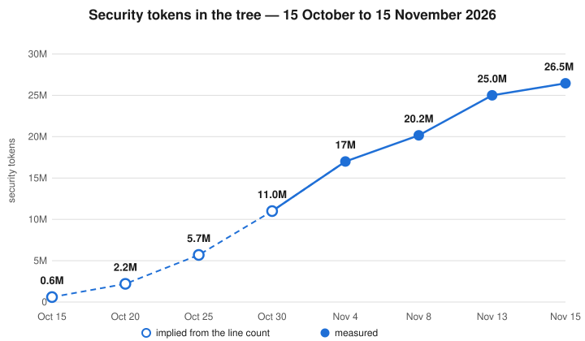

# The project's statistics: the 26-million-token measure

Dated 2026-11-16. Measured on main at commit
8111120ac7f158eda36395e5f42e4b0af40b72e9, the head this
refresh was measured on.

The recorded line, in the display form settled for publication:

26 mil security tokens, 6,000 commits, 1,500,000 lines at 96.31% non-latent code

## What stands behind each figure

- Tokens: 24,396,328, counted over the whole tree by the project's
  own estimator (runner/ops/version4.py) — the same measure the
  version number's 3rd component carries: the version's odometer
  keeps the component at 25, the whole millions the fresh measure
  crossed before the Q172 fold took the count back under it.
  Display form: 24 mil security tokens — security
  tokens is this record's name for the tree's tokens counted
  by the project's own estimator, so called because the tree's
  tokens all serve its security. The short form of the name
  is sec-tokens. Verify it on any checkout:
  `python3 runner/ops/version4.py measure` prints the count and
  its whole millions.
- Lines: 1,433,117 lines in tracked files at the measured head. The display
  figure, 1,400,000, is that count rounded.
- Commits: the display figure, 6,000, is rounded from a
  full-history recount at the measured head, taken from a
  complete clone, which counts 5,874. The project's local
  mirrors are shallow (the hook mirror reaches 171 commits
  at the 3.16.25.27 head) and cannot recount the whole
  history on their own — the recount above rests on the
  complete clone, and any future count should be taken
  the same way. The refresh tool now enforces that
  (Q193): the 3.16.25.27 refresh ran in a shallow clone
  and published its reachable count, 170, at display 0;
  the counting layer has refused an incomplete history
  ever since, and this figure is the first the fixed
  tool measured.
- Non-latent: 96.31%, from the fresh dormant-code audit
  ([dormant-code-audit-2026-11-16.md](dormant-code-audit-2026-11-16.md), 2026-11-16):
  total latent code held at 3.69% of the tree — 3.11% in
  near copies, 0.63% in templated lines (the lines of a
  written-out list, equal once the one varying token is
  masked) and 0.02% in exact copies. The audit supersedes
  the 2026-11-13 audit's figures (96.16%, from 3.84%
  total latent, measured before and after the Q172
  fold), whose record stands in
  [dormant-code-audit-2026-11-13.md](dormant-code-audit-2026-11-13.md); the
  family-by-family analysis stands
  in [duplication-audit.md](duplication-audit.md).

## The facts, machine-readable

The same figures, in the form the evergreen docs are
generated from. The marked figure slots in AGENTS.md,
PROTOCOL.md and docs/steady/fuzzing.md are filled from this
block by runner/tools/refresh_figures.py, and the guard test
holds them to it; the block is rewritten at each fresh
measure (see the release procedure in the use runbook), with
the core figures exported from runner/ops/core.py, which
stays their source of truth.

```json
{
  "as_of": "2026-11-16",
  "commit": "8111120ac7f158eda36395e5f42e4b0af40b72e9",
  "counter": "runner/ops/version4.py",
  "tokens": 26785355,
  "lines_tracked": 1500254,
  "commits": 6089,
  "display_commits": 6000,
  "display_lines": 1500000,
  "non_latent_percent": 96.31,
  "latent_near_percent": 3.11,
  "latent_exact_percent": 0.02,
  "audit_date": "2026-11-16",
  "core_files": 137,
  "core_lines": 68404,
  "core_lines_nonblank": 62021,
  "core_tokens": 755975,
  "core_assembled_lines": 69523,
  "core_assembled_nonblank": 63022,
  "core_assembled_zip_bytes": 897257,
  "core_assembled_tokens": 767554
}
```

## Verifying these figures against the artifacts

This record is the canonical source for the tree's figures:
every other mention of them in the project's documentation
states the figure with its date and points back here. A reader
with a checkout verifies locally first — re-measure the tree
in front of them with the version4.py command above and run
its tests; a release describes the commit it was cut from,
not a working tree. A reader who wants to check the figures
against the artifacts themselves
— rather than against another document — goes to the published
release: the latest release stands at
https://github.com/Pigeon-Home/homing-pigeon/releases/latest
and carries the wheel, the source distribution, the platform
archives, the project snapshot of the whole tree (its
PROJECT-SNAPSHOT.md indexes every file at the exact commit, and
its CI-SNAPSHOT.json states the facts of the producing build),
and SHA384SUMS, against which any downloaded artifact can be
checked. The release also carries a build-provenance
attestation tying the set to this repository's own workflow;
`gh attestation verify <file> --repo Pigeon-Home/homing-pigeon`
checks it. The snapshot is the tree a visiting system can read
the test suite from when it cannot run the suite itself.

## Why this record stands in the repository

These figures were first assembled in a working lane, off the
repository, and the lane died before the figures landed anywhere
a reader could find them. The project's standing rule is that
work lives in the repository, where it is visible, reviewable,
and carried by the next release cut; a lane outside the repo can
die unseen. The figures therefore stand here, with their measured
basis beside the display line, and the release that publishes
them states this record as its reason.

## The growth of the measure: a snapshot as of 2026-11-08

A dated record, kept for the shape of the growth rather than as
a current figure: the figures at the top of this record are the
current ones, with their own date and measured basis. The 6
points below are evenly spaced across the project's first 24
days, from its first release to the measure of 2026-11-08.


| Date | Release | Lines in the tagged tree | Security tokens | Basis |
|------|---------|--------------------------|-----------------|-------|
| 2026-10-15 | v3.7.2 | 41,632 | about 0.6M | implied from lines |
| 2026-10-20 | v3.11.30 | 144,993 | about 2.2M | implied from lines |
| 2026-10-25 | v3.12.78 | 378,222 | about 5.7M | implied from lines |
| 2026-10-30 | v3.14.42 | 727,924 | about 11.0M | implied from lines |
| 2026-11-04 | v3.15.17.156 | 1,127,754 | 17M | measured — the version's 3rd component |
| 2026-11-08 | count at commit d1b8e8a229 | 1,218,733 | 20,163,806 | measured — the count recorded that day |

How the points were derived. Each point is taken from that
day's last release tag, and the lines are the line count of the
tagged tree. The token measure was not recorded on the early
tags, so the first 4 points are implied: the tree's lines at
each tag, multiplied by the ratio the first measured point
gives — on 2026-11-04 the version's 3rd component measured
17M tokens against that tree's 1,127,754 lines, about 15.1
tokens per line. The last 2 points are measured, not implied:
2026-11-04 by the version component itself, and 2026-11-08 by
the count of 20,163,806 taken at commit d1b8e8a229. The implied
points are estimates, shown for the shape of the growth; the
measured points anchor the series at its later end. Read with
that caution, the shape is plain: the tree roughly doubled
every 5 days through October, and the climb steepened into
November.

## The growth of the measure, continued: a second snapshot as of 2026-11-15

The snapshot above stands as it was drawn, with its own date.
This second view of the same series keeps its 6 points exactly
as recorded there and carries the series a week further, to
2026-11-15, on 2 more measured points. From 2026-11-04 on,
every point in the series is measured; the implied points
remain only where the early tags left no count to take.



| Date | Release | Lines in the tagged tree | Security tokens | Basis |
|------|---------|--------------------------|-----------------|-------|
| 2026-10-15 | v3.7.2 | 41,632 | about 0.6M | implied from lines |
| 2026-10-20 | v3.11.30 | 144,993 | about 2.2M | implied from lines |
| 2026-10-25 | v3.12.78 | 378,222 | about 5.7M | implied from lines |
| 2026-10-30 | v3.14.42 | 727,924 | about 11.0M | implied from lines |
| 2026-11-04 | v3.15.17.156 | 1,127,754 | 17M | measured — the version's 3rd component |
| 2026-11-08 | count recorded that day | 1,218,733 | 20,163,806 | measured — the count recorded that day |
| 2026-11-13 | v3.16.25.1 | 1,497,490 | 25,004,714 | measured — the count recorded in that release's statistics |
| 2026-11-15 | v3.16.26.29 | 1,477,466 | 26,451,259 | measured — the count recorded in that release's statistics |

How the points were derived. The first 6 points are carried
over from the snapshot above unchanged, derivation and all.
The 2 new points need no derivation: each is the token count
the release named in the row recorded in its own statistics —
25,004,714 at v3.16.25.1, the measure that first crossed 25
million, and 26,451,259 at v3.16.26.29 — with the tagged
tree's line count from the same record beside it. A reader
with a checkout of either tag reads the same figures in that
tag's copy of this record.

## The growth of the measure, projected: a third snapshot as of 2026-11-16

The second snapshot above ends where the counts end, at
2026-11-15. This third view keeps its 8 points exactly as
recorded there and draws the 2 lines a reader draws next,
from the last count forward to 2026-12-15: the straight
trend of the 31 days extended unchanged, and an asymptotic
curve that bends toward a ceiling. Everything to the right
of the 2026-11-15 divider is a model, not a measurement;
the chart says so on its face, and the figures below are
the model's, stated so they can be checked against it.


The measured part of the view is the month the second
snapshot records: from about 0.6 million tokens at the
first release to 26,451,259 at the measure of 2026-11-15 —
25.9 million added in 31 days, a 44-fold rise over the
starting figure (26.5 ÷ 0.6). The projected part is 2
lines from that last count:

| Line | Form | At 2026-12-15 |
|------|------|---------------|
| Straight trend | the endpoints' slope, about 0.84 million a day, extended unchanged | 51.6M |
| Asymptotic curve | an exponential approach to a ceiling of 38M, from the 2026-11-15 count | 35.8M |
| Ceiling | the asymptote itself | 38M — approached, never crossed |

How the lines were drawn. The straight trend is the slope
the 2 endpoints fix — (26.5 − 0.6) over 31 days, about
0.84 million a day — carried forward unchanged; on that
slope the line passes 38 million in late November without
slowing. The asymptotic curve starts at the same last
count and closes the gap to the ceiling exponentially,
the remaining gap shrinking by a factor of e^(−0.055) each
day, so the rise eases as the curve nears 38 million and
stands 2.2 million short of it at 2026-12-15. Neither line
is a forecast: the first states what the month's pace
would do if nothing changed, the second what growth looks
like when a limit is doing the shaping. Which shape the
real series takes is a question the coming counts answer.

The ceiling is not an arbitrary round number. On
2026-11-16 the conductor raised the project's token goal
from 30 million to 38 million, taking the figure from this
view's ceiling; the goal now stands where the curve bends
toward.

The interactive original of this view stands beside this
record: [security-tokens-asymptotic-view.html](security-tokens-asymptotic-view.html).
It carries the same points and the same 2 lines with the
ceiling left on a slider, so a reader who opens the file
in a browser can move the ceiling between 30 and 60
million and watch the curve re-bend. The chart above is
that page with the slider set to 38 million, drawn for
the record.

## Where the project stands

The longer series changes what the shape can say. Across the
31 days from the first release to the measure of 2026-11-15,
the tree grew from about 0.6 million security tokens (implied)
to 26,451,259 measured, and the later part of that growth
rests on counts taken at the time rather than on estimates
reconstructed afterwards. The history behind it stands at
more than 6,000 commits: 6,004 at the v3.16.26.29 measure,
6,012 at the measure of 2026-11-16 recorded at the top of
this record.

The release line has kept pace with the growth. The 3.16 line
stands at 3.16.26.32, and each release is published with its
artifacts and SHA384SUMS, so the figures a release carries can
be checked against the artifacts themselves, as the section
above describes. The confinement work widened over the same
period from the Linux sandbox to a backend per platform — a
Job Objects backend on Windows, a jail backend on FreeBSD,
and a Seatbelt backend on macOS — each with hosted proof runs
recorded in the support matrix. On 2026-11-15 the project's
3 Internet-Drafts stood posted on the IETF datatracker in
their current revisions: version 1 at -04, version 2 at -04,
and version 3 at -00, each expiring 19 May 2027.

The measure itself is unchanged throughout: the whole tree,
counted by the project's own estimator, with duplicate and
latent code held at 3.69% of the tree at the audit of
2026-11-16 — under the 5% line the project holds itself to —
so the figure continues to stand for the tested surface of
the suite and the protocol rather than for bulk.
