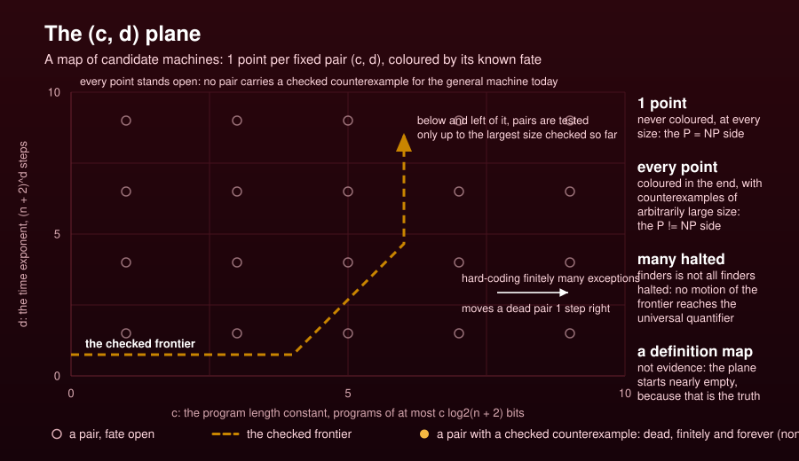

# Three chart candidates, drawn 2026-11-23

This page holds 3 candidate charts for the bottom of
[the statistics record](statistics.md), drawn on 2026-11-23
from that day's work: the squeeze on its second axis, the
chain rule for time bounded Kolmogorov complexity, and the
2 machines that state P versus NP as a pair of searches.
Each candidate is complete on its own. None of them stands
on the statistics page or in the README yet: the conductor
chooses 1, or none, and the choice is a later step. The
closing chart the statistics page already carries stays
exactly as it is either way.

The reading rules bind all 3 candidates, and each chart
carries them on its face.

- Solid marks are measured or proved. Dashed marks are a
  stipulated rule or a counterfactual. Dotted marks are
  conditional under a named premise, and the premise stands
  in the label, on the chart.
- Finite checks are drawn as points, with their counts.
  A point never grows into a line, and a line never claims
  an asymptotic result the points do not carry.
- Every information principle names its measure and its
  error regime: conditional Kt, pnKt, rnKt, rKt or pKt.
  A curve drawn without its measure named is decoration,
  not a claim.
- The charts show trajectories: where the lines are
  heading, whether they come together or push apart, and
  what a crossing or an escape would mean. No chart is a
  forecast, a timeline or a date for knowing an answer.
- No milestone is claimed that the numbers do not show.
  The whole tree stands at 34,415,959 tokens at the count
  of 2026-11-23, and the 38 million line stands approached,
  never crossed, on every chart here as on the record.

## Candidate A: the squeeze, second axis

What it shows. The proof work's own squeeze, drawn as a
schematic instead of a curve. For 1 frozen scope, with the
object, the observation alphabet, the build, the
configuration, the environments and the starting conditions
all fixed, 3 sets stand inside each other: witnessed (L)
inside actual (B) inside permitted (U), at 1 observation.
The part of the scope not yet characterized is drawn
hatched and marked unknown, because it is unknown: the
chart gives it no size, no share and no boundary of its
own. That B sits inside U is itself an obligation of the
scope, to be argued, not a gift of the drawing. If L = U
is established for the scope, the 2 inclusions give
B = L = U at that observation; a coarse projection does
not identify distinctions it has erased.

Why the curve is gone. The first drawing of this candidate
plotted a rising witnessed share of the permitted set on
its vertical axis, starting at 0.32. That start was
208,556,359 divided by 651,086,719: the share of recorded
attempts carried by targets tied to a constraint. A share
of recorded attempts is not a fraction of permitted
behaviours with checked witnesses. Attempts can repeat, or
land on the same behaviour twice, and the permitted set is
not the denominator of an attempt count. No measured
coverage curve exists for this scope, so none is drawn.
What would make one possible stands under its own heading
below.

The figures beside the schematic. 3 dated figures stand in
separate rows on the chart, each with its own date and its
own denominator, all from the bindings count of
2026-11-20:

- 18 of 31 fuzz targets tied to a constraint. The
  denominator is the 31 targets.
- 12 of 13 stated properties carrying a named model. The
  denominator is the 13 properties; 1 property carries
  observed execution alone, with no model behind it. This
  is a property model share, a third quantity, distinct
  from both of the others.
- 208,556,359 of 651,086,719 recorded attempts on the tied
  targets, about 32 percent. The denominator is the
  recorded attempts; the same count stands at 35,270 grow
  runs. It is not any set of behaviours.

None of the 3 is a share of the permitted set, and the
chart says so on its face.

The recurrence, in a box of its own. The token thought
experiment stands apart from the schematic, in a labelled
box: an illustrative conditional recurrence. Its starting
integer is stipulated: 3,393,230, the modeled token size
gap at the count of 2026-11-19, a modeled token quantity
and not a count of uncharacterized behaviours. Its rule is
stipulated: at least 0.39 of the remainder closes each
week, so under the rule alone the value stands at 1 in
week 29 and at zero by week 30. An earlier draft of this
page called the same rule measured in 1 sentence and
assumed in the next; the rule is stipulated, and the page
now says only that. The same draft also ran the count of
2026-11-19 and the bindings count of 2026-11-20 together
as 1 initial measurement; they are 2 distinct
measurements, and they stand apart here. The recurrence
supplies no transition rule for behaviour coverage, and
its units are never labelled uncovered behaviours. The
token trajectory itself stays in the closing chart the
statistics page already carries, with its corrected
by week 30 wording.

What a true coverage curve would need. A fixed finite
universe, or a specified finite quotient of one; a
complete denominator; distinct behaviour IDs; and
independently validated witness mappings, with an argument
that the implementation's relevant behaviours lie within
the abstraction. When those stand, an empirical coverage
curve becomes possible, and not before.

What it would mean, and what it would not. If the sets
meet, this 1 frozen scope is characterized exactly, and a
universal safety property over all permitted behaviours
already holds of the real ones without the meeting. It
would mean nothing about any other scope, and nothing
about P versus NP. The chart says so on its face.

Strength and limit. This is the safest candidate, and the
rebuild keeps it that way: every solid mark on it is the
project's own proved or measured material, each under its
own denominator, and the 1 picture that used to borrow a
denominator it had not earned is now a schematic that
borrows nothing. Its limit is unchanged: it describes the
proof work, not the day's P versus NP structure, and the
hinge of the day does not stand on it.

## Candidate B: trajectories

What it shows. The fates of the day's work, drawn in the
grammar of the Schwarzschild trajectory diagrams of
general relativity: boundaries that separate 2 regimes,
trajectories that end on a boundary, trajectories that
escape past every boundary, and trajectories that push
apart. The borrowed content is the drawing grammar only,
boundaries and fates. No field equation governs these
curves, and the chart says so on its face. In relativity
the diagram does not say when a particle falls in; here
the chart does not say when, or whether, the question
settles. It shows where the lines are heading.

Axes and quantities. The horizontal axis is scale,
log2(n + 2), with the formula size n growing to the right;
the chart labels it scale, not time, and no calendar stands
anywhere on it. The vertical axis is the normalized Levin
cost, L(F) divided by log2(n + 2), over satisfiable
formulas F, where L(F) is the minimum, over programs that
output a verified satisfying assignment, of the program
length plus the ceiling of log2(t + 1) for the running
time t. The definition stands on the chart.

The boundary family. Horizontal dotted lines stand at each
fixed constant a, each labelled with its fixed c absorbed:
a conditional line, not a result. There is no single
P = NP line, because the claim is that some 1 line holds
for every satisfiable F; the chart draws the family and
says so. The region under any 1 such line, holding
universally, is exactly the P = NP side of the equivalence
the day's work verified: P = NP if and only if fixed a and
c exist with L(F) at most a log2(n + 2) + c for every
satisfiable F.

The trajectories. 3 stand drawn. The converging trajectory,
solid amber, is a witness family whose normalized cost
settles under 1 fixed bound and stays there as n grows:
the direction of the P = NP side, with its label carrying
the limit that 1 family is not every formula. The escaping
trajectory, solid teal with its arrow leaving the top
right, is a counterexample family crossing each fixed bound
in turn: the shape the P != NP side needs, for every pair
(a, c), at arbitrarily large size, and still short of the
universal proof on its own. The pushing apart pair, 2 thin
white curves at the lower left, is a symmetry of
information computation read from its 2 sides and
disagreeing: proved apart, as a theorem, for rKt and for
pKt (Hu, Manor and Oliveira, ECCC TR26-021, 16 February
2026). Every curve names its measure.

The hinge. A vertical band at the centre marks the hinge
of the day: the chain rule for conditional time bounded
Kolmogorov complexity, with error o(N) (Kabanets and
Kolokolova, ECCC TR25-089; revision 1 of 13 March 2026;
STOC 2026). The verified form, stated here in full: the
chain rule with that error is equivalent to the
conjunction of E outside io-SIZE[2^o(n)] and GapMcKtP in
promise-P, and under the GapMcKtP hardness assumption it
collapses to chain rule if and only if P = NP. The chart's
own settling box carries the conditional form and the
asymmetry the day's ledger work established: P = NP alone
implies the exact chain rule with no hardness premise, so
refuting the exact rule would imply P != NP. The 2
directions do not carry the same premises, and the chart
does not draw them symmetrically.

Conditional, labelled as such. Dotted beside the diverging
pair stands the pnKt trajectory holding together, labelled
a hypothesis: if worst case symmetry of information for
pnKt holds, then TAUT is not in AM, hence P != NP
(Goldberg, Hu, Lu, Lyu and Oliveira, ECCC TR26-290,
14 October 2026, Theorem 2). The same paper's Theorem 3
gives an oracle where the symmetry fails strongly, so any
proof of the hypothesis must be non-relativizing; the
chart carries that too. The hypothesis is not established,
and nothing dotted on this chart is a result.

Measured. 3 points only, drawn as points in the lower left
and captioned with their counts: the worked example check
of 800 fixed seed tree instances with 53,272 assignments
scored against brute force; the corpus counts of
651,086,719 inputs over 35,270 grow runs; the bindings
count of 31 targets with 18 bound. The caption states what
finite checks are: they can falsify a candidate, and they
settle no bound. The day's second machine pair, the
procedure named Improve and its gap on 1 formula, stands
behind the boundary family rather than in a panel of its
own: a uniform polynomial time Improve closing every
formula's gap between its 2 sound bounds is equivalent to
P = NP by the same equivalence, and 1 formula's closing
would prove nothing asymptotic.

Settling events, stated as events. A box on the chart names
what would settle the picture: a proof that some fixed
(a, c) bounds every satisfiable F; or a proof that for
every (a, c) a defeating F exists; or a proof or a
refutation of the chain rule in its named error regime.
Until 1 of those happens, every curve on the chart is a
direction, not a destination reached.

Strength and limit. This candidate alone carries the whole
of the day: the hinge with its asymmetric premises, the
dual machines, the pnKt hypothesis with its consequence
and its oracle barrier, and the proved rKt and pKt
divergence as the standing warning to name the measure.
Its limit is density: it needs its captions, and the
captions stand inside the chart itself, so a copy cropped
away from them is not the chart.

## Candidate C: the (c, d) plane

What it shows. The day's 2 machines drawn as a map of the
pairs they range over. Fix a universal interpreter U with
efficient simulation in both directions. The machine
A(c, d) enumerates every U program of length at most
c log2(n + 2), runs each on the formula for at most
(n + 2)^d steps, and verifies any satisfying assignment
produced. P = NP if and only if some fixed c and d exist
for which A(c, d) finds a witness for every satisfiable
formula. The second machine, CounterexampleFinder(c, d),
enumerates formulas by brute force and returns a
satisfiable formula that defeats A(c, d), with its
satisfying assignment, whenever 1 exists; every return is
a real, finitely checkable fact about that 1 pair.

Axes and quantities. Both axes are constants, not data.
The horizontal axis is c, the program length constant. The
vertical axis is d, the time exponent. The plane is a space
of candidate machines, 1 point per fixed pair, and each
point is coloured by its known fate: a point turns amber
when CounterexampleFinder(c, d) has returned a checked
counterexample, and that pair is then dead, finitely and
forever.

The trajectories. A dashed frontier line sweeps the plane:
the largest formula size checked so far. Below and left of
the frontier, pairs stand tested only up to that size, and
the frontier's motion is the corpus work, today the 800
instance checks and the grow run counts. An arrow at the
side carries the reason the separation side needs
arbitrarily large counterexamples: hard-coding finitely
many exceptions moves a dead pair to a live pair 1 step
right, so P != NP needs, for each pair, counterexamples of
arbitrarily large size, not finitely many.

Measured, assumed, conditional. Nothing on this plane is
assumed, and nothing on it is conditional: the plane is a
definition map, not evidence. What is measured is which
pairs carry checked counterexamples at which sizes, and
today that count for the general machine stands at none.
The chart therefore starts almost entirely uncoloured, and
it says so on its face: every point stands open. The
P = NP side is the statement that at least 1 point never
turns amber, at formulas of every size. The P != NP side
is the statement that every point turns amber in the end.
No motion of the frontier reaches the universal quantifier,
and the chart states that too: many halted finders is not
all finders halted.

Strength and limit. This is the crispest picture of the
honest core of the day: why finite evidence, however large,
cannot settle the question by accumulation. Its limit is
the same honesty read from the other side: a nearly empty
field reads as a map of what is not known rather than a
picture of the day's work, and the chain rule hinge and
the symmetry results do not stand on it at all.

The finite toy version of this plane, completely enumerated under a tiny teaching interpreter, stands at [the finite toy map](../proofs/finite-toy-map-2026-11-23.md).

## Sources

The day's structures stand in the forum record of
2026-11-23 and in the proofs: the Levin measure and its 2
implications, the Improve equivalence and its dual, the
squeeze on 1 frozen scope, and the chain rule as the hinge
lemma with its verified form and its asymmetry. The papers
are Kabanets and Kolokolova, ECCC TR25-089, revision 1 of
13 March 2026, STOC 2026; Goldberg, Hu, Lu, Lyu and
Oliveira, ECCC TR26-290 of 14 October 2026; and Hu, Manor
and Oliveira, ECCC TR26-021 of 16 February 2026. The counts
stand in [the statistics record](statistics.md) and in the
bindings registry it cites. The drawing grammar of
candidate B follows the trajectory diagrams of Schwarzschild
geometry, and the profile curves of the algorithmic
statistics literature stand behind its axes: Bennett's
logical depth, the computational depth of Antunes and
Fortnow, and the stochasticity profile of Vereshchagin and
Shen.
