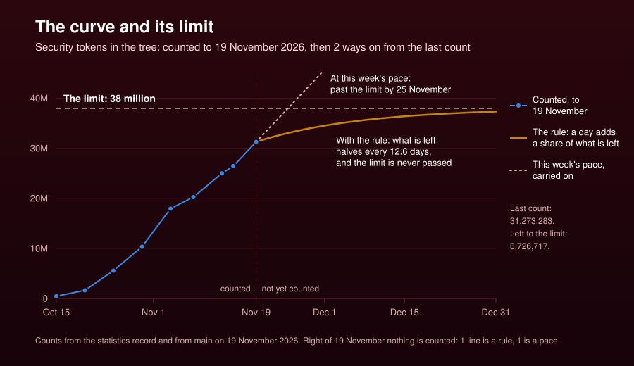

# The curve: a limit at 38 million

The owner asked for the proof that the count of security
tokens has an upper limit, and said it is easy. It is. It
is the calculus of a limit, and a child can check each
step. This page is that proof, and what the counts say
beside it.

## In short

- **1 rule gives the limit.** Each day the count may grow
  by at most a fixed share of what is left to 38 million.
- **Then the count never passes 38 million.** What is left
  gets smaller by the same factor each day, and it is never
  all gone.
- **It is Newton's law of cooling.** The count nears its
  limit the way a warm thing nears the air of the room.
- **The counts do not keep the rule yet.** The rule allows
  0.36 million on the next day. The last 4 days ran at 1.21
  million a day.
- **What the campaign finds already keeps it.** Its finds
  level off toward a limit near 25,000.
- **The count is 2 lines, and each needs a limit of its
  own.** Everything but the run log levels off near 16 to
  18 million. The run log has no limit yet.
- **A rule on the steps gives the limit as a result.**
  Nobody has to name it first.
- **A chart can show a limit. It cannot prove 1.**

## The picture

The points are counts. The flat line is the limit. Right of
19 November nothing is counted yet. The curve is what the
rule draws from the last count. The dotted line is what the
last 4 days' pace draws: it passes the limit by 25 November.

## The claim

Keep 1 rule, and the count of security tokens never passes
38 million. It has a limit. If each day uses what the rule
allows, that limit is 38 million itself.

## The rule

Pick a share. Call it k. It is more than 0 and less than 1.

**On each day, the count may grow by at most k times what
is left to 38 million at the start of that day.**

## The proof

Write G for what is left: 38,000,000 less the count.

**Step 1. Something is always left.** A day's growth is at
most k times G. So at the end of the day, what is left is
at least G less k times G. That is (1 - k) times G. It is
more than 0, because k is less than 1. So if something is
left this morning, something is left tonight. Something was
left on the first morning. So something is left on every
day, and the count is under 38 million on every day.

**Step 2. The count settles.** Let the count not fall, as a
tree that is only added to does not. By step 1 it does not
pass 38 million. A quantity that never falls and never
passes a bar has a limit, at the bar or under it. That is
the first theorem about limits in the calculus.

**Step 3. The limit is 38 million.** Let each day use all
that the rule allows. Then what is left is multiplied by
(1 - k) each day. After n days it is (1 - k) to the power
n, times what was left at the start. A number under 1,
multiplied by itself again and again, goes to 0. So what is
left goes to 0, and the count goes to 38 million. It gets
as near as anyone asks, and it does not arrive.

A share of a half shows it in 1 line. Of 8 left, a day
takes 4, then 2, then 1, then a half. There is always half
of something left.

## It is Newton's law of cooling

Said for every moment and not day by day, the rule is: the
count grows at a rate of k times what is left. Newton wrote
that law for a warm thing in a cool room, where the rate of
cooling is in proportion to how much warmer the thing still
is. Its curve is the same curve:

    count = 38,000,000 - (what was left at the start)
                         x e^(-k x days)

The record drew this curve on 2026-11-16, in the third
snapshot of `statistics.md`, with k at 0.055 a day. Taken
day by day that is a share of 5.35%.

## The numbers, from the last count

The last count is 31,273,283, on main on 19 November. What
is left is 6,726,717. With the record's share:

| Day | Left at the day's start | The day may add | Count at the day's end |
|----:|------------------------:|----------------:|-----------------------:|
| 1 | 6,726,717 | 359,979 | 31,633,262 |
| 2 | 6,366,738 | 340,715 | 31,973,977 |
| 7 | 4,835,996 | 258,798 | 33,422,801 |
| 14 | 3,290,657 | 176,099 | 34,885,442 |
| 30 | 1,364,908 | 73,043 | 36,708,135 |
| 60 | 262,131 | 14,028 | 37,751,897 |

What is left halves every 12.6 days. 1 million is left
after 35 days.

Counted in whole tokens, the rule allows 0 once fewer than
19 are left. So the count stops 18 tokens short of 38
million, after 244 days, and stays there.

## What the counts say now

**The test for a limit.** Take 3 counts the same number of
days apart: A, then B, then C. Under the rule the second
step is shorter than the first by a fixed factor. Call it
r: (C - B) over (B - A). If r is under 1 the curve levels
off, and its limit is C plus (C - B) times r over (1 - r).

**The count of tokens does not level off yet.** Its steps,
from the record's counts and the last count:

| Between the counts of | Added | A day |
|-----------------------|------:|------:|
| 4 and 8 November | 2,302,977 | 0.58 million |
| 8 and 13 November | 4,752,765 | 0.95 million |
| 13 and 15 November | 1,446,541 | 0.72 million |
| 15 and 19 November | 4,822,024 | 1.21 million |

The steps are not getting shorter. The rule allows 0.36
million on the next day, and the last step ran at more than
3 times that.

**What the campaign finds does level off.** The fuzz run
log's finds, new arcs and new entries, summed to each day:

| 3 days, the same number of days apart | Finds by each | The 2 steps | r | The limit |
|---------------------------------------|---------------|-------------|--:|----------:|
| 30 October, 8 November, 17 November | 21,840, 23,214, 23,916 | 1,374 then 702 | 0.51 | 24,649 |
| 4, 11 and 18 November | 22,834, 23,478, 23,988 | 644 then 510 | 0.79 | 25,929 |

By both, what these readers can find has a limit near
25,000, and 23,988 were found by 18 November.

So the knowing levels off and the count does not. The rule
is what ties the count to the knowing.

## Why the rule can be kept

What is still to be added is of 2 kinds.

- **Closed work.** A claim, proven, with its suite. It is
  added once and it is a fixed size. The join is what makes
  it closed: under the machine M every row of any length is
  1 of 14 kinds, so a longer row needs no new proof.
  `v4-the-motor.md` and `v4-the-ladder.md` carry that. A
  sum of finitely many fixed sizes fits under any bar that
  is set above it.
- **Open work.** A record of tries. It grows with the time
  spent, whatever is found. This is the part that breaks
  the rule today. It keeps the rule if it is written by
  what it finds. The finds have a limit, so a record that
  adds so much for each find has a limit too.

A first sum, with each part's source in this seat's notes
on the token curve, in the project folder:

| Part | Tokens |
|------|-------:|
| The last count | 31.27 million |
| The proof still owed: 31 constraints, up to 3 claims each | 1.0 to 2.9 million |
| The run log, at 658 tokens a find, which is its 16,318,670 tokens over its 24,804 finds, from 23,988 finds to the limit of its finds | 0.4 to 1.3 million |
| Together | 32.7 to 35.5 million |

That is under 38 million with room. It leaves out the
growth of the docs, the forum and the other tests, which
this page has not sized.

**The ladder has a limit of its own.** Each step of the
series over the step before goes to 1.618. Growing by a
fixed factor reaches any size in few steps. Step 31 passes
the cap of 1,048,576. Step 38 is 39,088,169, the first step
past 38 million. A claim that joins is carried to a size of
38 million in 38 steps, and not in 38 million.

## The rule, as a line a seat can check

At a release, 3 steps of arithmetic:

1. What was left at the day's start: 38,000,000 less the
   count then.
2. The day's allowance: 0.0535 times that.
3. The day's growth, the count now less the count then, is
   not more than the allowance.

This is a candidate. It has no number in the constraint
inventory and it is in no draft. The share and the ceiling
are the owner's to set.

## The second question: is 1 limit enough

The owner asked next: is a flat line on a chart not a
presumption, which has to be proven? Does the proof need a
rule of the second degree, or more limits, 1 or 2? The 6
sections below answer. What this seat expected before it
measured is in its notes on limits and bars, in the project
folder.

## The test is of the second degree

The test for a limit above takes 3 counts. Written with
differences, it is this:

    limit = last count
            + (last step) x (last step)
              / (how much shorter the last step is
                 than the step before it)

A step is a first difference. How much shorter it got is a
second difference. So the test reads how the line turns,
and not only where it stands. It has been known since 1926
as Aitken's delta-squared process.

For everything but the run log, on 20 October, 4 November
and 19 November: the last step is 3,046,267, and it is
7,246,289 shorter than the step before it. So the limit is
14,954,555 plus 1,280,620. That is 16,235,175.

The 2 forms give the same number to the token on every row
of this page, and on 1,000 draws.

## 2 limits, and the third follows

The count is 2 lines. 1 file, the fuzz run log, is the
first. Everything else is the second.

The same test, on the same 3 days:

| The line | 20 October | 4 November | 19 November | The second step over the first | The limit |
|----------|-----------:|-----------:|------------:|-------------------------------:|----------:|
| Everything else | 1,615,732 | 11,908,288 | 14,954,555 | 0.30 | 16.2 million |
| The run log | 0 | 6,040,688 | 16,318,728 | 1.70 | none |
| The whole | 1,615,732 | 17,948,976 | 31,273,283 | 0.82 | 90.3 million |

The 2 lines keep different laws. 1 limit for the whole
hides that: under a single line at 38 million, the log can
take the room that everything else has not used. So each
line needs a limit of its own, with a reason of its own.

**The third follows.** If everything else has a limit E and
the log has a limit G, the whole has the limit E plus G.
That is a theorem about limits. It turns the line at 38
million from a thing presumed into a thing that follows.

**Where everything else stops, by 4 readings.**

| The reading | Everything else stops at |
|-------------|-------------------------:|
| 3 counts, 15 days apart | 16.2 million |
| 3 counts, 10 days apart, on each of the last 8 days | 14.6 to 17.0 million |
| The falling line it has stayed under, below | under 17.6 million |
| Its last count, plus the proof still owed, above | 16.0 to 17.9 million |

**What that leaves for the log.** Under 38 million, 20 to
22 million. It stands at 16.3 million, and no reading gives
it a limit.

## A reading is believed while it stands still

Each new day moves the limit that 3 counts point at. So
this seat counted each day's tree on main, 15 October to
19 November: the last landing of each day, as it stood on
the evening of 19 November, by the estimator's rule.

    python3 runner/tests/test_v4_the_curve.py series

counts them again from a complete clone. The 2 rows of the
record that name a commit agree with it to the token.

| The 3 counts end on | Everything else, 10 days apart | The whole, 15 days apart |
|---------------------|-------------------------------:|-------------------------:|
| 16 November | 16.24 million | 49.84 million |
| 17 November | 16.33 million | 71.59 million |
| 18 November | 16.67 million | 86.14 million |
| 19 November | 16.95 million | 96.62 million |

The first has stood within 2.4 million on each of the last
8 days. The second rose by 47 million in 3 days. A limit
that climbs as fast as it is read is not a limit yet.

**The step has to be long enough.** With 3 counts 7 days
apart, everything else gives no limit at all on 2 of the
last 8 days, and from 14.75 to 47.65 million on the other
6. 1 day's landing can be as large as a week's step. At 10
days apart the reading holds still.

**The run log gives none.** Not at 7 days apart, not at 10,
not at 15, on any of the last 6 days.

## A second rule: on the steps

The first rule names the limit, and gives each day a share
of what is left. A rule of the second degree names no
limit. It speaks of the steps alone.

**Each day's allowance is at most r times the allowance of
the day before, with r under 1.**

Call the allowance of the day before the first S.

**Step 1.** Day n is allowed at most S times r to the power
n.

**Step 2.** So the first n days add at most S times
(r + r x r + ...), n terms. That sum is S times r times
(1 - r to the power n) over (1 - r). It is under S times r
over (1 - r) for every n.

**Step 3.** So the count never passes where it stands plus
S times r over (1 - r). A quantity that does not fall and
does not pass a bar has a limit.

The limit is a result here. Nobody names it first.

**A day of nothing closes no door.** The allowance falls by
r whatever was added. A rule on what was added would allow
0 for ever after 1 day of 0.

**It is the same curve.** Under the first rule with every
allowance used, each day's step is (1 - k) times the step
before it. So the first rule keeps this rule with r at
1 - k, and this rule's bar is then the first rule's limit.

**The numbers.** From this week's pace, 1.21 million a day:

- For a bar at 38 million, r is 0.848. Each day is allowed
  15% less than the day before.
- At the record's rate, r is 0.9465, and the bar is 52.6
  million.

**Everything else has kept this rule since its largest
week.** Its largest 7 days ended on 31 October: 6,486,136.
On each of the 19 days since, the 7 days that end there
added less than a line that falls by 0.61 a week from that
top. The least r that holds is 0.602. If everything else
stays under that line, the weeks to come add under 2.7
million, and it never passes 17.6 million.

**The run log has not.** Its largest 7 days ended on
18 November: 8,295,873.

## A curve of the second degree has no flat line

A parabola is thrown away. Through the 3 counts of
everything else it peaks late on 17 November at 14,977,518,
and it is at 0 on 18 December. A tree does not do that.
Through the 3 counts of the run log it rises without end:
49.6 million for the log alone by 19 December.

So the second degree is kept as a test and as a rule, and
thrown away as a curve.

## Counts cannot prove a limit

2 curves pass through the same 3 counts of everything else,
and neither ever falls. The first is the curve of the test.
Its limit is 16.2 million. The second is the first plus
days x (days - 15) x (days - 30) tokens. It passes 38
million within a year, and every bar after that.

The other way too. The run log's 3 counts point at no
limit, and they lie on a curve that has 1: a log that is
written no more after the third count.

So a chart can show a limit. It cannot prove 1. A flat
line on a chart is a presumption, and what proves it is 1
of 2 things.

- **A rule that is kept, with something that refuses to
  pass it.** For a job, the system refuses: a bar on a
  job's time is a limit that is enforced. `v4-the-bars.md`
  lists those bars, and the quantities that have none. For
  the count of tokens nothing refuses yet. The 3 steps of
  arithmetic above could be asked at a release.
- **A reason why the work is finite.** Closed work is a
  sum of finitely many fixed sizes. A record written by
  what it finds is bounded by its finds.

## What is proven, and what is not

- **Proven:** under the rule, the count is under 38 million
  on every day, it has a limit, and with the allowance used
  the limit is 38 million. The 3 steps above are the whole
  proof. The suite walks them with whole tokens for 5,000
  days at 6 shares, with a day's growth drawn at random
  under the allowance.
- **Proven:** under the rule on the steps, the count never
  passes where it stands plus S times r over (1 - r). 3
  steps again, walked for 2,000 days at 4 shares.
- **Proven:** the 2 forms of the test for a limit are 1
  number, and a limit for each line gives the limit of the
  whole.
- **Not proven, because it is a choice:** that either rule
  will be kept. The counts say the first is not kept yet.
- **Read off the counts, and not proven:** that everything
  but the run log stops near 16 to 18 million. 4 readings
  agree. A reading is not a proof.
- **Not there at all:** a limit for the run log.
- **Not claimed:** that 38 million is the right ceiling. It
  is the owner's goal of 2026-11-16, taken from the
  record's curve.

`runner/tests/test_v4_the_curve.py` holds the arithmetic on
this page.
