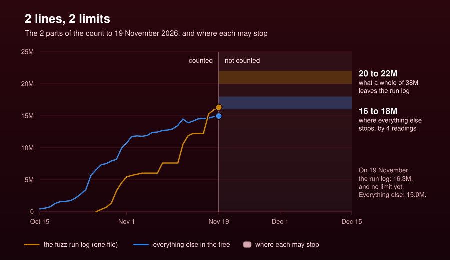

# The curve: limits that follow from a rule

The owner asked for the proof that the count of security
tokens has an upper limit, and said it is easy. It is. It
is the calculus of a limit, and a child can check each
step. This page is that proof, and what the counts say
beside it.

The first number this page carried was 38 million. It was
named before the counts were read. At the owner's word of
2026-11-20, no limit on this page is named first. Each
follows from a rule the counts have kept, and the page says
what would show it wrong.

## In short

- **1 rule gives a limit.** Each 7 days add less than a
  line that falls by 0.61 a week.
- **Then the limit is a result.** The weeks to come add
  less than a fixed amount. Nobody names the limit first.
- **Everything but the run log has kept that rule for 19
  days.** Its limit follows: 17.6 million.
- **The run log keeps no rule yet.** If it keeps the same
  rule from 19 November, its limit is 28.4 million.
- **The whole follows from the 2.** 46.0 million, and it
  stands on that if.
- **1 count can show each number wrong.** The page says
  what each coming week may add, to the token.
- **It is Newton's law of cooling.** The count nears its
  limit the way a warm thing nears the air of the room.
- **What the campaign finds already levels off.** Its finds
  level off toward a limit near 25,000.
- **A chart can show a limit. It cannot prove 1.**

## The picture

The points are counts. Right of 19 November nothing is
counted yet. The curve is what the rule allows from the
last count, and the flat line is the limit it nears. The
dotted line is the last 4 days' pace carried on: it passes
that limit by 2 December.

## Where the numbers come from

**The rule.** Take any day, and what the 7 days that end on
it added. The largest such 7 days is the top. From the top,
draw a line that falls by 0.61 a week. Call that number r:

    line on a day = top x r^(days since the top / 7)

The rule is that the 7 days ending on each day add less
than the line on that day.

**Where 0.61 comes from.** It is read off the counts.
Everything but the run log has stayed under that line on
each of the 19 days since its top. The least r that holds
is 0.602, and 0.61 is the next number of 2 digits above it.

**The 3 lines.**

| The line | It stands at, 19 November | Its largest 7 days | The line on 19 November | The weeks to come add under | The limit |
|----------|--------------------------:|--------------------|------------------------:|----------------------------:|----------:|
| Everything else | 14,954,760 | 6,486,136, ended 31 October | 1,695,547 | 2,652,010 | 17,606,770 |
| The run log, if it keeps the rule from 19 November | 16,318,728 | 8,295,873, ended 18 November | 7,730,275 | 12,090,943 | 28,409,671 |
| The whole | 31,273,488 | | | 14,742,953 | 46,016,441 |

**The sum.** The weeks that end 7, 14, 21 days after 19
November add less than the line on those days: the line of
19 November times 0.61, then times 0.61 again, and so on.
All of them together add less than the line of 19 November
times 0.61 over (1 - 0.61). The proof is the second rule,
below.

**What would show a number wrong.** What each coming week
may add, in whole tokens, and where each line stands at
most at the week's end:

| The 7 days ending | Everything else may add | and stands at most at | The run log may add | and stands at most at | The whole stands at most at |
|-------------------|------------------------:|----------------------:|--------------------:|----------------------:|----------------------------:|
| 26 November | 1,034,283 | 15,989,043 | 4,715,467 | 21,034,195 | 37,023,238 |
| 3 December | 630,913 | 16,619,956 | 2,876,435 | 23,910,630 | 40,530,586 |
| 10 December | 384,857 | 17,004,813 | 1,754,625 | 25,665,255 | 42,670,068 |
| 17 December | 234,762 | 17,239,575 | 1,070,321 | 26,735,576 | 43,975,151 |
| 24 December | 143,205 | 17,382,780 | 652,896 | 27,388,472 | 44,771,252 |
| 31 December | 87,355 | 17,470,135 | 398,266 | 27,786,738 | 45,256,873 |

If the 7 days ending on 26 November add more than
1,034,283 to everything but the run log, the rule is
broken and 17.6 million no longer follows. This page then
says so. The same holds for each cell of the table.

**If r were another number.** The limit follows from r. So
r is the 1 thing to choose:

| r, a week | Everything else | The run log, on the same if | The whole |
|-----------|----------------:|----------------------------:|----------:|
| 0.61, the least of 2 digits the counts have kept | 17.6 million | 28.4 million | 46.0 million |
| 0.65 | 18.7 million | 30.8 million | 49.5 million |
| 0.70 | 20.7 million | 34.7 million | 55.4 million |
| 0.80 | 29.1 million | 48.5 million | 77.6 million |

With r under 0.602, the counts of everything else have
already passed the line.

**The first number here was 38 million.** It was the goal
of 2026-11-16, taken from the curve the record drew that
day. What the counts say of it:

- At the last 4 days' pace, 1.21 million a day, the whole
  passes 38 million on 25 November.
- For the whole to stop at 38 million from that pace, each
  day would have to be allowed 15% less than the day
  before: r is 0.848 a day.
- At the record's rate, r is 0.9465 a day, and the whole
  stops near 52.6 million.
- Under the rule above, the whole may stand at 37,023,238
  on 26 November and at 40,530,586 on 3 December.

So 38 million is neither kept by the counts nor given by a
rule. It stays here as the page's first number, and no
chart carries it.

## The first rule: a share of what is left

Name a limit. Call it L. Pick a share. Call it k. It is
more than 0 and less than 1.

**On each day, the count may grow by at most k times what
is left to L at the start of that day.**

Keep that rule, and the count never passes L. It has a
limit. If each day uses what the rule allows, that limit
is L itself.

## The proof

Write G for what is left: L less the count.

**Step 1. Something is always left.** A day's growth is at
most k times G. So at the end of the day, what is left is
at least G less k times G. That is (1 - k) times G. It is
more than 0, because k is less than 1. So if something is
left this morning, something is left tonight. Something was
left on the first morning. So something is left on every
day, and the count is under L on every day.

**Step 2. The count settles.** Let the count not fall, as a
tree that is only added to does not. By step 1 it does not
pass L. A quantity that never falls and never passes a bar
has a limit, at the bar or under it. That is the first
theorem about limits in the calculus.

**Step 3. The limit is L.** Let each day use all that the
rule allows. Then what is left is multiplied by (1 - k)
each day. After n days it is (1 - k) to the power n, times
what was left at the start. A number under 1, multiplied by
itself again and again, goes to 0. So what is left goes to
0, and the count goes to L. It gets as near as anyone asks,
and it does not arrive.

A share of a half shows it in 1 line. Of 8 left, a day
takes 4, then 2, then 1, then a half. There is always half
of something left.

The proof asks nothing of L. It holds for 17,606,770, for
38 million, and for any number above the count.

## It is Newton's law of cooling

Said for every moment and not day by day, the rule is: the
count grows at a rate of k times what is left. Newton wrote
that law for a warm thing in a cool room, where the rate of
cooling is in proportion to how much warmer the thing still
is. Its curve is the same curve:

    count = L - (what was left at the start)
                x e^(-k x days)

The record drew this curve on 2026-11-16, in the third
snapshot of `statistics.md`, with L at 38 million and k at
0.055 a day.

## The numbers, for everything but the run log

With every week's allowance used, the rule of the 3 lines
is this first rule. L is 17,606,770, and what is left is
multiplied by 0.61 each week:

| The 7 days ending | Left at their start | They may add | At most at their end |
|-------------------|--------------------:|-------------:|---------------------:|
| 26 November | 2,652,010 | 1,034,283 | 15,989,043 |
| 3 December | 1,617,727 | 630,913 | 16,619,956 |
| 10 December | 986,814 | 384,857 | 17,004,813 |
| 17 December | 601,957 | 234,762 | 17,239,575 |
| 24 December | 367,195 | 143,205 | 17,382,780 |
| 31 December | 223,990 | 87,355 | 17,470,135 |

What is left halves every 9.8 days. Under 100,000 is left
after 7 weeks.

Counted in whole tokens, the line allows 0 once it is under
1 token. That is the 30th week. So the count stops 16
tokens short of 17,606,770, and stays there.

**On a day between, the line alone allows more.** The sum
above walks the days that are 7, 14, 21 days after 19
November. At the end of each of those weeks, everything but
the run log stands under 17,606,770.

- **If the count does not fall,** that holds on every day.
  A day between is not above the week's end that follows
  it.
- **The count has fallen on 2 days.** Without that if, a
  day between stands on a count of the last week, plus the
  line of its own days. The largest of the 6 bars is
  18,037,368, 3 days after a week's end. So on every day,
  under 18.1 million.

## What the counts say now

**The test for a limit.** Take 3 counts the same number of
days apart: A, then B, then C. Under the rule the second
step is shorter than the first by a fixed factor. Call it
r: (C - B) over (B - A). If r is under 1 the curve levels
off, and its limit is C plus (C - B) times r over (1 - r).

**The count of tokens does not level off yet.** Its steps,
from the record's counts and the last count:

| Between the counts of | Added | A day |
|-----------------------|------:|------:|
| 4 and 8 November | 2,302,977 | 0.58 million |
| 8 and 13 November | 4,752,765 | 0.95 million |
| 13 and 15 November | 1,446,541 | 0.72 million |
| 15 and 19 November | 4,822,024 | 1.21 million |

The steps are not getting shorter. The rule allows the
whole 5,749,750 in the 7 days to 26 November. That is 0.82
million a day, and the last step ran at 1.21 million a day.

**What the campaign finds does level off.** The fuzz run
log's finds, new arcs and new entries, summed to each day:

| 3 days, the same number of days apart | Finds by each | The 2 steps | r | The limit |
|---------------------------------------|---------------|-------------|--:|----------:|
| 30 October, 8 November, 17 November | 21,840, 23,214, 23,916 | 1,374 then 702 | 0.51 | 24,649 |
| 4, 11 and 18 November | 22,834, 23,478, 23,988 | 644 then 510 | 0.79 | 25,929 |

By both, what these readers can find has a limit near
25,000, and 23,988 were found by 18 November.

So the knowing levels off and the count does not. The rule
is what ties the count to the knowing.

## Why the rule can be kept

What is still to be added is of 2 kinds.

- **Closed work.** A claim, proven, with its suite. It is
  added once and it is a fixed size. The join is what makes
  it closed: under the machine M every row of any length is
  1 of 14 kinds, so a longer row needs no new proof.
  `v4-the-motor.md` and `v4-the-ladder.md` carry that. A
  sum of finitely many fixed sizes fits under any bar that
  is set above it.
- **Open work.** A record of tries. It grows with the time
  spent, whatever is found. This is the part that keeps no
  rule today. It keeps the rule if it is written by what it
  finds. The finds have a limit, so a record that adds so
  much for each find has a limit too.

A first sum, with each part's source in this seat's notes
on the token curve, in the project folder:

| Part | Tokens | The rule gives it |
|------|-------:|------------------:|
| Everything else: the proof still owed, 31 constraints, up to 3 claims each | 1.0 to 2.9 million | 2.65 million |
| The run log, at 658 tokens a find, which is its 16,318,670 tokens over its 24,804 finds, from 23,988 finds to the limit of its finds | 0.4 to 1.3 million | 12.09 million |

The log's part fits with room, if the log is written by
what it finds. The proof still owed fits only at its lower
end: 2.9 million is more than the 2.65 million the rule
gives. So the sum can show 17.6 million wrong too. It
leaves out the growth of the docs, the forum and the other
tests, which this page has not sized.

**The ladder has a limit of its own.** Each step of the
series over the step before goes to 1.618. Growing by a
fixed factor reaches any size in few steps. Step 31 passes
the cap of 1,048,576. Step 39 is 63,245,986, the first step
past 46 million. A claim that joins is carried to a size of
46 million in 39 steps, and not in 46 million.

## The rule, as a line a seat can check

At a release, 3 steps of arithmetic, for each of the 2
lines:

1. What the 7 days ending today added: the count now less
   the count 7 days before.
2. The line today: the top times 0.61 to the power of the
   days since the top over 7.
3. The first is less than the second.

This is a candidate. It has no number in the constraint
inventory and it is in no draft. The r of the line is the
owner's to set, and the limits follow from it.

## The second question: is 1 limit enough

The owner asked next: is a flat line on a chart not a
presumption, which has to be proven? Does the proof need a
rule of the second degree, or more limits, 1 or 2? The 6
sections below answer. What this seat expected before it
measured is in its notes on limits and bars, in the project
folder.

## The test is of the second degree

The test for a limit above takes 3 counts. Written with
differences, it is this:

    limit = last count
            + (last step) x (last step)
              / (how much shorter the last step is
                 than the step before it)

A step is a first difference. How much shorter it got is a
second difference. So the test reads how the line turns,
and not only where it stands. It has been known since 1926
as Aitken's delta-squared process.

For everything but the run log, on 20 October, 4 November
and 19 November: the last step is 3,046,267, and it is
7,246,289 shorter than the step before it. So the limit is
14,954,555 plus 1,280,620. That is 16,235,175.

The 2 forms give the same number to the token on every row
of this page, and on 1,000 draws.

## 2 limits, and the third follows

The count is 2 lines. 1 file, the fuzz run log, is the
first. Everything else is the second.

The same test, on the same 3 days:

| The line | 20 October | 4 November | 19 November | The second step over the first | The limit |
|----------|-----------:|-----------:|------------:|-------------------------------:|----------:|
| Everything else | 1,615,732 | 11,908,288 | 14,954,555 | 0.30 | 16.2 million |
| The run log | 0 | 6,040,688 | 16,318,728 | 1.70 | none |
| The whole | 1,615,732 | 17,948,976 | 31,273,283 | 0.82 | 90.3 million |

The 2 lines keep different laws. 1 limit for the whole
hides that: under a single line for the whole, the log can
take the room that everything else has not used. So each
line needs a limit of its own, with a reason of its own.

**The third follows.** If everything else has a limit E and
the log has a limit G, the whole has the limit E plus G.
That is a theorem about limits. It turns the line for the
whole from a thing presumed into a thing that follows:
17,606,770 plus 28,409,671 is 46,016,441.

**Where everything else stops, by 4 readings.**

| The reading | Everything else stops at |
|-------------|-------------------------:|
| 3 counts, 15 days apart | 16.2 million |
| 3 counts, 10 days apart, on each of the last 8 days | 14.6 to 17.0 million |
| The falling line it has stayed under, above and below | 17.6 million |
| Its last count, plus the proof still owed, above | 16.0 to 17.9 million |

**The log has a line of its own.** It is not given what
the whole leaves over. Its line gives 28.4 million, if it
keeps the rule. It stands at 16.3 million, and no reading
of its counts gives it a limit.

## A reading is believed while it stands still

Each new day moves the limit that 3 counts point at. So
this seat counted each day's tree on main, 15 October to
19 November: the last landing of each day, as it stood on
the evening of 19 November, by the estimator's rule.

    python3 runner/tests/test_v4_the_curve.py series

counts them again from a complete clone. The 2 rows of the
record that name a commit agree with it to the token.

| The 3 counts end on | Everything else, 10 days apart | The whole, 15 days apart |
|---------------------|-------------------------------:|-------------------------:|
| 16 November | 16.24 million | 49.84 million |
| 17 November | 16.33 million | 71.59 million |
| 18 November | 16.67 million | 86.14 million |
| 19 November | 16.95 million | 96.62 million |

The first has stood within 2.4 million on each of the last
8 days. The second rose by 47 million in 3 days. A limit
that climbs as fast as it is read is not a limit yet.

**The step has to be long enough.** With 3 counts 7 days
apart, everything else gives no limit at all on 2 of the
last 8 days, and from 14.75 to 47.65 million on the other
6. 1 day's landing can be as large as a week's step. At 10
days apart the reading holds still.

**The run log gives none.** Not at 7 days apart, not at 10,
not at 15, on any of the last 6 days.

## A second rule: on the steps

The first rule names the limit, and gives each day a share
of what is left. A rule of the second degree names no
limit. It speaks of the steps alone.

**Each day's allowance is at most r times the allowance of
the day before, with r under 1.**

Call the allowance of the day before the first S.

**Step 1.** Day n is allowed at most S times r to the power
n.

**Step 2.** So the first n days add at most S times
(r + r x r + ...), n terms. That sum is S times r times
(1 - r to the power n) over (1 - r). It is under S times r
over (1 - r) for every n.

**Step 3.** So the count never passes where it stands plus
S times r over (1 - r). A quantity that does not fall and
does not pass a bar has a limit.

The limit is a result here. Nobody names it first.

Said for weeks and not days, it is the rule of the 3 lines.
S is the line on 19 November, and r is 0.61.

**A day of nothing closes no door.** The allowance falls by
r whatever was added. A rule on what was added would allow
0 for ever after 1 day of 0.

**It is the same curve.** Under the first rule with every
allowance used, each day's step is (1 - k) times the step
before it. So the first rule keeps this rule with r at
1 - k, and this rule's bar is then the first rule's limit.

**Everything else has kept this rule since its largest
week.** Its largest 7 days ended on 31 October: 6,486,136.
On each of the 19 days since, the 7 days that end there
added less than a line that falls by 0.61 a week from that
top. The least r that holds is 0.602. If everything else
stays under that line, the weeks that end 7, 14, 21 days
after 19 November add under 2,652,010, and at each of those
week's ends it stands under 17,606,770.

**The run log has not.** Its largest 7 days ended on
18 November: 8,295,873. The 7 days ending on 19 November
added 5,767,107, under the line of that day. 1 day under a
line is not a rule kept.

## A curve of the second degree has no flat line

A parabola is thrown away. Through the 3 counts of
everything else it peaks late on 17 November at 14,977,518,
and it is at 0 on 18 December. A tree does not do that.
Through the 3 counts of the run log it rises without end:
49.6 million for the log alone by 19 December.

So the second degree is kept as a test and as a rule, and
thrown away as a curve.

## Counts cannot prove a limit

2 curves pass through the same 3 counts of everything else,
and neither ever falls. The first is the curve of the test.
Its limit is 16.2 million. The second is the first plus
days x (days - 15) x (days - 30) tokens. It passes 46
million within a year, and every bar after that.

The other way too. The run log's 3 counts point at no
limit, and they lie on a curve that has 1: a log that is
written no more after the third count.

So a chart can show a limit. It cannot prove 1. A flat
line on a chart is a presumption, and what proves it is 1
of 2 things.

- **A rule that is kept, with something that refuses to
  pass it.** For a job, the system refuses: a bar on a
  job's time is a limit that is enforced. `v4-the-bars.md`
  lists those bars, and the quantities that have none. For
  the count of tokens nothing refuses yet. The 3 steps of
  arithmetic above could be asked at a release.
- **A reason why the work is finite.** Closed work is a
  sum of finitely many fixed sizes. A record written by
  what it finds is bounded by its finds.

## What is proven, and what is not

- **Proven:** under the first rule, for any L above the
  count, the count is under L on every day, it has a limit,
  and with the allowance used the limit is L. The 3 steps
  above are the whole proof. The suite walks them with
  whole tokens for 5,000 days at 6 shares and 3 limits,
  with a day's growth drawn at random under the allowance.
- **Proven:** under the rule on the steps, the count never
  passes where it stands plus S times r over (1 - r). 3
  steps again, walked for 2,000 days at 4 shares.
- **Proven:** the 2 forms of the test for a limit are 1
  number, and a limit for each line gives the limit of the
  whole.
- **Kept so far, and no promise:** everything but the run
  log has stayed under its line for 19 days. 17,606,770
  follows for as long as it stays there.
- **Not proven, because it is a choice:** that the rule
  will be kept. Nothing refuses a week that breaks it.
- **Not there at all:** a limit for the run log from its
  own counts. 28,409,671 stands on an if, and so does
  46,016,441.
- **Not claimed:** that 0.61 is the right r. It is the
  least of 2 digits the counts have kept, and it is the
  owner's to set.

`runner/tests/test_v4_the_curve.py` holds the arithmetic on
this page.
