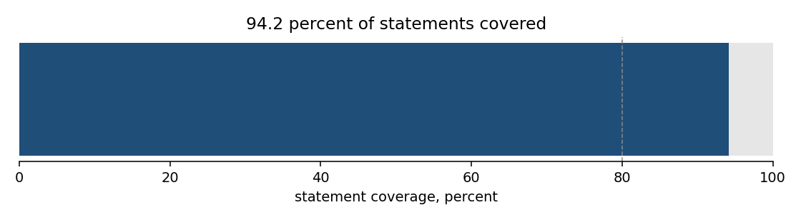
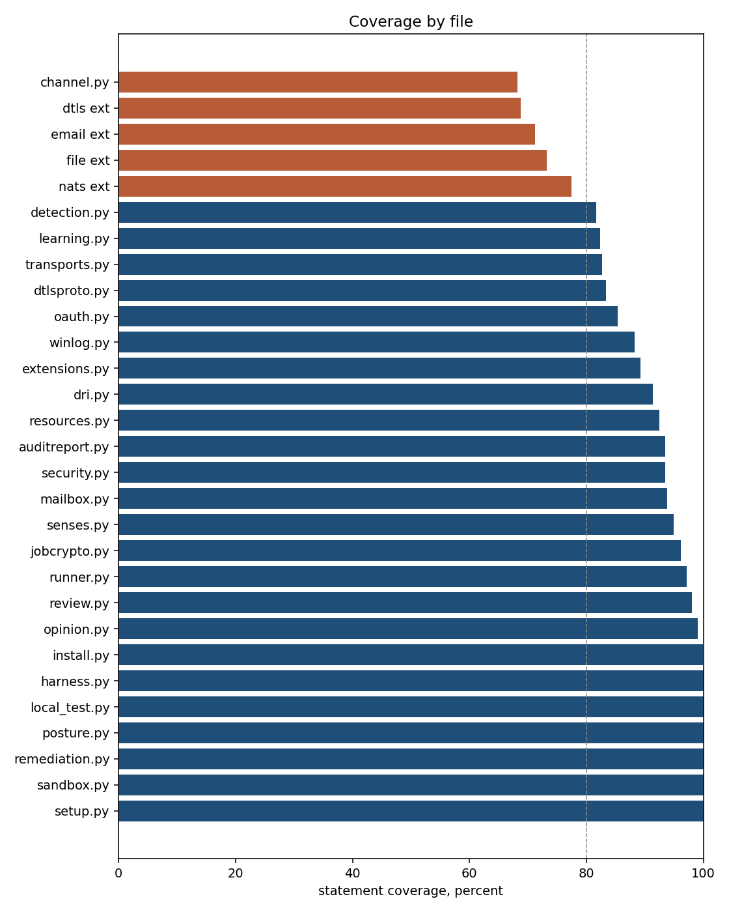
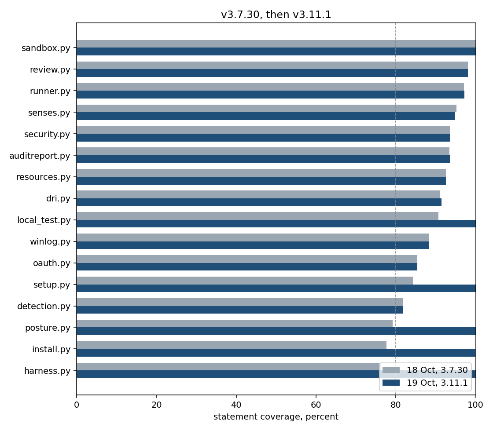
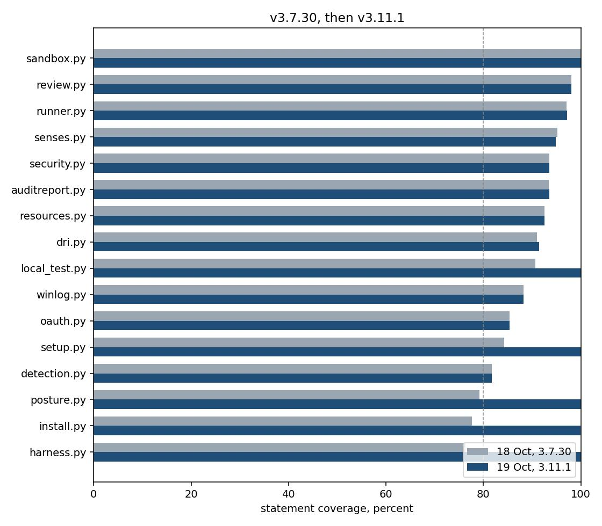

# Coverage findings

This report belongs to package 3.11.1. The previous measurement is
[v3.7.30](../v3.7.30/coverage.md). No new tag was cut for this
measurement. The tree measured is main at 5ada9d3 (`release: 3.11.1`).










Measured 2026-10-19 with coverage.py 7.16.2, on Python 3.11.2.
Hypothesis 6.170.3 was installed, which is what CI does.
The package version is 3.11.1.

```
python3 -m coverage run --branch --source=runner -m unittest discover -s tests -t .
```

3979 tests, OK, 12 skipped, 236 seconds under coverage.
The skips are optional tools that were not installed here,
the same kind as the eight skips in the v3.7.30 run.

Statements: 15326. Missed: 890. Covered: 14436. Covered: 94.2%.
Branches: 6212. Covered: 5621 (90.5%). Missing: 591, of which
477 are only partly taken.
Statement and branch together, the number `coverage report`
prints: 93.1%.

The 94.2% is statement coverage, the same kind of number as the
91.8% in the v3.7.30 report. That report's together figure was
90.9%. This run's together figure is 93.1%.

## Text chart

Statement coverage, 40 cells, one cell is 2.5 points.

```
all             94.2  [######################################..]
```

By file, lowest first. Forty cells, so the 32nd cell is the 80% line.
`channel.py` is `transport_extensions/channel.py`. The four `ext`
rows are the transport extension programs (`dtls`, `email`, `file`,
`nats`).

```
channel.py      68.2  [###########################.............]
dtls ext        68.8  [############################............]
email ext       71.2  [############################............]
file ext        73.2  [#############################...........]
nats ext        77.5  [###############################.........]
detection.py    81.7  [#################################.......]
learning.py     82.3  [#################################.......]
transports.py   82.7  [#################################.......]
dtlsproto.py    83.4  [#################################.......]
oauth.py        85.4  [##################################......]
winlog.py       88.2  [###################################.....]
extensions.py   89.3  [####################################....]
dri.py          91.4  [#####################################...]
resources.py    92.5  [#####################################...]
auditreport.py  93.5  [#####################################...]
security.py     93.5  [#####################################...]
mailbox.py      93.8  [######################################..]
senses.py       94.9  [######################################..]
jobcrypto.py    96.1  [######################################..]
runner.py       97.2  [#######################################.]
review.py       98.1  [#######################################.]
opinion.py      99.0  [########################################]
install.py      99.9  [########################################]
harness.py     100.0  [########################################]
local_test.py  100.0  [########################################]
posture.py     100.0  [########################################]
remediation.py 100.0  [########################################]
sandbox.py     100.0  [########################################]
setup.py       100.0  [########################################]
```

`runner/__init__.py` and `runner/_version.py` are one or two
statements each and fully covered. They are not on the chart.

## Against 18 October

The v3.7.30 report was 91.8% (9441 statements, 778 missed,
2496 tests). Covered statements went from 8663 to 14436.
The tree grew by 5885 statements. Misses rose by 112.
The percent rose because the new code is mostly covered.
The holes that were the point of the last report closed.

| File | 18 Oct | Now | Missed now |
|---|---:|---:|---:|
| winlog.py | 88% | 88% | 4 |
| oauth.py | 85% | 85% | 31 |
| install.py | 78% | 99.9% | 1 |
| setup.py | 84% | 100% | 0 |
| runner.py | 97% | 97% | 175 |
| senses.py | 95% | 95% | 15 |
| review.py | 98% | 98% | 3 |
| dri.py | 91% | 91% | 34 |
| local_test.py | 91% | 100% | 0 |
| resources.py | 93% | 93% | 14 |

`install.py` was the largest hole (254 missed). One statement
remains: the `getuid()` call inside `_posix_uid`, which a
Windows interpreter does not have.

`runner.py` grew from 5233 statements and 152 missed to 6343
statements and 175 missed. The percent did not move.

`harness.py`, `posture.py`, `local_test.py`, `setup.py`,
`remediation.py`, and `sandbox.py` are fully covered.
On 18 October the first four were 76%, 79%, 91%, and 84%.
`sandbox.py` was already 100%. `remediation.py` was not
in that report.

## Files that were below the first table

| File | 18 Oct | Now | Missed now |
|---|---:|---:|---:|
| harness.py | 76% | 100% | 0 |
| detection.py | 82% | 82% | 31 |
| posture.py | 79% | 100% | 0 |
| security.py | 94% | 94% | 15 |
| auditreport.py | 93% | 94% | 15 |
| sandbox.py | 100% | 100% | 0 |

`detection.py` still misses the same 31 statements.
`winlog.py` still misses the four lines that register the
event source. `oauth.py` still misses the refresh and store
path and `main`.

## What the new code leaves open

These files were not in the 18 October tree, or were not
measured then. They are the low end of this chart.

| File | Now | Missed |
|---|---:|---:|
| transport_extensions/channel.py | 68% | 28 |
| dtls extension | 69% | 45 |
| email extension | 71% | 30 |
| file extension | 73% | 38 |
| nats extension | 78% | 47 |
| learning.py | 82% | 65 |
| transports.py | 83% | 77 |
| dtlsproto.py | 83% | 177 |
| extensions.py | 89% | 24 |
| mailbox.py | 94% | 11 |
| jobcrypto.py | 96% | 7 |
| opinion.py | 99% | 3 |

`dtlsproto.py` is the largest new hole: 177 missed statements
in the handshake. The extension programs under
`transport_extensions/` are the next. They are processes the
runner supervises, and a unit test that stands up a live NATS
or a live DTLS peer is the wrong fix for the parts that only
fail on a real socket.

`jobcrypto.py` is the AES-256-GCM envelope. Seven statements
missed. That is not the hole.

## How to repeat

From the repo root, with coverage.py installed. It is a
measurement tool, not a project dependency. Install hypothesis
first if you want the property tests; CI does. Use Python 3.11
or newer. `tomllib` and `contextlib.chdir` are not on 3.10,
and a 3.10 run errors five tests before it finishes.

```
python3 -m pip install coverage hypothesis
python3 -m coverage run --branch --source=runner -m unittest discover -s tests -t .
python3 -m coverage report
```

Expect about four minutes. Do not treat 94.2% as a target.
The number moves when the untested transport shells move.
The hole that is worth a test is the DTLS handshake and the
extension programs, not another point on `runner.py`.
