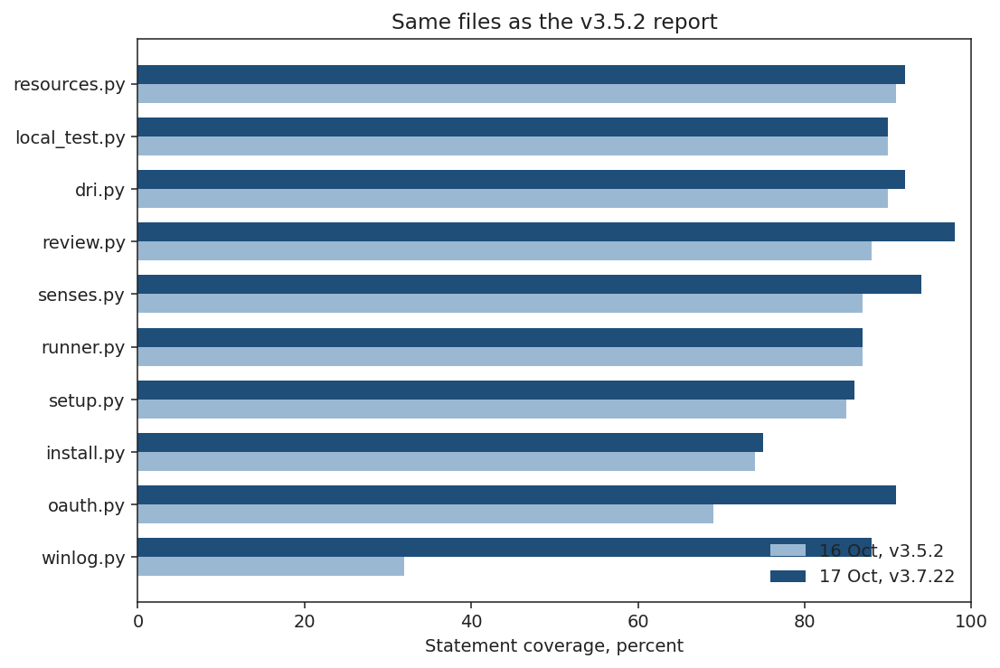
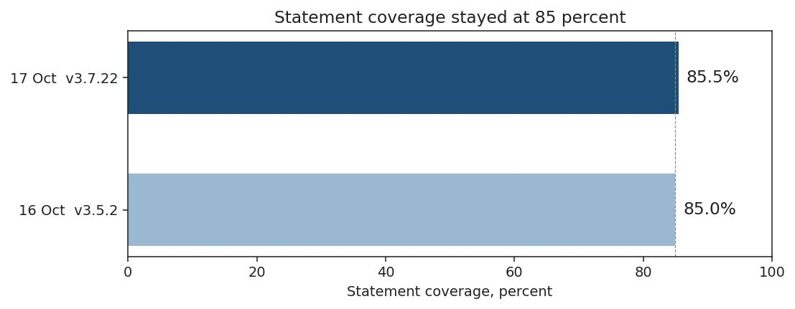
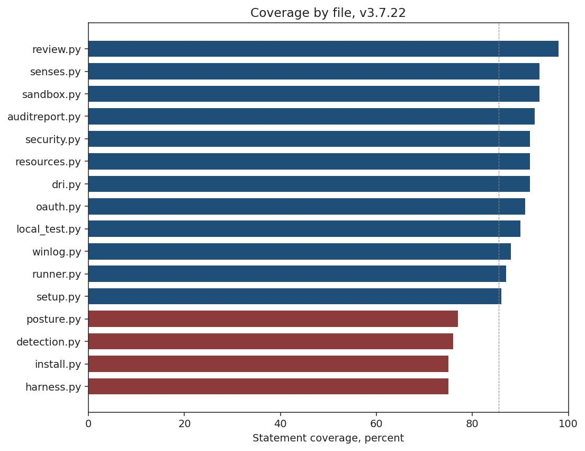
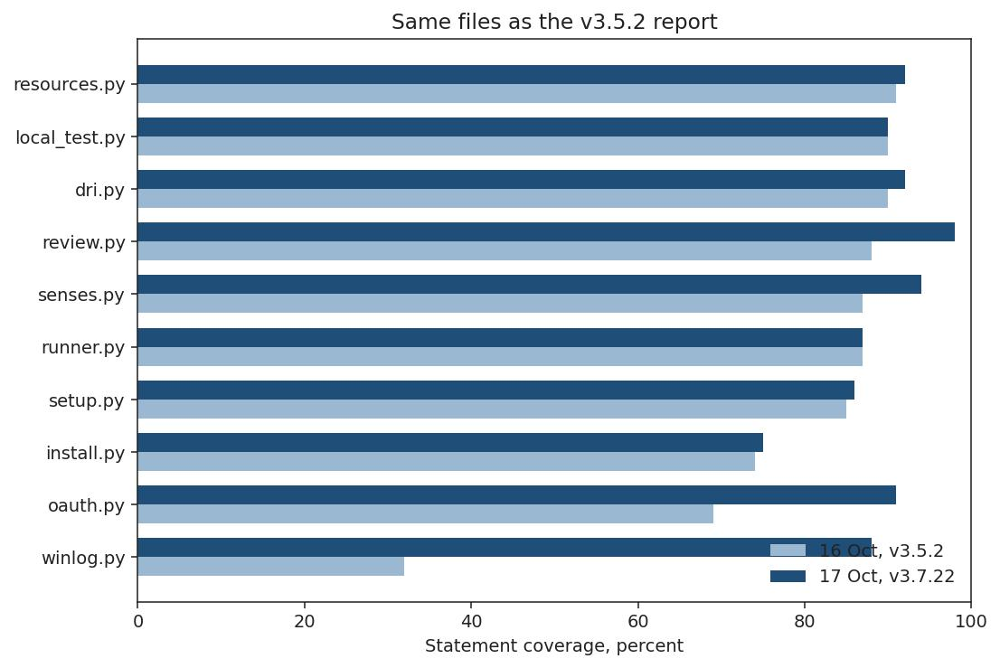

# Coverage findings

This report belongs to package 3.7.22. The previous measurement is
[v3.5.2](../../archive/v3.5.2/coverage.md). No new tag was cut for this measurement.










Measured 2026-10-17 with coverage.py 7.16.2, on main at 4524578.
The package version is 3.7.22.

```
python3 -m coverage run --branch --source=runner -m unittest discover -s tests -t .
```

1668 tests, OK, 4 skipped, 123 seconds under coverage.
Hypothesis was installed, which is what CI does. The four skips are
optional tools that were not installed here (z3, bubblewrap, a POSIX
job-user account).

Statements: 8697. Missed: 1259. Covered: 85.5%.
Branches: 3596, of which 493 are only partly taken.
Statement and branch together: 84.4%.

The 84.4% is not a drop from 85%. The October 16 report did not
count branches. A line can run and still leave one side of a
decision untested.

## Against 16 October

The v3.5.2 report, main at c48aece, was 85% (4714 statements, 694
missed, 1005 tests). Covered statements went from 4020 to 7438.
The tree grew by about 4000 statements. About 3400 of those are
covered and about 560 are not. The percentage did not move.

| File | 16 Oct | Now | Missed now |
|---|---:|---:|---:|
| winlog.py | 32% | 88% | 4 |
| oauth.py | 69% | 91% | 14 |
| install.py | 74% | 75% | 269 |
| setup.py | 85% | 86% | 30 |
| runner.py | 87% | 87% | 636 |
| senses.py | 87% | 94% | 15 |
| review.py | 88% | 98% | 3 |
| dri.py | 90% | 92% | 29 |
| local_test.py | 90% | 90% | 18 |
| resources.py | 91% | 92% | 13 |

`winlog.py` and `oauth.py` were the two worst files in that report.
The event-log path and the token exchange are now covered. What
remains in `winlog.py` is creating the event source. What remains
in `oauth.py` is a refresh-token failure.

`install.py` and `runner.py` stayed in the same band and got much
larger. `install.py` was about 440 statements and is now 1086.
`runner.py` was about 2800 statements and is now 4842.

## Files that did not exist in that table

| File | Statements | Missed | Cover |
|---|---:|---:|---:|
| harness.py | 444 | 110 | 75% |
| detection.py | 129 | 31 | 76% |
| posture.py | 233 | 54 | 77% |
| security.py | 184 | 14 | 92% |
| auditreport.py | 223 | 16 | 93% |
| sandbox.py | 53 | 3 | 94% |

`runner/__init__.py` and `runner/_version.py` are fully covered.

## What is still open, and why it matters

`harness.py` is `--diagnose`. The uncovered lines are the sections
that talk to a live mailbox, a live model, and the host senses:
entropy, the mailbox probe, waiting for a result, the senses
section. The in-process probes are covered. A unit test that opens
a real mailbox is the wrong fix. A diagnose report from the laptop
is the measurement those lines are waiting for.

Inside `runner.py` the poll library is still the high band from
the last report (`handle_mail`, `answer_queries`, `execute_job`,
`poll_once`). The misses that are new in kind are dropping
privileges for a job user, the Oracle page server and turn log,
and the thin host checks (canary, registry, firewall posture,
YARA). Another line in the poll path does not change what a person
sees when they start the program.

`install.py` still leaves out Ollama download and startup, Linux
and macOS uninstall, and most of the Windows scheduled-task
helpers. The last report said those stay untested until a machine
of that OS runs them. That is still the case. Wipe and migrate are
only partly covered, and those are commands a person runs on
purpose.

`detection.py` misses are the plan budget and the baseline update.
`posture.py` misses are the Windows file-ACL check and the
privilege check.

## How to repeat

From the repo root, with coverage.py installed. It is a measurement
tool, not a project dependency. Install hypothesis first if you
want the property tests; CI does.

```
python3 -m pip install coverage hypothesis
python3 -m coverage run --branch --source=runner -m unittest discover -s tests -t .
python3 -m coverage report
```

Expect about two minutes. Do not treat 85.5% as a target. The
number moves when the untested platform shells move, and those
shells should stay untested until a machine of that OS runs them.
The hole that is worth a test is not a percentage point on
`runner.py`. It is a diagnose report from a real host.
