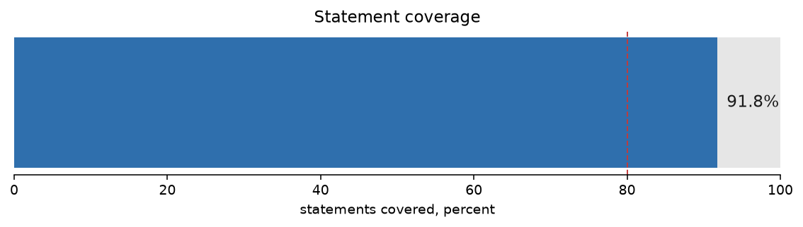
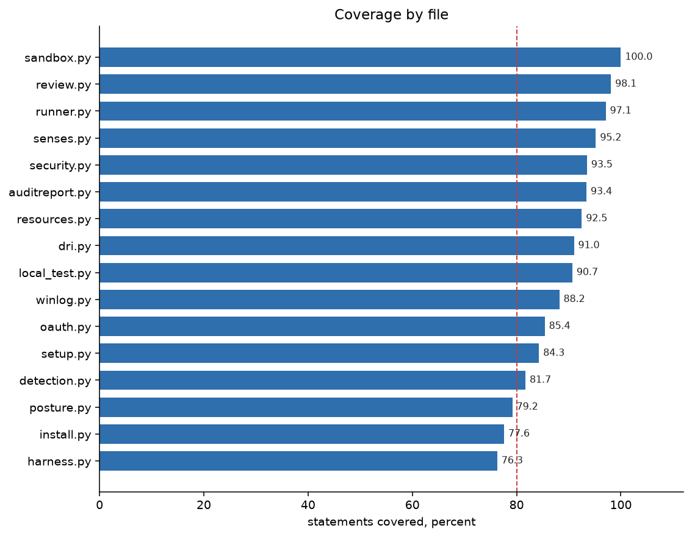
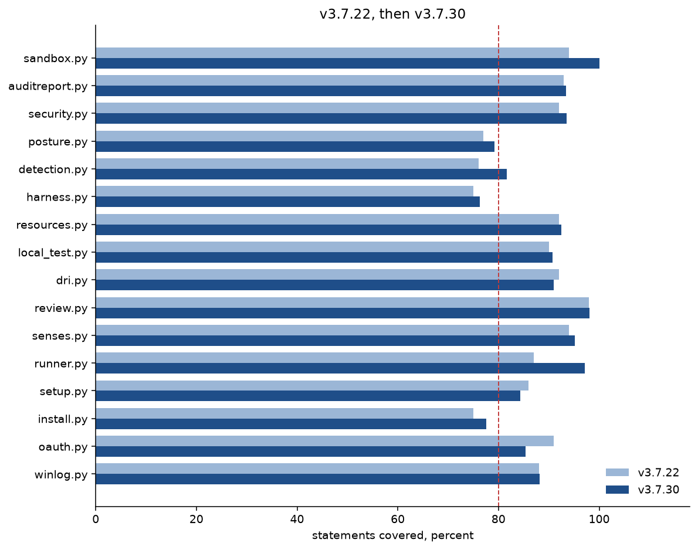
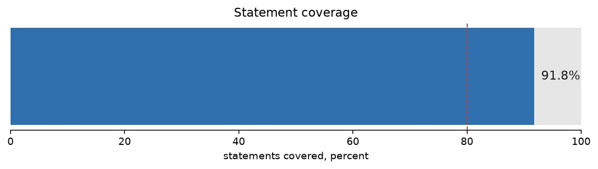

# Coverage findings

This report belongs to package 3.7.30. The previous measurement is
[v3.7.22](../v3.7.22/coverage.md). No new tag was cut for this
measurement. The tree measured is `reports/coverage-mutation-3.7.30`
at e3d88e4, which is main plus one fix: a job id that ends in a
newline is rejected. Python's `$` matches just before a final
newline, so the old pattern accepted `0\n`.










Measured 2026-10-18 with coverage.py 7.16.2, on Python 3.11.2.
Hypothesis 6.170.1 was installed, which is what CI does.
The package version is 3.7.30.

```
python3 -m coverage run --branch --source=runner -m unittest discover -s tests -t .
```

2496 tests, OK, 8 skipped, 196 seconds under coverage.
The eight skips are optional tools that were not installed here
(z3, bubblewrap, a POSIX job-user account). The v3.7.22 run
skipped four of the same kind.

Statements: 9441. Missed: 778. Covered: 91.8%.
Branches: 3948. Covered: 3510 (88.9%). Missing: 438, of which
338 are only partly taken.
Statement and branch together, the number `coverage report`
prints: 90.9%.

The 91.8% is statement coverage, the same kind of number as the
85.5% in the v3.7.22 report. The October 17 report's "together"
figure was 84.4%. This run's together figure is 90.9%.

## Text chart

Statement coverage, 40 cells, one cell is 2.5 points.

```
all             91.8  [#####################################...]
```

By file, lowest first. Forty cells, so the 32nd cell is the 80% line.

```
harness.py      76.3  [###############################.........]
install.py      77.6  [###############################.........]
posture.py      79.2  [################################........]
detection.py    81.7  [#################################.......]
setup.py        84.3  [##################################......]
oauth.py        85.4  [##################################......]
winlog.py       88.2  [###################################.....]
local_test.py   90.7  [####################################....]
dri.py          91.0  [####################################....]
resources.py    92.5  [#####################################...]
auditreport.py  93.4  [#####################################...]
security.py     93.5  [#####################################...]
senses.py       95.2  [######################################..]
runner.py       97.1  [#######################################.]
review.py       98.1  [#######################################.]
sandbox.py     100.0  [########################################]
```

`runner/__init__.py` and `runner/_version.py` are one statement
each and fully covered. They are not on the chart.

## Against 17 October

The v3.7.22 report was 85.5% (8697 statements, 1259 missed,
1668 tests). Covered statements went from 7438 to 8663.
The tree grew by 744 statements. Misses fell by 481.
Both happened: new code landed, and a lot of the old misses
in `runner.py` are now run.

| File | 17 Oct | Now | Missed now |
|---|---:|---:|---:|
| winlog.py | 88% | 88% | 4 |
| oauth.py | 91% | 85% | 31 |
| install.py | 75% | 78% | 254 |
| setup.py | 86% | 84% | 37 |
| runner.py | 87% | 97% | 152 |
| senses.py | 94% | 95% | 14 |
| review.py | 98% | 98% | 3 |
| dri.py | 92% | 91% | 34 |
| local_test.py | 90% | 91% | 17 |
| resources.py | 92% | 93% | 14 |

`runner.py` is the move that changes the total. It was about
4842 statements with 636 missed. It is now 5233 statements
with 152 missed.

`oauth.py` went the other way. It was 91% with 14 missed and
is now 212 statements, 31 missed, 85%. The new misses are
`refresh_access_token`, `store_refresh_token`, and `main`.

`winlog.py` did not move. The four missed lines are still
creating the event source.

## Files that were below the first table

| File | 17 Oct | Now | Missed now |
|---|---:|---:|---:|
| harness.py | 75% | 76% | 108 |
| detection.py | 76% | 82% | 31 |
| posture.py | 77% | 79% | 49 |
| security.py | 92% | 94% | 15 |
| auditreport.py | 93% | 93% | 15 |
| sandbox.py | 94% | 100% | 0 |

`detection.py` still misses the same 31 lines (plan budget and
the baseline update). The percent rose because the file grew
around them. `sandbox.py` is fully covered.

## What is still open, and why it matters

`harness.py` is still `--diagnose`. The uncovered lines are
the sections that talk to a live mailbox, a live model, and
the host senses: entropy, the mailbox probe, waiting for a
result, the senses section. A unit test that opens a real
mailbox is the wrong fix.

`install.py` is still the largest hole: Ollama download and
startup, wipe and migrate, the Windows scheduled-task helpers,
and parts of console and logs. Those stay untested until a
machine of that OS runs them.

`posture.py` still misses the Windows file-ACL check and the
privilege check. `setup.py` still misses the browser-login
loop and most of the wizard's write path.

Inside `runner.py` the remaining misses are edges, not the
poll library: a few verify and retain paths, the Windows
event-log and registry queries, the canary plant, AV posture,
and `recent_chat`. Another line there does not change what a
person sees when they start the program.

`security.py` is the mutation scope. Fifteen statements are
still uncovered, in `validate_security_config` and
`_bump_counts`. Mutation only scores mutants on covered lines.
The mutation run is [mutation.md](mutation.md): 458 of 537
killed, 85.3%.

## How to repeat

From the repo root, with coverage.py installed. It is a
measurement tool, not a project dependency. Install hypothesis
first if you want the property tests; CI does.

```
python3 -m pip install coverage hypothesis
python3 -m coverage run --branch --source=runner -m unittest discover -s tests -t .
python3 -m coverage report
```

Expect about three and a half minutes. Do not treat 91.8% as
a target. The number moves when the untested platform shells
move, and those shells should stay untested until a machine
of that OS runs them. The hole that is worth a test is not a
percentage point on `runner.py`. It is a diagnose report from
a real host, and the Ollama install path.
