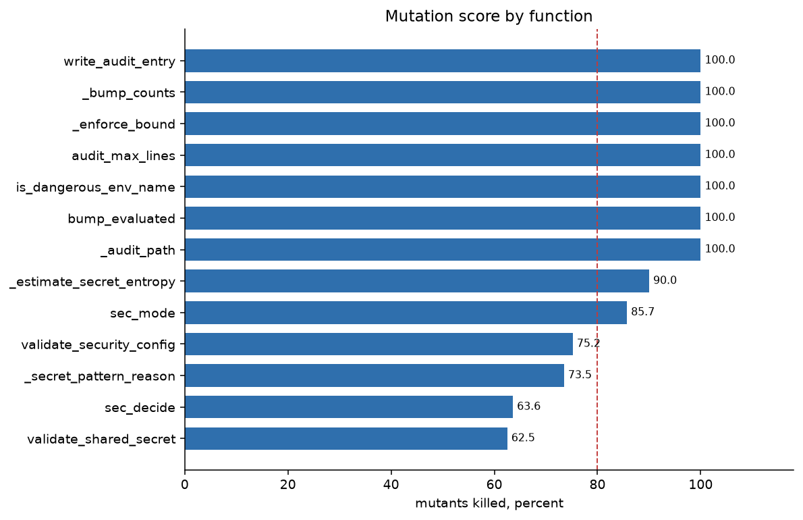

# Mutation findings

This report belongs to package 3.7.30, measured with the coverage
run in [coverage.md](coverage.md). No new tag was cut.
The tree is `reports/coverage-mutation-3.7.30` at e3d88e4.




Measured 2026-10-18 with mutmut 3.8.0, the same pin CI uses.
Scope is `runner/security.py` only (`only_mutate` in
pyproject.toml). Covered lines only. Four workers.

```
mutmut run --max-children 4
```

537 mutants, 441 seconds. 7.80 mutants per second.
Killed: 458. Survived: 79. Score: 85.3%.
Timeouts: 0. Suspicious: 0. Skipped: 0. No tests: 0.

mutmut exits 0 with survivors. CI treats that the same way:
the job is a signal, not a block. The tag workflow is the
only place this command usually runs.

## Text chart

Killed share, 40 cells. One cell is 2.5 points.

```
all                          85.3  [##################################......]  458/537
```

By function. Fully killed functions are one bar.

```
write_audit_entry           100.0  [########################################]   98/98
_bump_counts                100.0  [########################################]   92/92
_enforce_bound              100.0  [########################################]   21/21
audit_max_lines             100.0  [########################################]   19/19
is_dangerous_env_name       100.0  [########################################]   10/10
bump_evaluated              100.0  [########################################]    8/8
_audit_path                 100.0  [########################################]    4/4
_estimate_secret_entropy    90.0  [####################################....]    9/10
sec_mode                     85.7  [##################################......]   24/28
validate_security_config     75.2  [##############################..........]   82/109
_secret_pattern_reason       73.5  [#############################...........]   25/34
sec_decide                   63.6  [#########################...............]   56/88
validate_shared_secret       62.5  [#########################...............]   10/16
```

## What survived

Most of the 79 are wording. mutmut wraps a string in `XX` or
changes its case. The tests check that a weak secret or a bad
config raises. They do not check the sentence. About 30 of the
survivors are that wrap, and another handful are the same
sentence in capitals. Those are not behavior changes a caller
can observe unless they match the text.

A few are equivalent, so a test could not kill them:

- `alphabet <= 1` changed to `< 1`. A one-character alphabet
  has `log2(1) == 0`, so the estimate is already 0.
- `modes.get(feature, "off")` changed to `None` or `"OFF"`.
  Neither is a known mode, and the next line returns `"off"`.
- The repeat check builds one extra copy of the unit
  (`+ 1` changed to `+ 2`) and then slices to the secret's
  length. Both copies are long enough. The slice matches
  either way.
- `os.name != "nt"` changed to `!= "NT"`. `os.name` is
  `"nt"` or `"posix"`, never `"NT"`, so the branch does not move.

The survivors that are real gaps:

`sec_decide` is the low bar, 56 of 88 killed. The allow/deny
return value is tested. The audit line is not. A mutant can
drop `key_id`, pass `job_id=None`, or pass `feature=None`
into `write_audit_entry` and the suite still passes. A
non-dict `ctx` is also untested: forcing the isinstance
check true survived.

`validate_shared_secret` does not pin the 128-bit line.
`bits < 128` survived as `bits <= 128` and as `bits < 129`.
No test uses a secret whose estimate is exactly 128.
`max_lines < 1` in `validate_security_config` survived as
`<= 1` and `< 2` for the same reason: the value 1 is not
asserted. The confinement validator can be called with
`None` instead of the block, and the job-user error text
can be deleted. Startup still fails; the test does not
read why.

`_estimate_secret_entropy`, `_bump_counts`,
`write_audit_entry`, `_enforce_bound`, and the dangerous
environment-name check are caught. The audit writer itself
is fully killed (98 of 98). The hole is the caller that
fills the audit line, not the writer.

## How to repeat

From the repo root. mutmut is not a project dependency.
CI pins 3.8.0.

```
python3 -m pip install "mutmut==3.8.0" pytest hypothesis
mutmut run --max-children 4
mutmut results
```

Expect about seven minutes for `runner/security.py`.
A wider scope was measured before and rejected for CI:
four files ran toward three quarters of an hour, and the
whole of `runner/` would be hours. Do not treat 85.3% as
a target. The mutants worth a test are the audit fields
on a deny, and a secret whose estimate is exactly 128 bits.
The `XX` strings are not.
